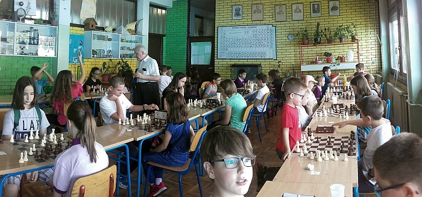
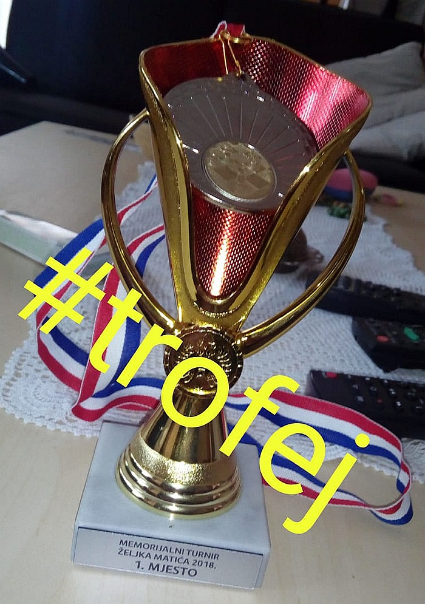

U srijedu, 30. lipnja 2018., povodom dana škole, u OŠ Braće Radić održan je 10. Memorijal Željka Matića. Glavni sudac turnira bio je prof. Nenad Frouth. Od naših članova nastupili su Toma (1), Višeslav (3,5), Filip Mahin (3), Slavko (2,5), Tin (2), Botica (4), Roko (3,5), Franka (4,5), Filip Matašić (5), Luka Fiolić (5), Josip (3), Lucija (4), Monika (5), Anđela (4) i Ana (5,5). Turnir se igrao na tempo 10+0, a bio je dopušten jedan nemogući potez. Nastupila su ukupno 32 igrača, a uvjerljivo prvo mjesto osvojio je Vibor Frouth iz OŠ Dobriše Cesarića s osvojenih 6,5 bodova. Drugo mjesto u ukupnom poretku, a prvo među djevojčicama osvojila je Ana Kolovrat i tako postala vlasnica prekrasnog pehara čiju sliku nam je velikodušno ustupila. Treće mjesto osvojio je Luka Fiolić, za kojeg se nadam da će do Prvenstva Hrvatske odigrati i jedan turnir na duži tempo. Ugodno iznenađenje je rezultat Monike koja je osvojila četvrto mjesto s istim brojem bodova. Iako je u međusobnom okršaju pobijedila Luku, imala je mrvicu slabiji srednji buholc. Visoko su završili i Filip Matašić i Franka. Iako mu se uskoro bliži nastup na državnom prvenstvu, Filip i dalje ne radi na šahu. Vidjet ćemo kako će mu ići na ozbiljniji tempo… Ekipno su učenici OŠ Odra osvojili prvo i treće mjesto, a drugo ekipno mjesto osvojila je OŠ Trnsko.  Mnogima je ovo bio i prvi nastup na šahovskom turniru, rezultati su očekivani, nije bilo suza i može se zaključiti da je turnir uspješno završio.  
U prilogu rezultati turnira.    [Memorijalni turnir Željka Matića 2018.](/files/wp/2018/06/Memorijalni-turnir--eljka-Mati-a-2018.pdf)  [Svi Memorijali Zeljka Matica 2009-2017](/files/wp/2018/06/Svi-Memorijali-Zeljka-Matica-2009-2017.pdf)
