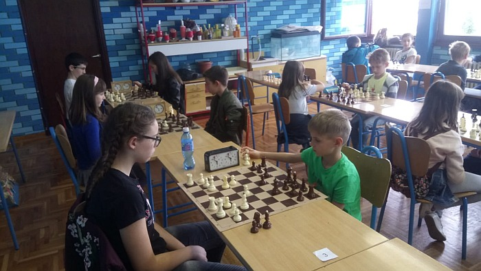
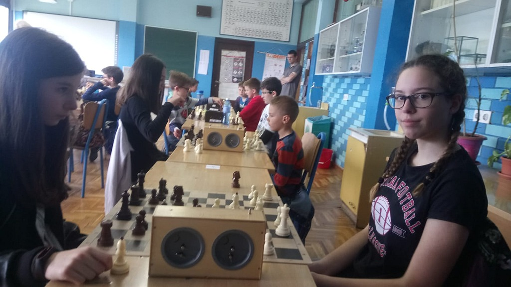
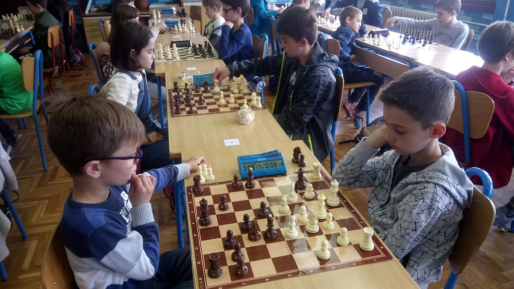

U petak, 31. svibnja, odigran je tradicionalni turnir, 11. Memorijal Željka Matića. Turnir je odigran u OŠ Braće Radić u Botincu, povodom dana škole. Pobjednici turnira su **Vibor Frouth (I.), Ivan Horvat (II.) i Luka Fiolić (III.).** Od naših članova, nastupili su Luka Fiolić (5), Monika (5), Visko (5), Luka Matašić (5), Josip (5), Franka (5), Botica (4), Lucija (4), Ivanda (4), Flucija (4), Filip (4), Fivana (3,5) i Nola (1,5). Luka Fiolić i Monika su ponovili prošlogodišnji uspjeh. Luka je završio treći u ukupnom poretku, a **Monika** četvrta, kao **najbolja cura na turniru**. [Prošle godine](/novosti/10-memorijal-zeljka-matica/) titulu najbolje cure osvojila je Ana koja ove godine nije nastupila. Veliki napredak pokazao je Visko osvojivši bod i pol više nego prošle godine. Flucija i Fivana lijepo napreduju, a i Nola je upisala prve turnirske bodove. 🙂 Iz nepoznatih razloga na turniru se nisu pojavili Vraneša i braća Biondić. Ekipno, OŠ odra je nastupila sa čak tri ekipe, koje su podijelile treće mjesto. Ekipnu pobjedu odnijela je ekipa OŠ Lučko I, a drugo mjesto OŠ Dobriše Cesarića. Turnir je bio masovniji nego inače, nastupilo je čak 48 mladih šahista, a zbog toga se igrao u dvije učionice.  
   
[Memorijalni turnir Zeljka Matica 2019](/files/wp/2019/06/Memorijalni-turnir-Zeljka-Matica-2019.pdf)
