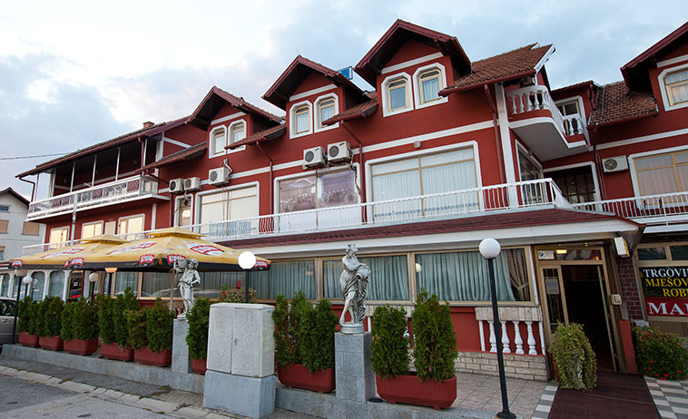

Za manje od dva tjedna počinje pojedinačno prvenstvo Hrvatske u šahu za dječake i djevojčice do osam godina. Točnije, 15. i 16. studenoga, u subotu i nedjelju, u Sesvetama, u [hotelu Martini](http://www.martini.hr/). Prijašnjih godina prvenstvo se održavalo u Topuskom, a ove je godine još jednostavnije što se tiče [prijevoza](./hotel-martini-adresa.jpg).  
Od naših članova pravo nastupa imaju **Lucija, Monika, Franka i Luka**. Prema priloženom [raspisu](/files/wp/2014/11/Raspis-pojed-8-god.-2014.pdf), pravo nastupa ima godište 2006. i mlađi. Ostaje nam još malo vježbati pisanje, organizirati prijevoz i pratnju te ne zaboraviti ponijeti olovke, članske iskaznice Hrvatskoga šahovskog saveza i šahovske satove, koje treba uzeti petak prije iz prostorija Kluba. Kako seniorska ekipa taj vikend gostuje u Karlovcu, neće biti problema s opremom.

[dječaci](http://chess-results.com/tnr150065.aspx?lan=13&art=3&fed=CRO&turdet=YES&wi=821)

[djevojčice](http://chess-results.com/tnr150066.aspx?lan=13&art=3&wi=821&turdet=YES)
