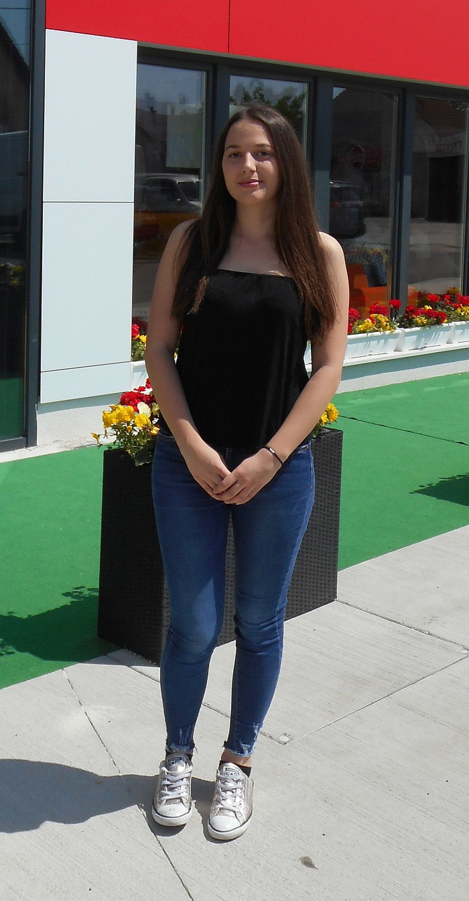
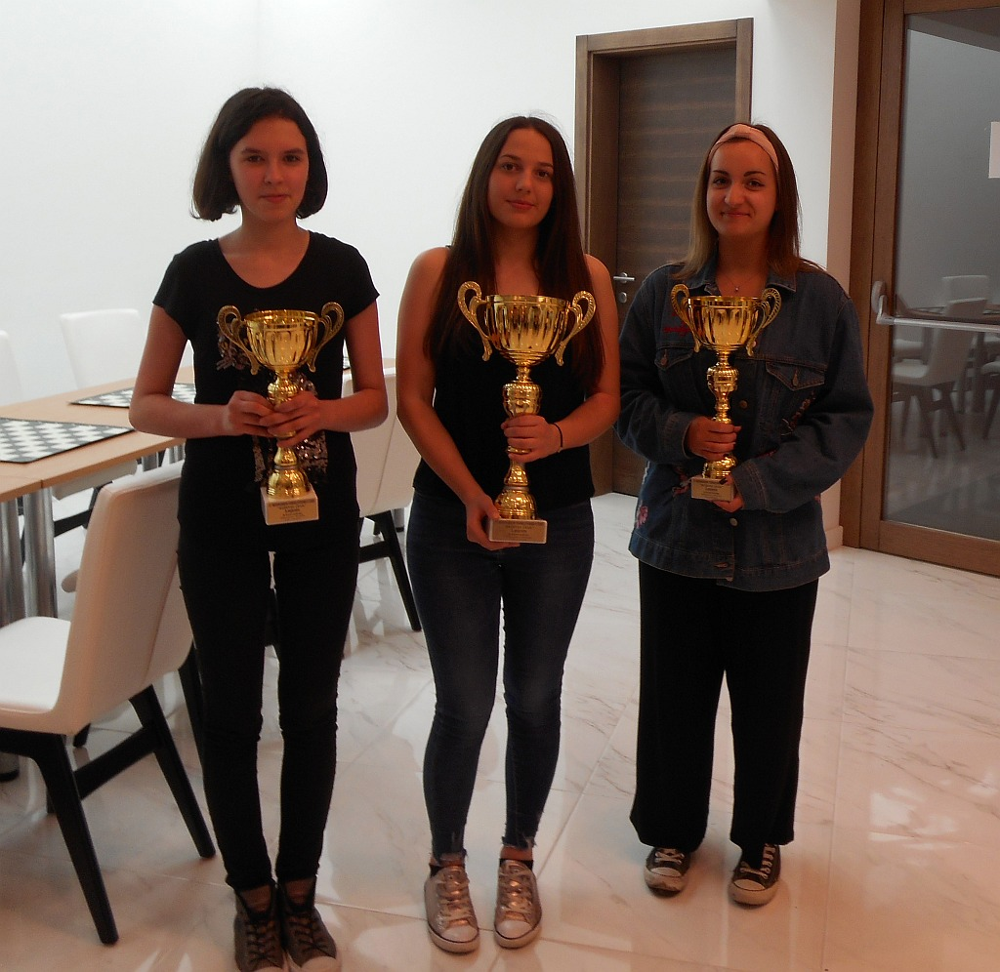
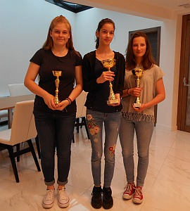
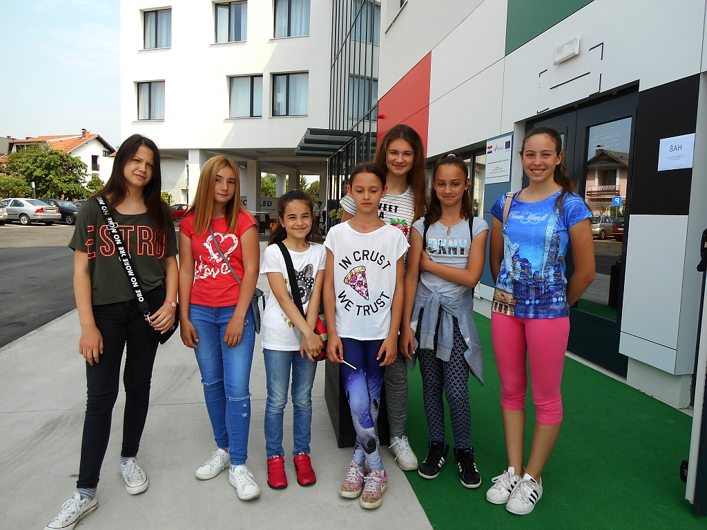
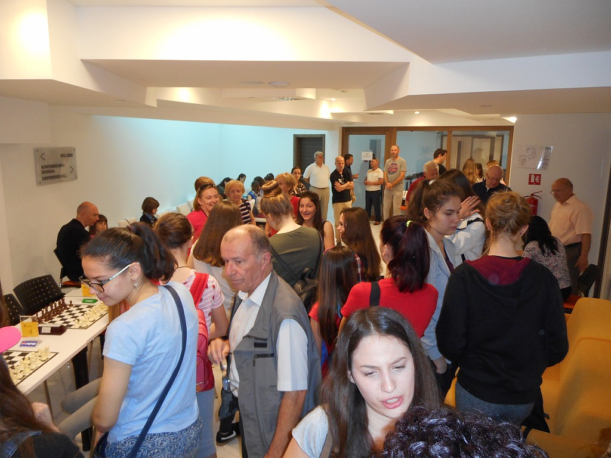
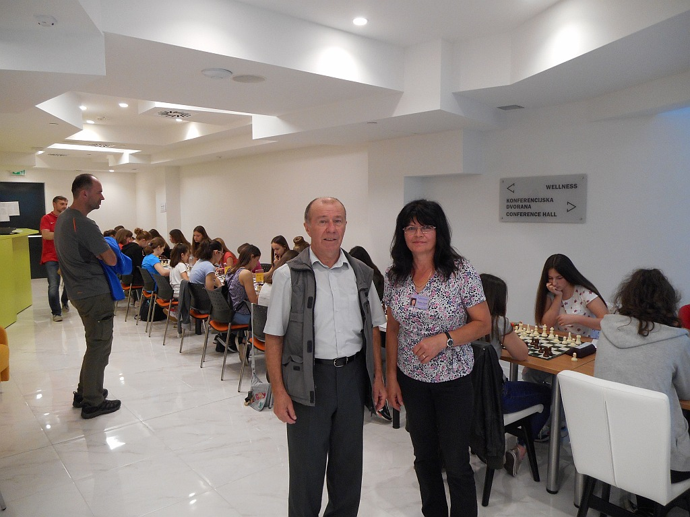
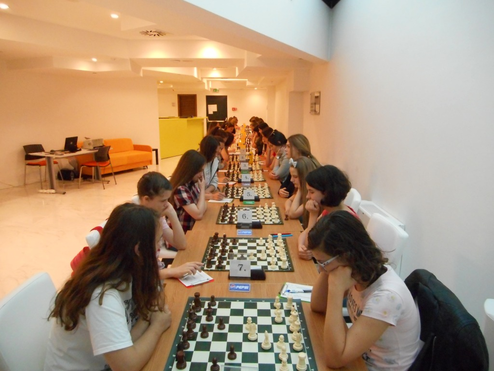
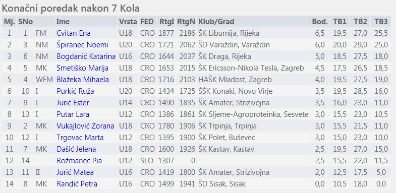
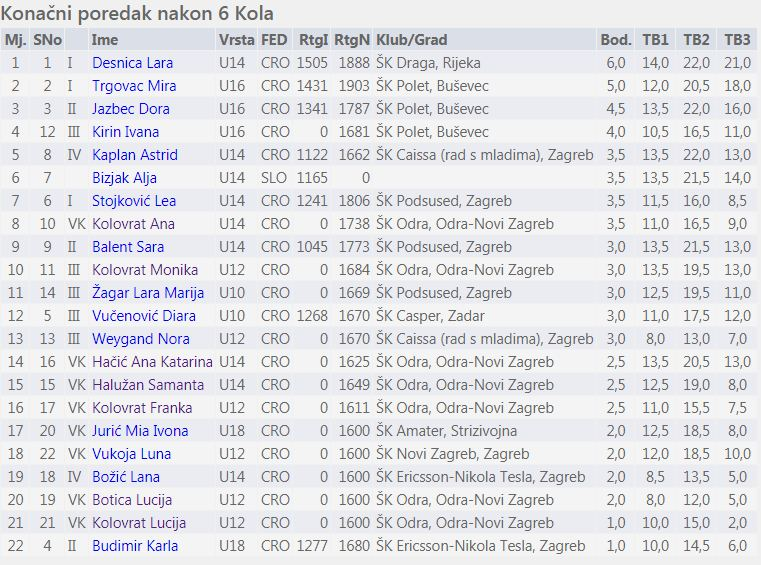

**–** U organizaciji šahovskog kluba Polet Buševec i pod pokroviteljstvom Zajednice sportskih udruga grada Velike Gorice  održan je tradicionalni Međunarodni turnir juniorki “Buševec 2018.”. Turnir se ove godine igrao 12. i 13. svibnja, u Velikoj Gorici u [hotelu  Garden Hill](https://www.hotel-garden-hill.hr/hr/o-hotelu/) , a bio je podijeljen u dvije skupine. Na jačem A turniru igrale su igračice s ELO rejtingom (uglavnom iznad 1450), dok je B turnir rezerviran uglavnom za mlađe igračice bez elo rejtinga. Na [A-turniru](http://chess-results.com/tnr344159.aspx?lan=13&art=1&turdet=YES) je igralo 14 igračica, dok su na [B turniru](http://chess-results.com/tnr344160.aspx?lan=13&art=4&turdet=YES) nastupile 22 igračice. Dovitljivošću organizatora, jedna je igračica prebačena iz A turnira u B turnir kako bi bio paran broj natjecateljica u obje skupine. Nažalost, ove godine je bio nešto manji odziv nego prošle, a direktor turnira, gosp. Zlatko Rožić je na otvaranju turnira obećao da će sljedeće godine pokušati rezervirati termin turnira kada će biti manje ligaških natjecanja u Sloveniji i BiH, zbog kojih su neke igračice izostale s ovog uistinu lijepog turnira. Oba turnira igrala su se u zajedničkoj, dobro osvijetljenoj, omanjoj dvorani, ali moram priznati da mi se više svidio prostor i lokacija na kojoj je igran prošlogodišnji turnir, prvenstveno zbog igrališta na kome su mlađe igračice kratile vrijeme između kola.  
Glavni favorit i prvo ime turnira, ujedno i uvjerljiva pobjednica A turnira (po drugi put!), je (još uvijek) šesnaestogodišnja fide majstorica **Ena Cvitan**, članica ŠK Liburnija iz Rijeke. U sedam kola ostvarila je šest pobjeda i samo jedan remi. Drugo mjesto pripalo je nacionalnoj majstorici **Noemi Špiranec** iz ŠD Varaždin, dok je treće mjesto osvojila nacionalna majstorica **Katarina Bogdanić** iz ŠK Draga iz Rijeke.  
B turnir osvojila je prvokategornica **Lara Desnica**, također iz ŠK Draga, dok su drugo i treće mjesto osvojile domaće djevojke, članice ŠK Polet Buševec, prvokategornica **Mira Trgovac** i drugokategornica **Dora Jazbec**.  
**–** Iz ŠK Odra nastupilo je sedam igračica, Ana, Monika, Katarina, Samanta, Franka, Lucija i Botica. Ana i Monika su se ugurale među prvih deset i pokazale znatan napredak. Prošle godine Ana je završila na 18. mjestu s osvojenih 2,5 boda, dok je ove godine bila osma uz osvojena 3,5 boda. Monika je prošle godine bila 23.-a , s 1,5 bodom, a ove godine 10.-a s osvojena 3 boda. I druge igračice pokazuju dobar napredak, a važno je da je i Botica ostvarila svoju prvu službenu pobjedu! Katarina je ostvarila impresivan rezultat kada je prvi dan osvojila 2,5 boda i igrala sporo. Ipak, drugi dan vratila se starim navikama i ubrzala igru. Srećom, i sama je uvidjela da brzopletošću ne može ostvariti ozbiljan rezultat pa vjerujem da će poraditi na tom segmentu igre. Samanta napreduje polako, ali konstantno. Vjerujem da će joj i ove partije pomoći da skupi više ideja koje su joj u nekim pozicijama nedostajale. Franka se “vratila” u igru. Pokazuje zavidno strpljenje i koncentraciju, a obzirom da je ostvarila rezultat kao i starije klupske kolegice, Katarina i Samanta, na dobrom je putu. Samo Lucija nije popravila rezultat, ali je popravila igru. Nju još muči taktika koju srećom može lako izvježbati. Tako je već prvi dan propustila dva dobitka jer nije vidjela jednostavnu dobitničku taktiku. Ali je zato odigrala jednu od najljepših partija. Vraneša joj je počeo pomagati u posljednje vrijeme te se nadam da će nastaviti suradnju, jer su pomaci očigledni.  Većina djevojaka je prešla u jednu višu razinu kada “vide” sve  u poziciji, grubih previda gotovo da više i nema i vrijeme im je da počnu ozbiljnije studirati otvaranja.  
    
     
   
darko
