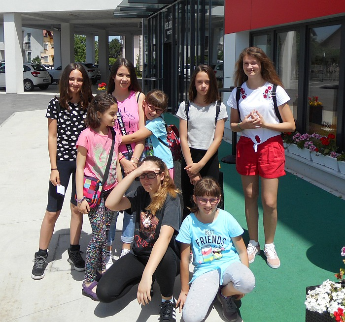
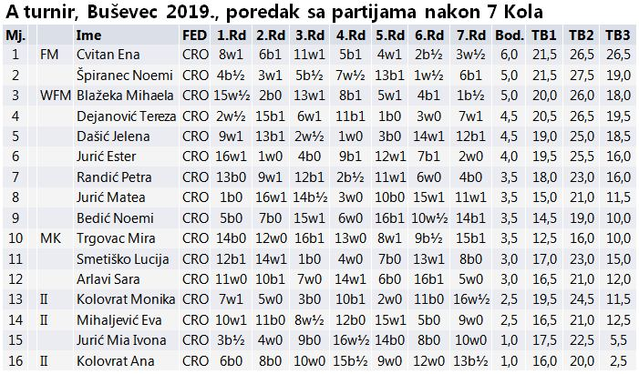
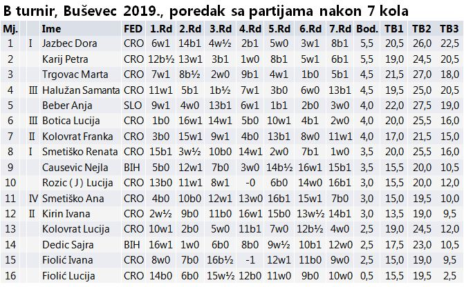
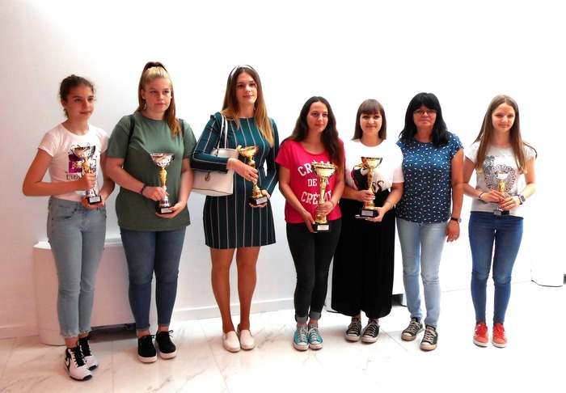
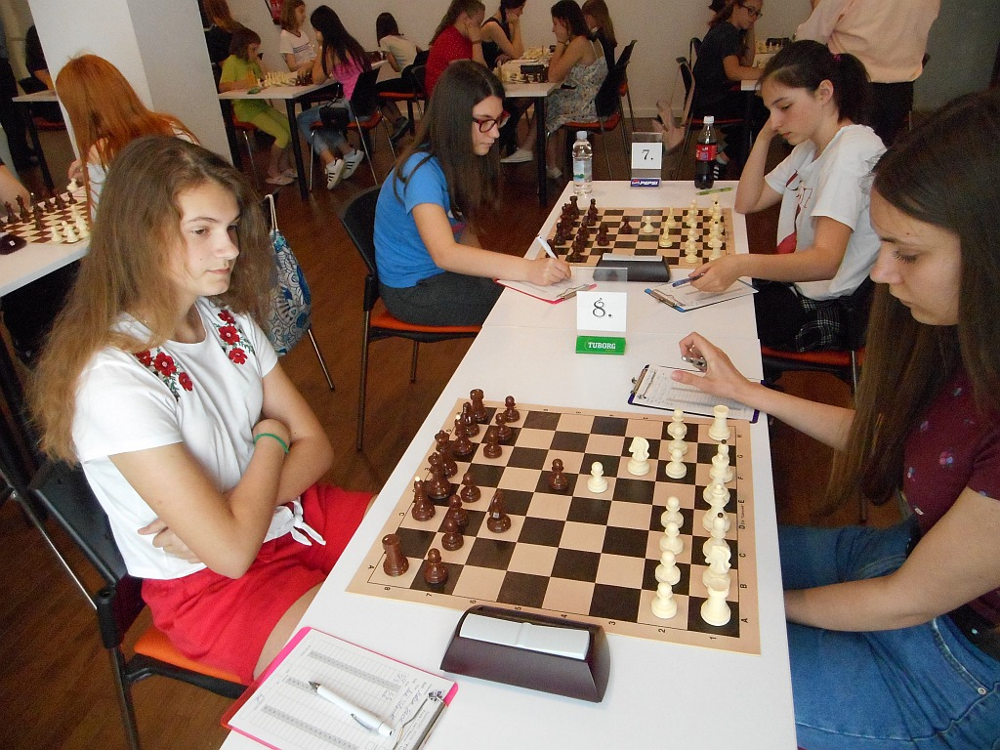
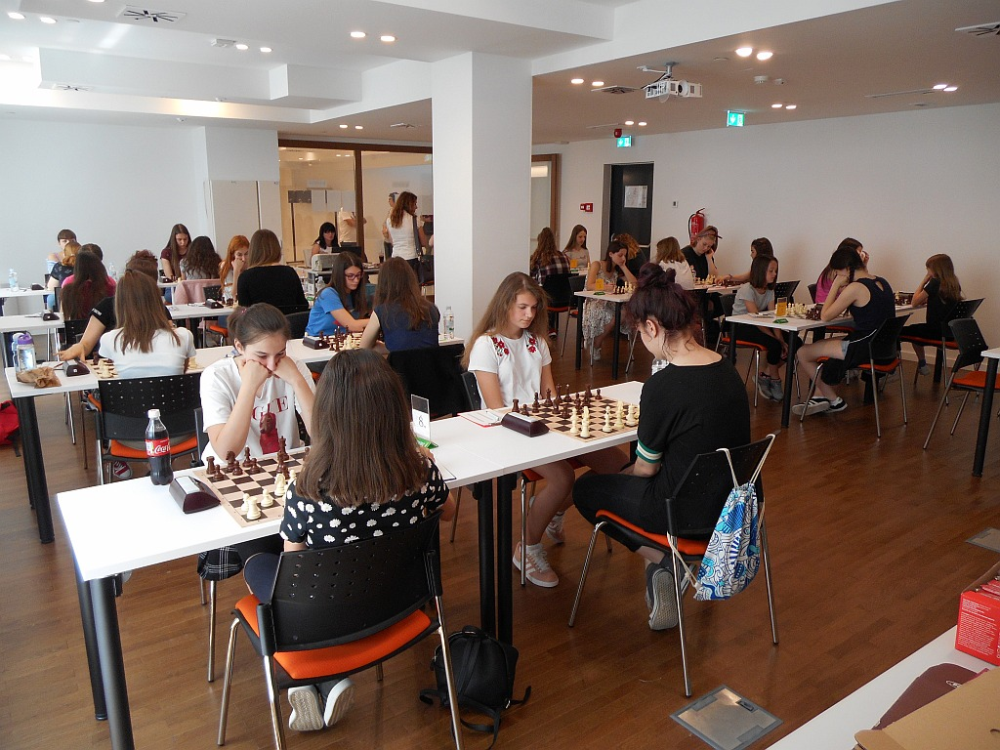
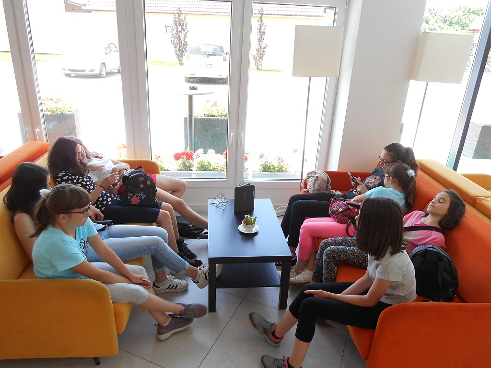
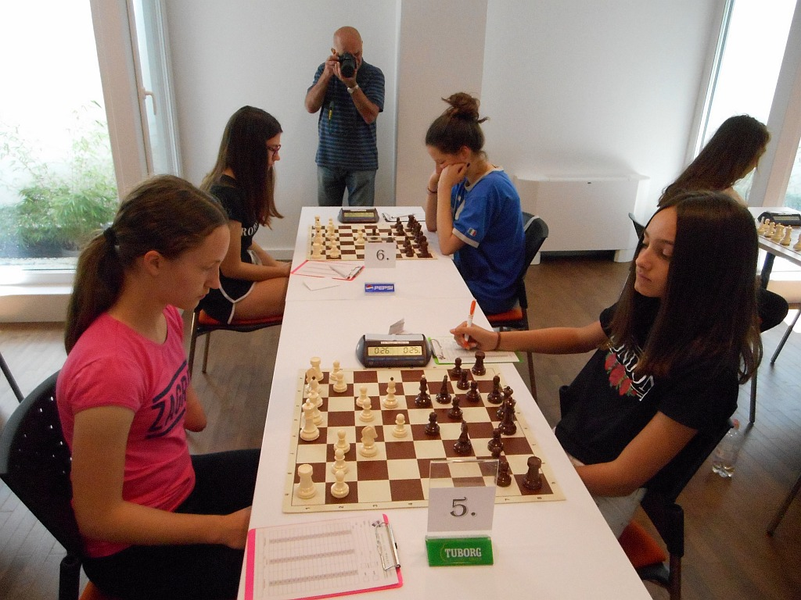

  
Jučer i danas, 8. i 9. linja odigran je [18\. Međunarodni turnir juniorki “Buševec 2019.”](http://chess-results.com/tnr438071.aspx?lan=13). Turnir je igran u hotelu Garden Hill u Velikoj Gorici, podijeljen u dvije skupine, jači A turnir i slabiji B turnir. Tempo igre bio je 25+15. Organizator natjecanja je Šahovski klub Polet Buševec, a pokrovitelj Zajednica sportskih udruga grada Velike Gorice. Na svakom turniru nastupilo je po 16 natjecateljica. Po treći puta, A turnir osvojila je **FM Ena Cvitan** iz ŠK Draga, Rijeka. Drugo mjesto pripalo je **NM Noemi Špiranec** iz AŠK Junior, Rijeka, a treće mjesto **WFM Mihaela Blažeka** iz HAŠK Mladost, Zagreb. Na B turniru prvo mjesto osvojila je **I. Dora Jazbec** iz ŠK Polet, Buševec, drugo mjesto **I. Petra Karij** iz ŠU Bljesak, Garešnica i treće mjesto **MK Marta Trgovac** iz ŠK Polet, Buševec, tako da su domaćini uzeli dva pehara. 🙂 Od naših članica, na A turniru su se okušale najhrabrije, Ana i Monika, koje su bile i najmlađe na tom turniru. Ana je igrala dobro, ali je bila prilično nesigurna u sebe. Za Moniku ne možemo reći da je iznenadila dvjema pobjedama nad igračicama rejtinga preko 1900, prije da je samo potvrdila koliko je postala jaka igračica. Na B turniru Samanta je dugo bila na vrhu i očekivali smo postolje, ali su je klupske kolegice “prizemljile” te je na kraju završila četvrta. Vjerujem da će smoći hrabrosti i možda se već sljedeće godine okušati na A turniru. Botica je prebacila prošlogodišnji rezultat za 400%, na ovom turniru pobijedila i Samantu i prilično dobro napreduje. Franka i Lucija su pokazale onoliko koliko se od njih i očekuje, obzirom na uloženi rad (ili nerad 😉 ), a Flucija i Fivana su stekle još jedno iskustvo više. Iako, bitno je spomenuti i veliku pobjedu Fivane u petom kolu nad znatno starijom drugokategornicom. Od njih očekujemo jaku četvrtu ploču u školskoj ekipi za manje od dvije godine. A za tjedan dana djevojke sele na jug na Kadetsko prvenstvo Hrvatske 2019. Sretno!  
   

   
