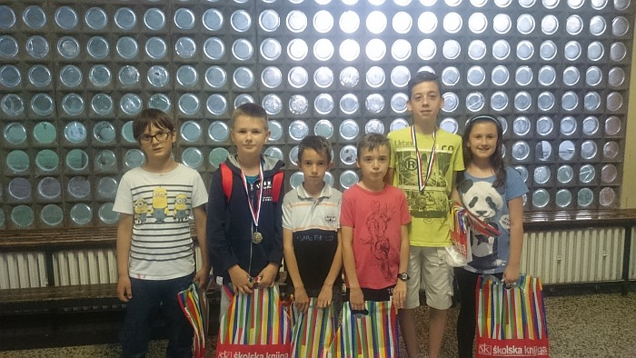

  
U posljednji petak prošlog mjeseca, 26. svibnja, u [OŠ Dragutina Domjanića](http://os-ddomjanica-zg.skole.hr/) u Gajnicama, u organizaciji škole i prof. Roberta Kupeka, kojemu i ovim putem zahvaljujemo na organizaciji i pozivu, odigran je šahovski turnir za osnovnoškolce, 2. Domjanićev šahovski festival. Turnir se igrao na tempo igre 10+5, a bio je podijeljen u tri dobne skupine: do trećeg razreda, do šestog razreda i do osmog razreda. To je i mnogo bolji način razdvajanja po skupinama nego po godinama. Turnir je održan na radni dan pa smo uspjeli organizirati samo manju skupinu šahista koji su nastupili. Bio je besplatan, tj. bez kotizacije, i svi su sudionici dobili prigodne darove [Školske knjige](https://shop.skolskaknjiga.hr/), a pobjednici medalje i šahovsku literaturu. Tata Božo, Rokova mama i tata Matašić uspješno su odradili prijevoz, a **Božo** junior, kao najstariji, bio je zadužen da pazi na mlađe članove. Izvrsno je odradio taj zadatak, a usto se okitio i **zlatnom medaljom** u skupini do osmog razreda (Dijamanti)! **Medalju, srebrnu**, osvojio je i **Luka Fiolić** u skupini do trećeg razreda (Pupoljci). Njih dvojica imaju najdulji staž u Klubu. Nastupili su još Roko, Luka i Filip Matašić te Dora, koja je čudnim manipulacijama uspjela za sebe organizirati odlazak na turnir, a organizaciju povratka prepustila je drugima. Za nju se može izvući zaključak da je počela pokazivati veliku volju, dobro podnosi poraze, a kako je tek drugi razred, vjerujem da će  daleko dogurati. Svi su uspjeli ostvariti poneku pobjedu i vratili se zadovoljni, a Božo i Luka ponosni!

Pobjednici do trećeg razreda: **Nikola Kos** i **Katarina Resman**   
Pobjednici do šestog razreda: **Leni Kaplan** i **Lea Stojković**  
Pobjednici do osmog razreda: **Božo Cvetković** i **Mira Trgovac**

U prilogu su detaljni rezultati svih triju skupina.

darko  
[PUPOLJCI – REPORT](/files/wp/2017/06/PUPOLJCI-REPORT.pdf) , [CVJETOVI – REPORT](/files/wp/2017/06/CVJETOVI-REPORT.pdf) , [DIJAMANTI – REPORT](/files/wp/2017/06/DIJAMANTI-REPORT.pdf)
