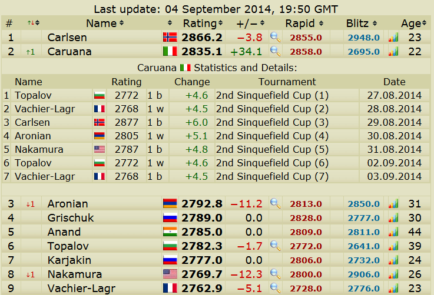

Još lani organizatori su izrazili želju da ovaj kup postane tradicionalan i zasad po tom pitanju idu u dobrom smjeru. Prošlogodišnji pobjednik **Magnus Carslen** tada je obećao da će igrati i dogodine bude li mu raspored dozvolio. Tada uspješno položen, bio je to posljednji test forme pred meč za prvaka svijeta protiv **Ananda.**

Ove godine, nakon problema s ugovorom za revanš protiv Ananda, navodno zbog nepovoljnih uvjeta, a čije bi nepotpisivanje moglo dovesti čak do oduzimanja titule svjetskog prvaka?! očito je da rezultat na ovom turniru nije ono što najviše zaokuplja Carslena. Takav rasplet iskoristio je [**Fabiano Caruana**](http://en.wikipedia.org/wiki/Fabiano_Caruana "Wiki: Fabiano Caruana") koji igra u životnoj formi. **Ima sedam pobjeda u nizu** **protiv top 10 igrača**, **bez ijedne izgrubljene partije i bez ijednog remija!** Neviđeno! 🙂 Osim što je zacementirao poziciju svjetskog broj 2, postao je i vlasnik četvrtog rejtinga svih vremena! (*edit*: nakon večerašnjeg remija protiv Carlsena ima i treći rejting svih vremena, osigurao je pobjedu na turniru, a ni 100.000$ nije za bacit).

Partije možete pogledati na [službenoj stranici turnira](http://www.uschesschamps.com/live "Sinquefield Cup 2014"), a mi ćemo objaviti samo ovo:

