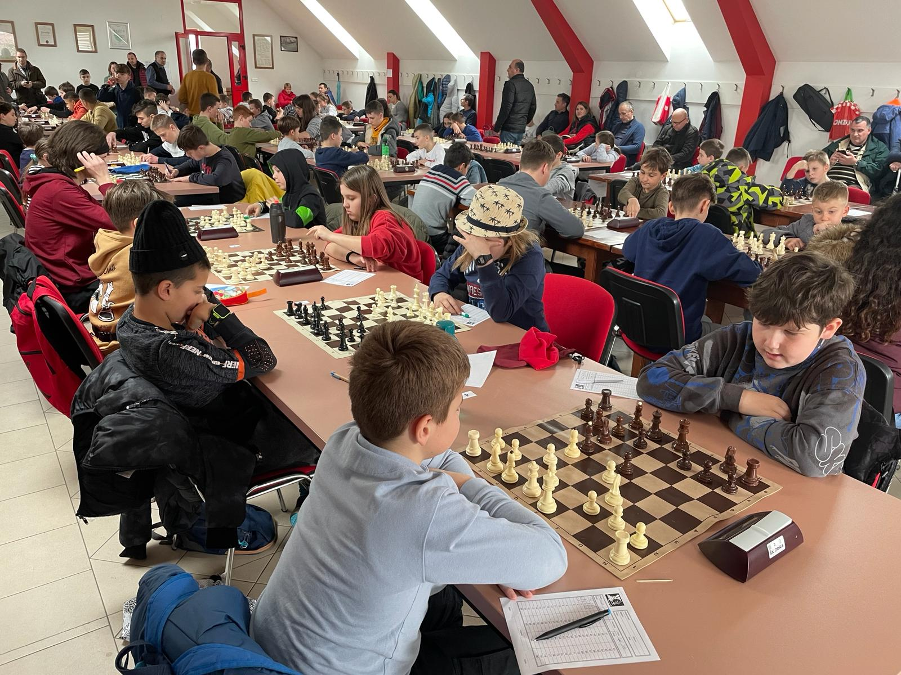
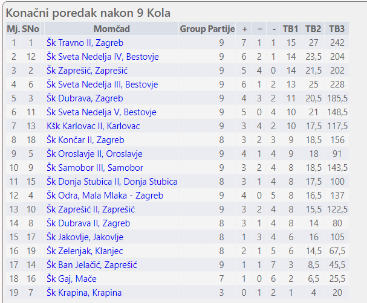
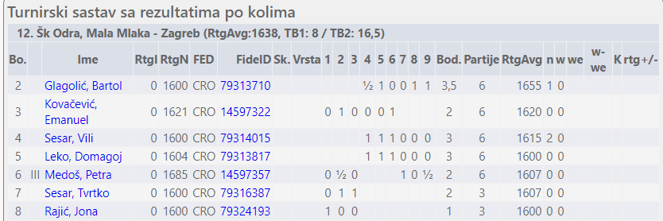

[III. A kadetska liga](https://chess-results.com/tnr900281.aspx?lan=1&art=20&snr=4) igrana je 9.3. , 23.3. i 13.4.2024.. Nastupilo je 19 ekipa, a tempo igre bio je 30 minuta + 30 sekundi za svaki potez. Mečevi su igrani na četiri ploče. Klubovi su mogli prijavljivati po dvije ekipe. Partije su rejtingirane za nacionalni rejting. Nastupili su: Bartol Glagolić, Emanuel Kovačević, Vili Sesar, Domagoj Leko, Petra Medoš, Tvrko Sesar i Jona Rajić. Ekipa našeg kluba je završila na 12. mjestu sa osvojenih 8 meč bodova. Natjecanje je donijelo uzbuđenje, napetost i priliku za rast i razvoj svakog igrača koji je sudjelovao. Nije samo o pobjedama i porazima, već i o procesu učenja, poboljšavanja vještina i jačanja šahovske zajednice.

 

IvanV
