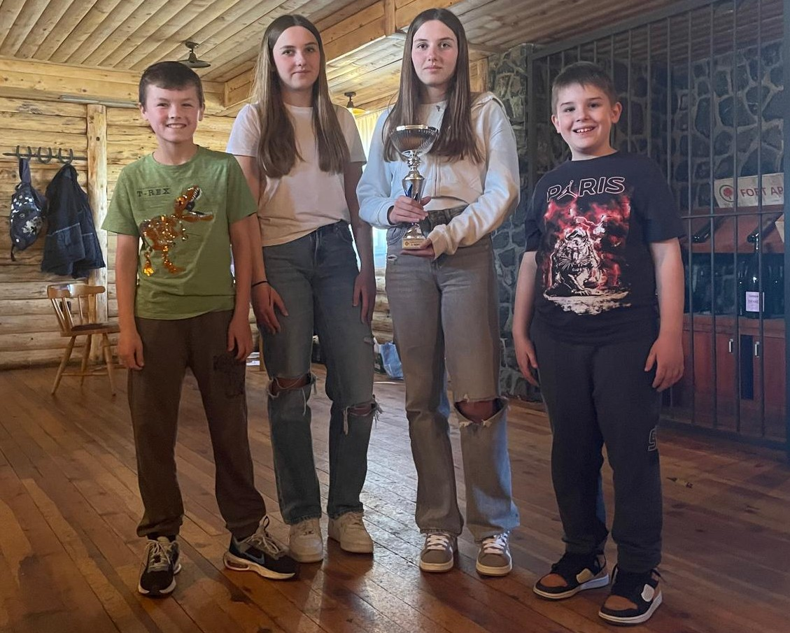
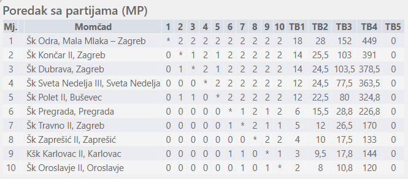
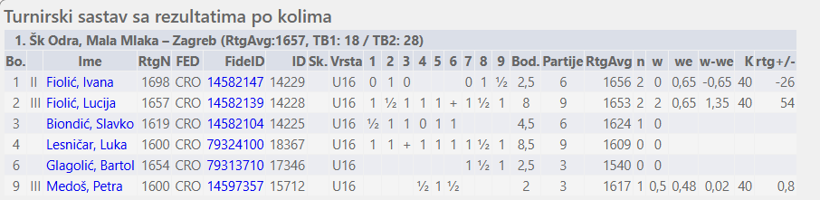
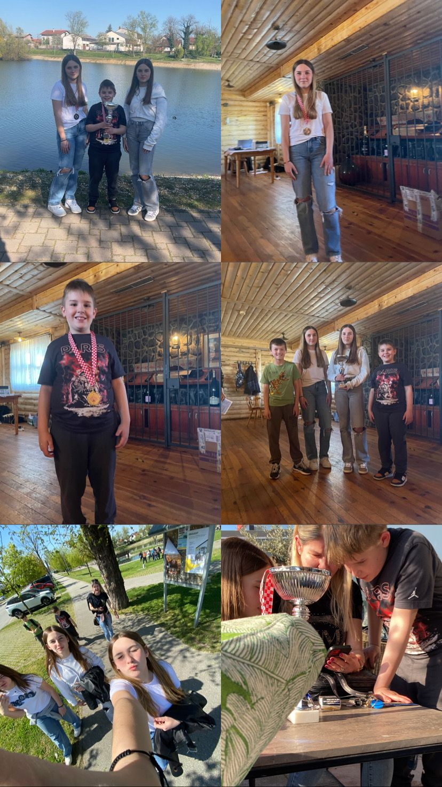
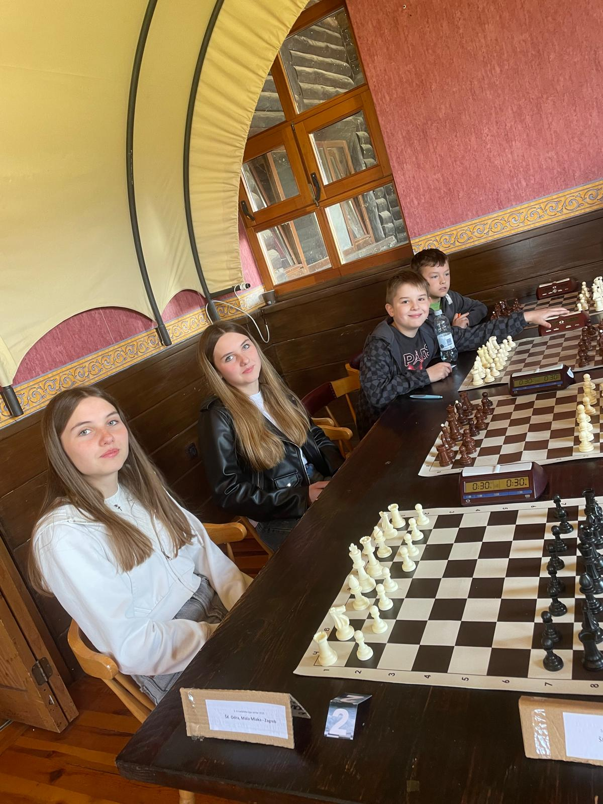
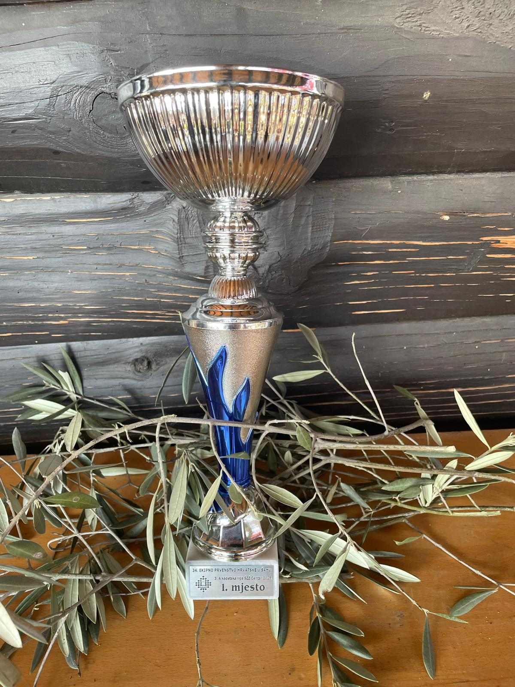
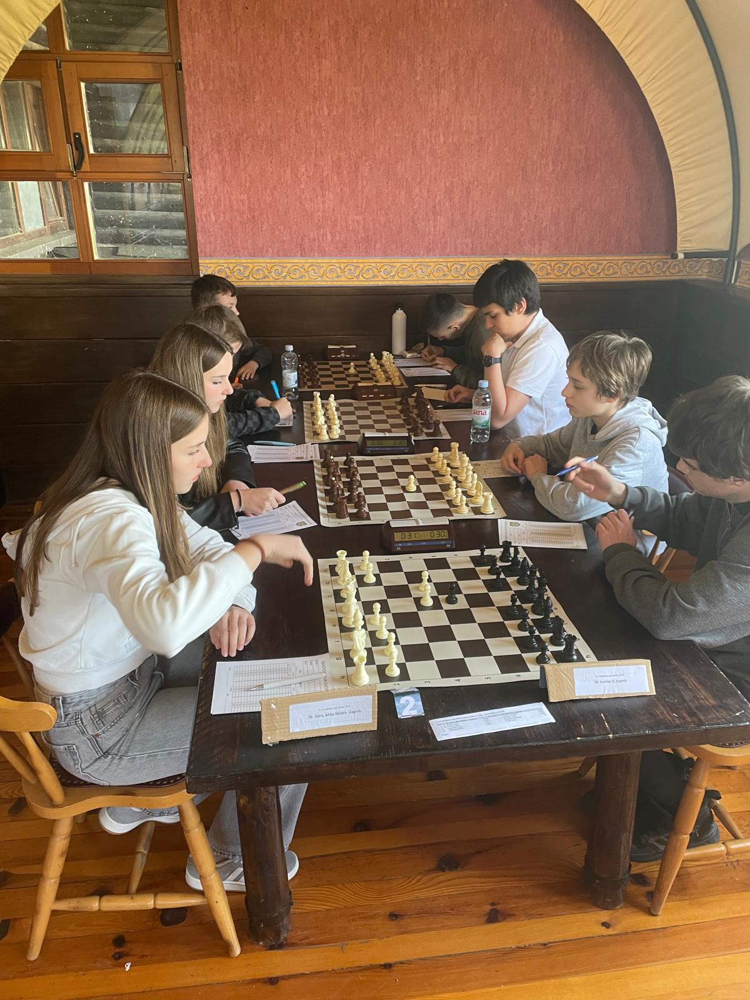
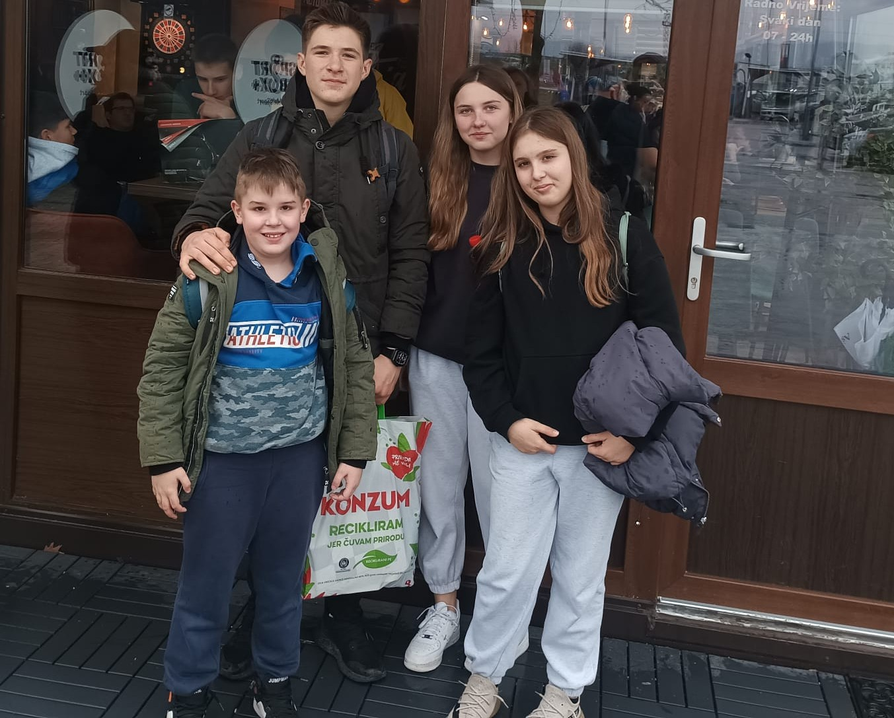

III. A kadetska liga igrana je 15.3., 29.3. i 12. 4. 2025. godine. Ukupno je nastupilo 10 ekipa, a tempo igre bio je 30 minuta + 30 sekundi dodatka po potezu. Mečevi su se igrali na četiri ploče, a klubovima je bilo omogućeno prijaviti po dvije ekipe. Partije su rejtingirane za nacionalni rejting.

Za ekipu ŠK Odra nastupili su: Luka Lesničar, Lucija Fiolić, Ivana Fiolić, Slavko Biondić, Bartol Glagolić i Petra Medoš. Ekipa je [turnir](https://chess-results.com/tnr1131544.aspx?lan=1&art=83&turdet=YES) završila na uvjerljivom 1. mjestu s maksimalnih 18 meč bodova i ukupno 28 osvojenih pojedinačnih bodova. Čestitamo im na tome! Protivnici nisu bili iznimno jaki, ali naša ekipa je pokazala ozbiljnost, koncentraciju i stabilnost kroz cijelo natjecanje.

Luka je odigrao izvrstan turnir i završio kao **drugi najbolji pojedinac lige** sa 7,5 bodova iz 8 partija. Pokazao je zrelost u igri, dobru pripremljenost i sigurnost u pozicijama, te često donosio mirnoću i sigurnost ekipi. Lucija je bila odmah iza njega – **trećeplasirana u ukupnom poretku pojedinaca**, sa 7 bodova iz 8 partija. Igrala je borbeno i s puno energije, uvijek spremna iskoristiti slabosti protivnika, a posebno se istaknula u važnim mečevima u završnici turnira.

Ovo natjecanje bilo je dobra prilika za stjecanje dodatnog iskustva i potvrdu rada u klubu. Čestitke ekipi na rezultatu i zreloj igri, uz poticaj da nastave trenirati i usavršavati se za teže izazove koji slijede.

  

