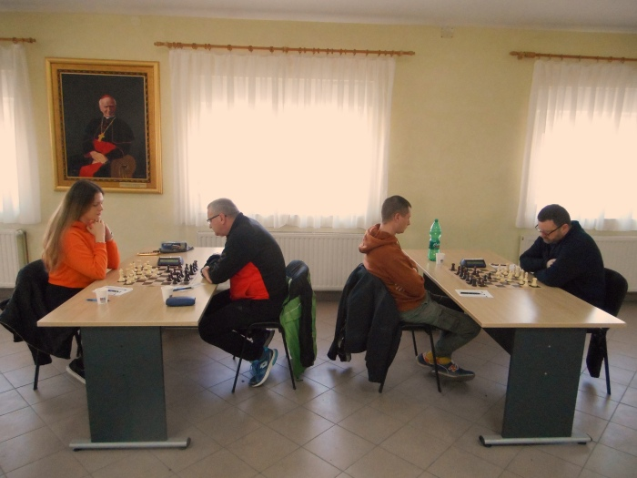

**III A. liga, 1.-4. kolo  
  
**

Odrađena su već četiri kola [treće seniorske lige](http://chess-results.com/tnr617122.aspx?lan=13&art=0) i možemo biti zadovoljni trenutnim rezultatom kao i stanjem na tablici. U četvrtom kolu ubilježili smo prvi poraz. Za sada imamo jednu pobjedu, jedan poraz i dva remija. Imamo i solidnu ekipu koju su ove godine pojačali Darko Šutić i Mladen Sliepčević. Trenutno je kratka proljetna pauza, a nastavak natjecanja je osmog svibnja kada nam u goste dolazi ŠK Velika Gorica. Zasad je za seniorsku ekipu zaigralo već deset igrača.

**  
Pojedinačni učinak  
**

<table><tbody><tr class="CRg1b"><td class="CRc">Pl.</td><td class="CR"></td><td class="CR">Ime</td><td class="CRr">RtgI</td><td class="CRr">RtgN</td><td class="CR">FED</td><td class="CRr">FideID</td><td class="CRc">1</td><td class="CRc">2</td><td class="CRc">3</td><td class="CRc">4</td><td class="CRc">Bod.</td><td class="CRc">Partije</td><td class="CRr">RtgAvg</td></tr><tr class="CRg2 CRO"><td class="CRc">1</td><td class="CR">MK</td><td class="CR">Karlić Zvjezdan</td><td class="CRr">2072</td><td class="CRr">2105</td><td class="CR">CRO</td><td><a href="http://ratings.fide.com/card.phtml?event=14503328" target="_blank" rel="noopener">14503328</a></td><td class="CRc"></td><td class="CRc">½</td><td class="CRc"></td><td class="CRc"></td><td class="CRc">0,5</td><td class="CRc">1</td><td class="CRr">2013</td></tr><tr class="CRg1 CRO"><td class="CRc">2</td><td class="CR">MK</td><td class="CR">Maravić Stjepan</td><td class="CRr">2120</td><td class="CRr">2113</td><td class="CR">CRO</td><td><a href="http://ratings.fide.com/card.phtml?event=14504316" target="_blank" rel="noopener">14504316</a></td><td class="CRc">½</td><td class="CRc">½</td><td class="CRc">½</td><td class="CRc">½</td><td class="CRc">&nbsp;2</td><td class="CRc">4</td><td class="CRc">2147</td></tr><tr class="CRg2 CRO"><td class="CRc">3</td><td class="CR">MK</td><td class="CR">Maravić Ivan</td><td class="CRr">2026</td><td class="CRr">2107</td><td class="CR">CRO</td><td><a href="http://ratings.fide.com/card.phtml?event=14539411" target="_blank" rel="noopener">14539411</a></td><td class="CRc">½</td><td class="CRc">1</td><td class="CRc">0</td><td class="CRc">½</td><td class="CRc">&nbsp;2</td><td class="CRc">4</td><td class="CRc">2075</td></tr><tr class="CRg1 CRO"><td class="CRc">4</td><td class="CR">MK</td><td class="CR">Sliepčević Mladen</td><td class="CRr">2091</td><td class="CRr">2089</td><td class="CR">CRO</td><td><a href="http://ratings.fide.com/card.phtml?event=14503247" target="_blank" rel="noopener">14503247</a></td><td class="CRc"></td><td class="CRc">0</td><td class="CRc"></td><td class="CRc">½</td><td class="CRc">&nbsp;0,5</td><td class="CRc">2</td><td class="CRc">1977</td></tr><tr class="CRg2 CRO"><td class="CRc">6</td><td class="CR">MK</td><td class="CR">Bačurin Juraj</td><td class="CRr">2015</td><td class="CRr">2017</td><td class="CR">CRO</td><td><a href="http://ratings.fide.com/card.phtml?event=14506246" target="_blank" rel="noopener">14506246</a></td><td class="CRc"></td><td class="CRc"></td><td class="CRc">½</td><td class="CRc">½</td><td class="CRc">&nbsp;1</td><td class="CRc">2</td><td class="CRc">2136</td></tr><tr class="CRg1 CRO"><td class="CRc">7</td><td class="CR">MK</td><td class="CR">Cvetković Ivan</td><td class="CRr">1966</td><td class="CRr">1959</td><td class="CR">CRO</td><td><a href="http://ratings.fide.com/card.phtml?event=14515024" target="_blank" rel="noopener">14515024</a></td><td class="CRc">½</td><td class="CRc"></td><td class="CRc">½</td><td class="CRc"></td><td class="CRc">&nbsp;1</td><td class="CRc">2</td><td class="CRc">1883</td></tr><tr class="CRg2 CRO"><td class="CRc">8</td><td class="CR">II</td><td class="CR">Šutić Darko</td><td class="CRr">1945</td><td class="CRr">1894</td><td class="CR">CRO</td><td><a href="http://ratings.fide.com/card.phtml?event=14515415" target="_blank" rel="noopener">14515415</a></td><td class="CRc">½</td><td class="CRc">1</td><td class="CRc">1</td><td class="CRc">0</td><td class="CRc">&nbsp;2,5</td><td class="CRc">4</td><td class="CRc">&nbsp;1858</td></tr><tr class="CRg1 CRO"><td class="CRc">9</td><td class="CR">II</td><td class="CR">Vraneša Ivan</td><td class="CRr">1668</td><td class="CRr">1892</td><td class="CR">CRO</td><td><a href="http://ratings.fide.com/card.phtml?event=14552523" target="_blank" rel="noopener">14552523</a></td><td class="CRc"></td><td class="CRc">0</td><td class="CRc"></td><td class="CRc">½</td><td class="CRc">&nbsp;0,5</td><td class="CRc">2</td><td class="CRc">1800</td></tr><tr class="CRg2 CRO"><td class="CRc">10</td><td class="CR">IV</td><td class="CR">Furčić Tin</td><td class="CRr">1623</td><td class="CRr">1698</td><td class="CR">CRO</td><td><a href="http://ratings.fide.com/card.phtml?event=14544172" target="_blank" rel="noopener">14544172</a></td><td class="CRc">½</td><td class="CRc"></td><td class="CRc">1</td><td class="CRc"></td><td class="CRc">&nbsp;1,5</td><td class="CRc">2</td><td class="CRc">1964</td></tr><tr class="CRg1 CRO"><td class="CRc">12</td><td class="CR">III</td><td class="CR">Cvetković Božo</td><td class="CRr">1434</td><td class="CRr">1792</td><td class="CR">CRO</td><td><a href="http://ratings.fide.com/card.phtml?event=14552493" target="_blank" rel="noopener">14552493</a></td><td class="CRc">½</td><td class="CRc"></td><td class="CRc"></td><td class="CRc"></td><td class="CRc">&nbsp;0,5</td><td class="CRc">1</td><td class="CRc">1903</td></tr></tbody></table>

**Poredak sa partijama**

<table><tbody><tr class="CRg1b"><td class="CRc">Mj.</td><td class="CR">Momčad</td><td class="CRc">1</td><td class="CRc">2</td><td class="CRc">3</td><td class="CRc">4</td><td class="CRc">5</td><td class="CRc">6</td><td class="CRc">7</td><td class="CRc">8</td><td class="CRc">9</td><td class="CRc">10</td><td class="CRc">11</td><td class="CRc">12</td><td class="CRc">&nbsp;TB1</td><td class="CRc">&nbsp;TB2</td></tr><tr class="CRg2"><td class="CRc">1</td><td class="CR">ŠK DUGO SELO</td><td class="CR">&nbsp;*</td><td class="CRc"></td><td class="CRc">5</td><td class="CRc"></td><td class="CRc"></td><td class="CRc">4</td><td class="CRc">4</td><td class="CRc"></td><td class="CRc"></td><td class="CRc"></td><td class="CRc"></td><td class="CRc">5½</td><td class="CRc">8</td><td class="CRc">18,5</td></tr><tr class="CRg1"><td class="CRc">2</td><td class="CR">ŠK SAMOBOR</td><td class="CRc"></td><td class="CR">&nbsp;*</td><td class="CRc">2½</td><td class="CRc">4</td><td class="CRc"></td><td class="CRc"></td><td class="CRc"></td><td class="CRc"></td><td class="CRc"></td><td class="CRc"></td><td class="CRc">4½</td><td class="CRc">5</td><td class="CRc">6</td><td class="CRc">16,0</td></tr><tr class="CRg2"><td class="CRc">3</td><td class="CR">ŠD SISAK, Sisak</td><td class="CRc">1</td><td class="CRc">3½</td><td class="CR">&nbsp;*</td><td class="CRc"></td><td class="CRc">5</td><td class="CRc"></td><td class="CRc"></td><td class="CRc"></td><td class="CRc"></td><td class="CRc">4½</td><td class="CRc"></td><td class="CRc"></td><td class="CRc">6</td><td class="CRc">14,0</td></tr><tr class="CRg1"><td class="CRc">4</td><td class="CR">ŠK GAJ, Mače</td><td class="CRc"></td><td class="CRc">2</td><td class="CRc"></td><td class="CR">&nbsp;*</td><td class="CRc">3½</td><td class="CRc"></td><td class="CRc"></td><td class="CRc">3</td><td class="CRc"></td><td class="CRc">3½</td><td class="CRc"></td><td class="CRc"></td><td class="CRc">5</td><td class="CRc">12,0</td></tr><tr class="CRg2"><td class="CRc">5</td><td class="CR">ŠK ZAPREŠIĆ, Zaprešić</td><td class="CRc"></td><td class="CRc"></td><td class="CRc">1</td><td class="CRc">2½</td><td class="CR">&nbsp;*</td><td class="CRc">3½</td><td class="CRc"></td><td class="CRc"></td><td class="CRc"></td><td class="CRc"></td><td class="CRc"></td><td class="CRc">5½</td><td class="CRc">4</td><td class="CRc">12,5</td></tr><tr class="CRg1"><td class="CRc">6</td><td class="CR">ŠK OROSLAVJE</td><td class="CRc">2</td><td class="CRc"></td><td class="CRc"></td><td class="CRc"></td><td class="CRc">2½</td><td class="CR">&nbsp;*</td><td class="CRc">3½</td><td class="CRc"></td><td class="CRc"></td><td class="CRc"></td><td class="CRc"></td><td class="CRc">4½</td><td class="CRc">4</td><td class="CRc">12,5</td></tr><tr class="CRg2"><td class="CRc">7</td><td class="CR">ŠK STRAŽA, Hum na Sutli</td><td class="CRc">2</td><td class="CRc"></td><td class="CRc"></td><td class="CRc"></td><td class="CRc"></td><td class="CRc">2½</td><td class="CR">&nbsp;*</td><td class="CRc">3½</td><td class="CRc">4</td><td class="CRc"></td><td class="CRc"></td><td class="CRc"></td><td class="CRc">4</td><td class="CRc">12,0</td></tr><tr class="CRg1"><td class="CRc">8</td><td class="CR"><strong>ŠK ODRA, Zagreb</strong></td><td class="CRc"></td><td class="CRc"></td><td class="CRc"></td><td class="CRc">3</td><td class="CRc"></td><td class="CRc"></td><td class="CRc">2½</td><td class="CR">&nbsp;*</td><td class="CRc">3½</td><td class="CRc"></td><td class="CRc">3</td><td class="CRc"></td><td class="CRc"><strong>4</strong></td><td class="CRc">12,0</td></tr><tr class="CRg2"><td class="CRc">9</td><td class="CR">ŠK BAN JELAČIĆ</td><td class="CRc"></td><td class="CRc"></td><td class="CRc"></td><td class="CRc"></td><td class="CRc"></td><td class="CRc"></td><td class="CRc">2</td><td class="CRc">2½</td><td class="CR">&nbsp;*</td><td class="CRc">3</td><td class="CRc">4</td><td class="CRc"></td><td class="CRc">3</td><td class="CRc">11,5</td></tr><tr class="CRg1"><td class="CRc">10</td><td class="CR">ŠK VELIKA GORICA</td><td class="CRc"></td><td class="CRc"></td><td class="CRc">1½</td><td class="CRc">2½</td><td class="CRc"></td><td class="CRc"></td><td class="CRc"></td><td class="CRc"></td><td class="CRc">3</td><td class="CR">&nbsp;*</td><td class="CRc">4</td><td class="CRc"></td><td class="CRc">3</td><td class="CRc">11,0</td></tr><tr class="CRg2"><td class="CRc">11</td><td class="CR">HAŠK MLADOST II</td><td class="CRc"></td><td class="CRc">1½</td><td class="CRc"></td><td class="CRc"></td><td class="CRc"></td><td class="CRc"></td><td class="CRc"></td><td class="CRc">3</td><td class="CRc">2</td><td class="CRc">2</td><td class="CR">&nbsp;*</td><td class="CRc"></td><td class="CRc">1</td><td class="CRc">8,5</td></tr><tr class="CRg1"><td class="CRc">12</td><td class="CR">ŠK POLET II, Buševec</td><td class="CRc">½</td><td class="CRc">1</td><td class="CRc"></td><td class="CRc"></td><td class="CRc">½</td><td class="CRc">1½</td><td class="CRc"></td><td class="CRc"></td><td class="CRc"></td><td class="CRc"></td><td class="CRc"></td><td class="CR">&nbsp;*</td><td class="CRc">0</td><td class="CRc">3,5</td></tr></tbody></table>

darko
