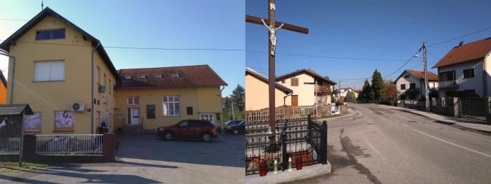

**11\. kolo**

  
U nedjelju, 23. listopada odigrano je zadnje kolo ovogodišnje [seniorske lige](http://chess-results.com/tnr617122.aspx?lan=13&art=0). Ligu je uvjerljivo osvojila ekipa ŠK Dugo Selo. A mi smo dva kola prije kraja bili u zoni ispadanja. Nakon prilično uspješnog proljetnog dijela, seniorska ekipa zaredala je poraz za porazom. I nisu bili baš neki “nesretni” porazi, nego nas je većina ekipa nadigrala. Od pozitivnih vijesti bila je da su dva juniora u seniorskoj ekipi, Ivan Maravić i Božo Cvetković, podigli kvalitetu igre. Ivan Maravić posebno. Treći junior, Ivan Vraneša je prilično oscilirao, a kada je i odigrao dobru partiju, naišao bi na protivnika koji je kažnjavao i najmanji propust. Predzadnje kolo, zbog loše igre u prethodnom kolu, kapetan ekipe Stjepan Maravić, izbacio je sam sebe iz osnovnog sastava. Igrali smo protiv direktnog konkurenta za ispadanje (Buševec II) i iako ne igrom, ali rezultatski uvjerljivo pobijedili te se tako izjednačili po meč bodovima. Zadnje kolo u goste nam je došla ekipa Siska, druga na tablici. Bila nam je potrebna pobjeda da bi osigurali ostanak. Ekipa Siska izašla nam je u susret i na meč došla sa dvije nominalno slabije ploče. Sportski su čestitali i mislim da je i njima bilo drago što smo opstali. Jer, uz neobjašnjivo dobru igru svih naših igrača te pobjede na petoj i šestoj ploči, naši igrači na gornjim pločama prihvaćali su remije i u znatno izglednijim pozicijama (Zvjezdan i Ivan), upisali drugu meč pobjedu zaredom i osigurali ostanak ŠK Odra u III. ligi. Tako smo dobili još dobrih vijesti, samo dan nakon što su djevojke OŠ Odra osvojile Ekipno školsko prvenstvo Grada Zagreba.

**11\. kolo**

<table><tbody><tr><td>Pl.</td><td></td><td><strong>ŠK Odra</strong></td><td>–</td><td></td><td><strong>ŠD Sisak</strong></td><td><strong>4-2</strong></td></tr><tr><td>1.</td><td>MK</td><td>Karlić, Zvjezdan</td><td>–</td><td>FM</td><td>Brigljević, Milan</td><td>½ – ½</td></tr><tr><td>2.</td><td>MK</td><td>Maravić Stjepan</td><td>–</td><td>FM</td><td>Balenović, Zvonimir</td><td>½ – ½</td></tr><tr><td>3.</td><td>MK</td><td>Maravić, Ivan</td><td>–</td><td>MK</td><td>Prihoda, Leonardo</td><td>½ – ½</td></tr><tr><td>4.</td><td>MK</td><td>Sliepčević, Mladen</td><td>–</td><td>NM</td><td>Galić, Kruno</td><td>½ – ½</td></tr><tr><td>5.</td><td>MK</td><td>Vidaković, Darko</td><td>–</td><td>MK</td><td>Brigljević, Iva-Mila</td><td>1-0</td></tr><tr><td>6.</td><td>II</td><td>Šutić, Darko</td><td>–</td><td>II</td><td>Petričević, Petar</td><td>1-0</td></tr></tbody></table>

Konačni poredak

<table><tbody><tr><td><strong>Mj.</strong></td><td><strong>&nbsp;</strong></td><td><strong>Momčad</strong></td><td><strong>1</strong></td><td><strong>2</strong></td><td><strong>3</strong></td><td><strong>4</strong></td><td><strong>5</strong></td><td><strong>6</strong></td><td><strong>7</strong></td><td><strong>8</strong></td><td><strong>9</strong></td><td><strong>10</strong></td><td><strong>11</strong></td><td><strong>12</strong></td><td><strong>&nbsp;TB1&nbsp;</strong></td><td><strong>&nbsp;TB2&nbsp;</strong></td></tr><tr><td>1.</td><td></td><td>ŠK DUGO SELO</td><td>&nbsp;*</td><td>5</td><td>4½</td><td>4½</td><td>5</td><td>4</td><td>4</td><td>4½</td><td>3½</td><td>4½</td><td>5½</td><td>5½</td><td><strong>22</strong></td><td>50,5</td></tr><tr><td>2.</td><td></td><td>ŠD SISAK</td><td>1</td><td>&nbsp;*</td><td>3½</td><td>4</td><td>5</td><td>3</td><td>5</td><td>3</td><td>4½</td><td>2</td><td>3</td><td>5</td><td><strong>15</strong></td><td>39</td></tr><tr><td>3.</td><td></td><td>ŠK SAMOBOR</td><td>1½</td><td>2½</td><td>&nbsp;*</td><td>4</td><td>3</td><td>3</td><td>4</td><td>3</td><td>3</td><td>4½</td><td>5</td><td>4½</td><td><strong>14</strong></td><td>38</td></tr><tr><td>4.</td><td></td><td>ŠK GAJ, Mače</td><td>1½</td><td>2</td><td>2</td><td>&nbsp;*</td><td>3½</td><td>3</td><td>4</td><td>3</td><td>3½</td><td>3</td><td>4</td><td>3½</td><td><strong>13</strong></td><td>33</td></tr><tr><td>5.</td><td></td><td>ŠK ZAPREŠIĆ, Zaprešić</td><td>1</td><td>1</td><td>3</td><td>2½</td><td>&nbsp;*</td><td>3</td><td>3½</td><td>3½</td><td>3</td><td>3½</td><td>5½</td><td>3</td><td><strong>12</strong></td><td>32,5</td></tr><tr><td>6.</td><td></td><td>ŠK STRAŽA, Hum na Sutli</td><td>2</td><td>3</td><td>3</td><td>3</td><td>3</td><td>&nbsp;*</td><td>2½</td><td>4</td><td>3</td><td>3½</td><td>2½</td><td>3½</td><td><strong>11</strong></td><td>33</td></tr><tr><td>7.</td><td></td><td>ŠK OROSLAVJE, Oroslavje</td><td>2</td><td>1</td><td>2</td><td>2</td><td>2½</td><td>3½</td><td>&nbsp;*</td><td>1½</td><td>5</td><td>4½</td><td>4½</td><td>4</td><td><strong>10</strong></td><td>32,5</td></tr><tr><td>8.</td><td></td><td>ŠK BAN JELAČIĆ, Zaprešić</td><td>1½</td><td>3</td><td>3</td><td>3</td><td>2½</td><td>2</td><td>4½</td><td>&nbsp;*</td><td>3</td><td>2½</td><td>3</td><td>4</td><td><strong>9</strong></td><td>32</td></tr><tr><td>9.</td><td></td><td>ŠK VELIKA GORICA</td><td>2½</td><td>1½</td><td>3</td><td>2½</td><td>3</td><td>3</td><td>1</td><td>3</td><td>&nbsp;*</td><td>4</td><td>3</td><td>4</td><td><strong>9</strong></td><td>30,5</td></tr><tr><td>10.</td><td></td><td><strong>ŠK ODRA</strong>, Zagreb</td><td>1½</td><td>4</td><td>1½</td><td>3</td><td>2½</td><td>2½</td><td>1½</td><td>3½</td><td>2</td><td>&nbsp;*</td><td>4</td><td>3</td><td><strong>8</strong></td><td>29</td></tr><tr><td>11.</td><td></td><td>ŠK POLET II, Buševec</td><td>½</td><td>3</td><td>1</td><td>2</td><td>½</td><td>3½</td><td>1½</td><td>3</td><td>3</td><td>2</td><td>&nbsp;*</td><td>4½</td><td><strong>7</strong></td><td>24,5</td></tr><tr><td>12.</td><td></td><td>HAŠK MLADOST II, Zagreb</td><td>½</td><td>1</td><td>1½</td><td>2½</td><td>3</td><td>2½</td><td>2</td><td>2</td><td>2</td><td>3</td><td>1½</td><td>&nbsp;*</td><td><strong>2</strong></td><td>21,5</td></tr></tbody></table>

Statistika

<table><tbody><tr><td><strong>Pl.</strong></td><td></td><td><strong>Ime</strong></td><td><strong>RtgI</strong></td><td><strong>RtgN</strong></td><td><strong>1</strong></td><td><strong>2</strong></td><td><strong>3</strong></td><td><strong>4</strong></td><td><strong>5</strong></td><td><strong>6</strong></td><td><strong>7</strong></td><td><strong>8</strong></td><td><strong>9</strong></td><td><strong>10</strong></td><td><strong>11</strong></td><td><strong>Bod.</strong></td><td><strong>Partije</strong></td><td><strong>RtgAvg</strong></td></tr><tr><td>1.</td><td>MK</td><td>Karlić Zvjezdan</td><td>2072</td><td>2105</td><td></td><td>½</td><td></td><td></td><td></td><td></td><td>0</td><td>0</td><td></td><td></td><td>½</td><td>1</td><td>4</td><td>2072</td></tr><tr><td>2.</td><td>MK</td><td>Maravić Stjepan</td><td>2120</td><td>2113</td><td>½</td><td>½</td><td>½</td><td>½</td><td>½</td><td>1</td><td>½</td><td>0</td><td>0</td><td></td><td>½</td><td>4,5</td><td>10</td><td>2142</td></tr><tr><td>3.</td><td>MK</td><td>Maravić Ivan</td><td>2026</td><td>2107</td><td>½</td><td>1</td><td>0</td><td>½</td><td>0</td><td>0</td><td>0</td><td>1</td><td>½</td><td>1</td><td>½</td><td>5</td><td>11</td><td>2050</td></tr><tr><td>4.</td><td>MK</td><td>Sliepčević Mladen</td><td>2091</td><td>2089</td><td></td><td>0</td><td></td><td>½</td><td>½</td><td></td><td>½</td><td></td><td>1</td><td>0</td><td>½</td><td>3</td><td>7</td><td>1977</td></tr><tr><td>5.</td><td>MK</td><td>Vidaković Darko</td><td>2112</td><td>2109</td><td></td><td></td><td></td><td></td><td>1</td><td>0</td><td></td><td></td><td></td><td>1</td><td>1</td><td>3</td><td>4</td><td>1970</td></tr><tr><td>6.</td><td>MK</td><td>Bačurin Juraj</td><td>2015</td><td>2017</td><td></td><td></td><td>½</td><td>½</td><td></td><td></td><td>1</td><td></td><td>0</td><td>0</td><td></td><td>2</td><td>5</td><td>1979</td></tr><tr><td>7.</td><td>MK</td><td>Cvetković Ivan</td><td>1966</td><td>1959</td><td>½</td><td></td><td>½</td><td></td><td></td><td>½</td><td></td><td></td><td></td><td>1</td><td></td><td>2,5</td><td>4</td><td>1933</td></tr><tr><td>8.</td><td>II</td><td>Šutić Darko</td><td>1945</td><td>1894</td><td>½</td><td>1</td><td>1</td><td>0</td><td>0</td><td></td><td></td><td></td><td></td><td>1</td><td>1</td><td>4,5</td><td>7</td><td>1842</td></tr><tr><td>9.</td><td>II</td><td>Vraneša Ivan</td><td>1668</td><td>1892</td><td></td><td>0</td><td></td><td>½</td><td>0</td><td></td><td>½</td><td></td><td>0</td><td></td><td></td><td>1</td><td>5</td><td>1823</td></tr><tr><td>10.</td><td>IV</td><td>Furčić Tin</td><td>1623</td><td>1698</td><td>½</td><td></td><td>1</td><td></td><td></td><td></td><td></td><td>0</td><td></td><td></td><td></td><td>1,5</td><td>3</td><td>2003</td></tr><tr><td>11.</td><td>IV</td><td>Kobali Borislav</td><td>1666</td><td>1763</td><td></td><td></td><td></td><td></td><td></td><td>0</td><td></td><td>½</td><td></td><td></td><td></td><td>0,5</td><td>2</td><td>1913</td></tr><tr><td>12.</td><td>III</td><td>Cvetković Božo</td><td>1434</td><td>1792</td><td>½</td><td></td><td></td><td></td><td></td><td>0</td><td></td><td>0</td><td>0</td><td></td><td></td><td>0,5</td><td>4</td><td>1792</td></tr></tbody></table>

darko
