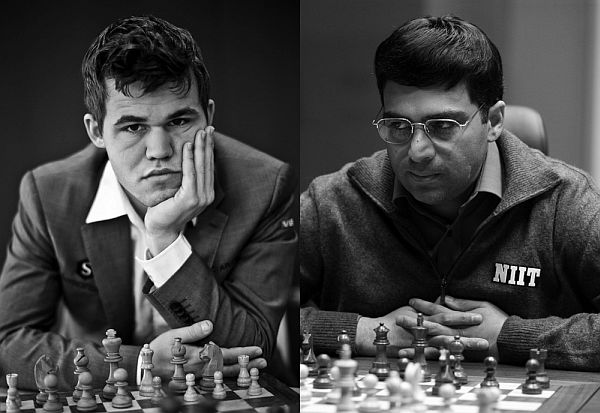

U drugoj partiji igrala se *španjolska* u kojoj je **Carlsen** prikazao novu ideju protiv *berlinske* varijante. **Anand** se vrlo dobro branio ali je u kasnijoj fazi nakon nekoliko nepreciznih poteza zapao u poteškoće koje iz kojih bi se teško izvukao i da nije grubo pogriješio na kraju.

*Live* prijenos vrlo dobro pokrivaju komentarima **Peter Svidler** i **Sopiko Guramishvili** (engleski).

Trenutni rezultat nakon dvije partije je 1,5: 0,5 za Carlsena. Slijedi dan odmora i nastavak 11. studenog.

```pgn
[Event "World Championship Match 2014"]
[Site "Sochi RUS"]
[Date "2014.11.09"]
[Round "2"]
[White "Carlsen, Magnus"]
[Black "Anand, Viswanathan"]
[Result "1-0"]
[ECO "C65"]
[WhiteElo "2863"]
[BlackElo "2792"]
[PlyCount "69"]
[EventDate "2014.11.08"]

1. e4 e5 2. Nf3 Nc6 3. Bb5 Nf6 4. d3 Bc5 5. O-O d6 6. Re1 O-O 7. Bxc6 bxc6 8. h3 Re8 9. Nbd2 Nd7 10. Nc4 Bb6
11. a4 a5 12. Nxb6 cxb6 13. d4 Qc7 14. Ra3 Nf8 15. dxe5 dxe5 16. Nh4 Rd8 17. Qh5 f6 18. Nf5 Be6 19. Rg3 Ng6 20. h4 Bxf5
21. exf5 Nf4 22. Bxf4 exf4 23. Rc3 c5 24. Re6 Rab8 25. Rc4 Qd7 26. Kh2 Rf8 27. Rce4 Rb7 28. Qe2 b5 29. b3 bxa4 30. bxa4 Rb4
31. Re7 Qd6 32. Qf3 Rxe4 33. Qxe4 f3+ 34. g3 h5 35. Qb7 1-0
```
