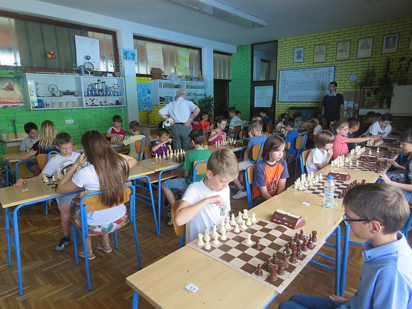
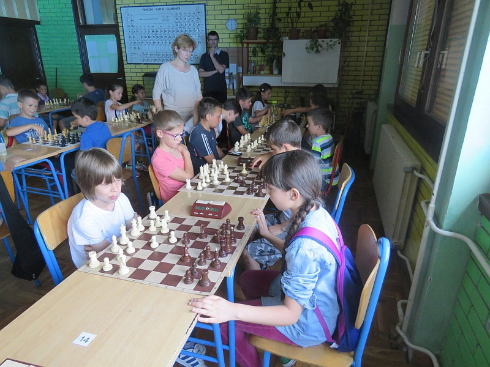

  
U petak 2. lipnja 2017. u [OŠ Braće Radić](http://os-brace-radic-zg.skole.hr/) u Botincu, u povodu Dana škole, održan je šahovski turnir za osnovnoškolce, Memorijal Željka Matića. Nastupilo je 37 mladih šahista i šahistica iz nekoliko škola, a iz OŠ Odra deset učenika i učenica: Luka Fiolić, Monika, Lucija, Luka Matašić, Josip, Filip, Roko, Lorusso, Dora i Hana. Prijavom na turnir, koji se igrao u prijepodnevnim satima, izbjegli su školske obveze za taj dan, što je većina zdušno prihvatila. 🙂 Turnir se igrao švicarskim sustavom, sedam kola s tempom igre 10+0. S osvojenih šest bodova, **pobjednik turnira** je **Vibor Frouth** iz OŠ Dobriše Cesarića, dok su drugo i treće mjesto osvojili **Petra Mardešić** i **Mislav Mikacinić**, oboje iz OŠ Ive Andrića. Od naših igrača najbolji rezultat ostvario je **Luka Fiolić** osvojivši **sedmo mjesto** s pet bodova, dok su među prvih deset uskočile i sestre Kolovrat, obje s 4,5 boda. Prilično visoko završila su i braća Matašić te Josip, svi s po četiri boda. Ipak, najugodnije su iznenadili Roko, Lorusso, Dora i Hana jer su svi osvojili po dva boda, a Roko čak tri. Oni su me već nekako naviknuli da se s turnira vraćaju s osvojenim jednim, do jednim i pol bodom, a ovaj put su se ipak malo popravili. Roko se pridružio ekipi tek nedavno, pa je njegov rezultat to impresivniji. Josip, Lucija i Monika od sljedeće su godine u višim razredima pa ćemo školske ekipe do četvrtog razreda nagodinu slagati od ostalih sudionika ovog turnira. Luka Fiolić i Luka Matašić već su si zacementirali mjesto u školskoj ekipi, a ostali će morati još više igrati na turnirima kako bi što brže napredovali i uskočili u ekipu.  
U ekipnom poretku na ovom turniru prva ekipa **OŠ Odra**, u sastavu Luka Fiolić, Josip Mahin, Monika Kolovrat i Lucija Kolovrat, **osvojila je drugo mjesto** s četrnaest bodova, dok je prvo mjesto osvojila OŠ Ive Andrića s 15 bodova. Treće mjesto pripalo je OŠ Brezovica s osvojenih 13 bodova.

Zahvaljujemo OŠ Braće Radić i voditelju prof. Nenadu Frouthu na pozivu i organizaciji.

[REZULTATI 9. Memorijal Željka Matića](/files/wp/2017/06/9.-Memorijal--eljka-Mati-a-rezultati.docx)
