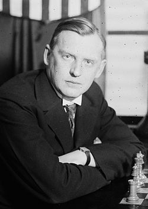
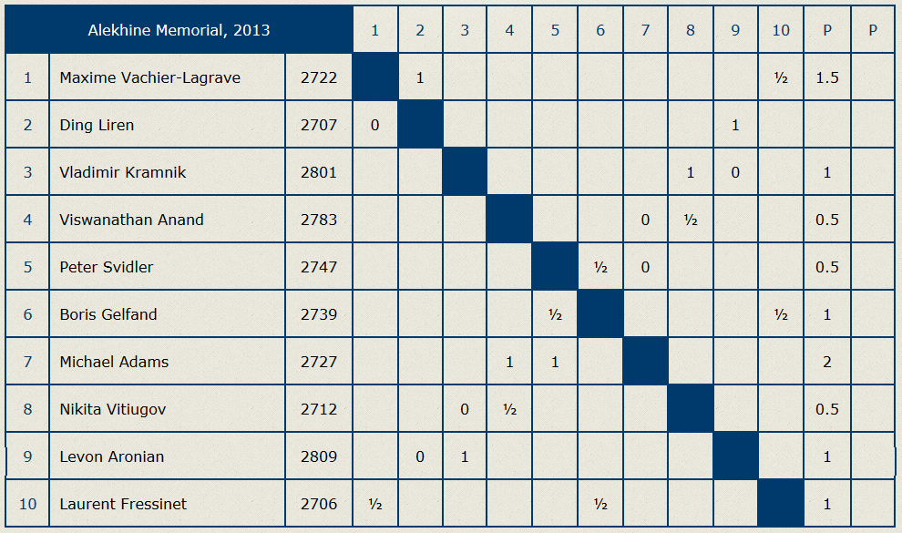

Od 21.4. do 1.5 u *Parizu (Louvre)* i *Petrogradu (Ruski državni muzej)* igra se **[memorijalni turnir](http://www.alekhine-memorial.com/ "Aljehinov memorijal")** u čast četvrtog svjetskog prvaka [**Aleksandra Aleksandrovicha Aljehina (1892-1946)**](http://bs.wikipedia.org/wiki/Aleksandar_Aljehin "Wiki: Aleksandar Aljehin").

Ovo nije prvi put da se šahovski turnir odigrava u muzejskom prostoru (meč za prvaka svijeta Anand – Gelfand), a cilj je promocija ruske kulture i muzejske tradicije. Turnir je otvoren za javnost uz bespalatan ulaz, uz [online](http://www.alekhine-memorial.com/online_game "Aljehinov memorijal - online") i [video](http://www.alekhine-memorial.com/videos "Aljehinov memorijal - video") prijenos.

Aljehin je bio jedan od najboljih šahista svih vremena, a mnogi ga smatraju i najboljim.

Na turniru sudjeluje deset velemajstora (rejting 2700+): **Maxime Vachier-Lagrave**, **Ding Liren**, **Vladimir Kramnik**, **Viswanathan Anand**, **Peter Svidler**, **Boris Gelfand**, **Michael Adams**, **Nikita Vitiugov**, **Levon Aronian** i **Laurent Fressinet**. Trenutačni poredak:

