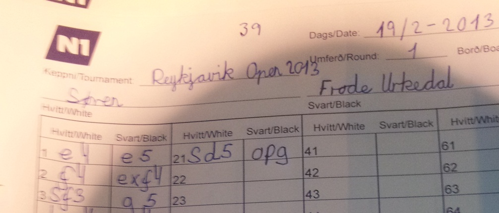

U tijeku je drugo kolo (a poslijepodne se igra i treće) turnira [Reykjavik Open 2013.](http://www.reykjavikopen.com "Reykjavik Open 2013") Očekivano, glavni favoriti (2700+: **Giri Anish**, **Vachier-Lagrave Maxime**, **Navara David**, **Cheparinov Ivan**, **Ding Liren**) [su slavili ili bar remizirali](http://www.reykjavikopen.com/results/ "Reykjavik Open 2013 - svi rezultati"), no dogodilo se i poneko iznenađenje. Evo jedne takve partije gdje je IM **Urkedal** (2473), favorit po rejtingu očito “uletio” u varijantu i nastradao, jer je **Jensen** (1909) potrošio svega dvadesetak minuta za cijelu partiju:

```pgn
[Date "19.02.2013."]
[White "Søren Jensen (1909)"]
[Black "Frode Urkedal (2473)"]
[Result "1-0"]
1. e4 e5 2. f4 exf4 3. Nf3 g5 4. Bc4 g4 5. O-O gxf3 6. Qxf3 Qf6 7. e5 Qxe5 8. Bxf7+ Kxf7 9. d4 Qxd4+ 10. Be3 Qf6 11. Bxf4 Bc5+ 12. Kh1 Bd6 13. Qh5+ Qg6 14. Bxd6+ Nf6 15. Qd5+ Kg7 16. Rxf6 Qxf6 17. Be5 Rf8 18. Bxf6+ Rxf6 19. Qg5+ Kf7 20. Nc3 d6 21. Nd5 1-0
```
