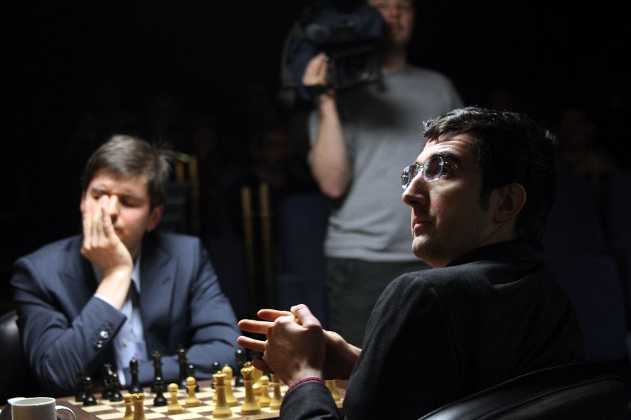

Osmo kolo proteklo je u velikoj borbi. Osim remija vodećeg dvojca (**Carlsen**, **Aronian**) sve ostale partije su odlučene. Zanimljivo, **Kramnik**, **Gelfand** i **Grischuk** su u ovom kolu upisali prvu pobjedu na turniru.

```pgn
[Event "London, turnir kandidata 2013"]
[Round "8"] [Date "24.03.2013."]
[White "Kramnik, Vladimir"]
[Black "Svidler, Peter"]
[Result "1-0"]
1.d4 Nf6 2. c4 g6 3. Nc3 d5 4. cxd5 Nxd5 5. e4 Nxc3 6. bxc3 Bg7 7. Nf3 c5 8. Be3 Qa5 9. Qd2 Nc6 10. Rc1 cxd4 11. cxd4 Qxd2 12. Kxd2 O-O 13. d5 Rd8 14. Kc2 Ne5 15. Nxe5 Bxe5 16. Bc4 Bd7 17. f4 Bd6 18. Kb3 f6 19. a4 Rdc8 20. h4 Rab8 21. Bb5 Bxb5 22. axb5 a6 23. b6 Kf7 24. h5 Rxc1 25. hxg6 Kxg6 26. Bxc1 Rg8 27. g4 h6 28. Rh5 Kf7 29. e5 Bc5 30. e6 Kf8 31. Rh4 Kg7? (31...h5 32.gxh5 Rg1 33.Bd2 Kg7 34.Kc4 Bd6 35.f5 Kh7 36.h6 Rg8 37.Bf4 Rc8+ 38.Kb3 Rd8 39.Be3 Rg8 40.Kc4 Bg3 41.Rh1) 32. f5 Rd8 (32...Rh8 33.Bf4 Bd6 34.Bxd6 exd6 35.Rh1 Rc8 36.Re1 Kf8 37.e7+ Kf7 38.Re6 Re8 39.Kc4 Rxe7 40.Rxd6 Re4+ 41.Kc5 Re7 42.Re6) 33. Bxh6 Kg8 34. Kc4 Bxb6 35. g5 Bf2 36. Rg4 Kh7 37. gxf6 exf6 38. e7 Rc8 39. Kb3 Bc5 40. Rc4 1-0
```
