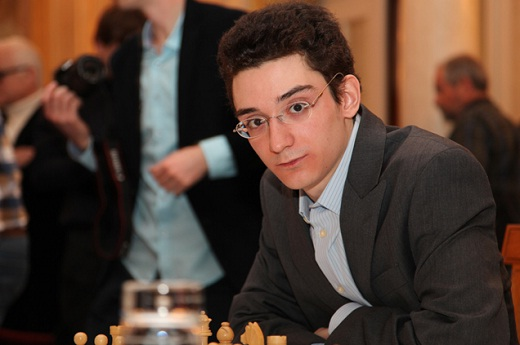

**Fabiano Caruana** pobjednik je *Zurich Chess Chelange* 2013 ispred **Ananda**, **Kramnika, Gelfanda**.

U posljednjem kolu igrala se katalonka. Caruana je dao lovački par za pješaka, a Gelfand se dobro branio sve do 55. poteza kad se odlučio na žrtvu pješaka za aktivniju poziciju, ali Caruana je to ideju brzo oborio.

Prije tjedan dana Caruana je lošijom igrom u zadnja dva kola propustio osvojiti *GRENKE Classic* (osvojio ga je Anand), pa mu je pobjeda na ovom turniru sigurno dobro došla za vraćanje samopouzdanja. Osim toga, ponovo je u Top 10, trenutno 7. igrač svijeta (2771.6).

<table summary="Event 2012 Crosstable"><tbody><tr><td>1.</td><td>Caruana, Fabiano</td><td>ITA</td><td>2757</td><td>4</td></tr><tr><td>2.</td><td>Anand, Viswanathan</td><td>IND</td><td>2780</td><td>3</td></tr><tr><td>3.</td><td>Kramnik, Vladimir</td><td>RUS</td><td>2810</td><td>2½</td></tr><tr><td>4.</td><td>Gelfand, Boris</td><td>ISR</td><td>2740</td><td>2½</td></tr></tbody></table>

```pgn
[Event "Zurich Chess Chelange 2013"]
[Round "6"]
[Date "02.03.2013."]
[White "Caruana, Fabiano (2757)"]
[Black "Gelfand, Boris (2740)"]
[Result "1-0"]

1. d4 Nf6 2. c4 e6 3. g3 d5 4. Nf3 Bb4+ 5. Bd2 Be7 6. Bg2 O-O 7. O-O c6 8. Qc2 Nbd7 9. Bf4 b6 10. Rd1 Bb7 11. Ne5 Nh5 12. Bd2 Nhf6 13. cxd5 cxd5 14. Nc6 Bxc6 15. Qxc6 Qb8 16. Qc2 b5 17. Qd3 b4 18. Be1 Qb6 19. Nd2 a5 20. Rac1 Rac8 21. e3 e5 22. Bh3 Rc7 23. Bxd7 Nxd7 24. dxe5 Nxe5 25. Qxd5 Rfc8 26. Nb3 Nc4 27. Rd4 Qa6 28. Rf4 Bf6 29. Qd3 Qe6 30. Re4 Qd6 31. Re8+ Rxe8 32. Qxd6 Nxd6 33. Rxc7 a4 34. Nc5 b3 35. axb3 axb3 36. Rc6 Bxb2 37. Nxb3 Ne4 38. Kg2 h5 39. f3 Ng5 40. Bf2 g6 41. Nc5 Ne6 42. Ne4 Bg7 43. Rb6 Ra8 44. h3 Ra2 45. f4 Ra5 46. Kf3 g5 47. Rb8+ Kh7 48. Nd6 f5 49. Rb6 g4+ 50. hxg4 fxg4+ 51. Kg2 Nc5 52. Nb7 Nxb7 53. Rxb7 Ra4 54. Rb6 Re4 (54...Rc4 55. Rb5 Kg6 56. Kf1 Rc1+ 57. Ke2 Rc2+ 58. Ke1 Bc3+ 59. Kf1 Rc1+ 60. Kg2 Be1 61. Rb6+ Kf7 62. Bxe1 Rxe1 63. Kf2 Rc1 64. Rb2 Rc3 65. Ke2 Rc6 66. Ra2 Rc1 67. Ra7+ Ke6 68. Ra6+ Kf7 69. Rb6 Rg1 70. Kf2 Rc1 71. Rb2) 55. Kf1 h4? (55...Ra4 56.Rc6 Ra1+ 57.Ke2 Ra2+ 58.Ke1 Bf8 59.Kf1 Ra1+ 60.Kg2 Ra4 61.Rf6 Ba3 62.Re6 Bb2 63.Rb6 Ba3 64.Kf1 Bf8 65.Rb8) 56. gxh4 g3 57. Bg1 Bh6 58. Kg2 1-0
```
