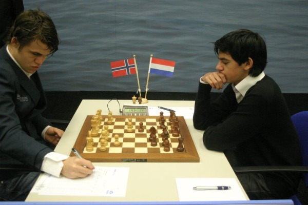

```pgn
[Date "17.01.2011."]
[White "Carlsen, M."]
[Black "Giri, A."]
[Result "0-1"]

1. d4 Nf6 2.c4 g6 3.g3 Bg7 4.Bg2 d5 5.cxd5 Nxd5 6.Nf3 Nb6 7.Nc3 Nc6 8.e3 O-O 9.O-O Re8
10.Re1 a5 (10...e5) (10...Bd7) (10...e6) (10...h6) (10...Bg4) 11.Qd2?!
(11. b3) (11.Qe2) (11.h3) (11.Nd2) (11.Qc2) (11.d5) (11.a4) (11.Na4) (11.Ng5) (11.Nb5)
11...e5 12.d5 Nb4 13.e4 c6 14.a3 cxd5! 15.axb4 axb4 16.Rxa8 bxc3 17.bxc3 Nxa8 18.exd5 (18.Qxd5 Qxd5 19.exd5) 18...Nb6 19.Rd1? (19.Ng5 h6 20.Ne4 f5 21.Nc5 Qd6 22.Ne6 Bxe6 23.dxe6 Qxe6) (19.c4 Nxc4 20.Qb4 Nd6 21.Be3 e4) 19...e4! 20.Ng5? (20.Nh4 Bd7 21.Re1 f5) 20...e3 21.Qb2? (21.Qd3 Qxg5 22.Bxe3 Qd8) 21...Qxg5 (21...Na4 22.Qc2 Nxc3 23.Bxe3 Nxd1 24.Qxd1 Rxe3 25.fxe3 Qxg5) 22.Bxe3 (22. Qxb6 e2 23. Re1 Qxc1 24. Rxc1 e1=Q+ 25. Rxe1 Rxe1+ 26. Bf1 Bh3) Qg4 0-1
```
