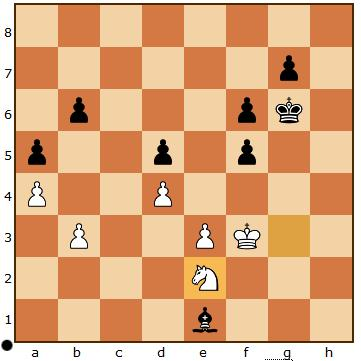

Porazom u devetom kolu **Caruana** je dopustio **Anandu** da se izjednače na tablici! Nakon dosta lošeg starta Anand je u finišu turnira ubacio u višu brzinu i u jedinoj odlučenoj partiji devetog kola uzeo bod za izjednačenje na vrhu tablice. Da stvar bude gora po Caruanu, Anand je pobjedio i u 10. kolu, a Caruana (crni) svoju partiju trenutno još igra i ima dva pješaka više (ali izgleda ne zadugo 😉 ) protiv **Fridmana**, trenutno posljednjeg na tablici (direktan prijenos je još kratko vrijeme [ovdje](http://www.grenkechessclassic.de/en/10)).



Crni je na potezu. Što biste **Vi** igrali?

```pgn
[Date "16.02.2013."]
[White "Anand, V."]
[Black "Fridman, A."]
[Result "1-0"]

1. e4 e5 2. Nf3 Nf6 3. Nxe5 d6 4. Nf3 Nxe4 5. d4 d5 6. Bd3 Nc6 7. O-O Be7 8. c4 Nb4 9. Be2 O-O 10. Nc3 Bf5
11. a3 Nxc3 12. bxc3 Nc6 13. Re1 Re8 14. cxd5 Qxd5 15. Bf4 Rac8 16. h3 h6 17. Nd2 Na5 18. Bf3 Qd7 19. Ne4 Rcd8 20. Ra2 b6
21. Rae2 Bxa3 22. Bg4 Rf8 23. Bxf5 Qxf5 24. Bxc7 Rd7 25. Be5 f6 26. Ng3 Qe6 27. Qa4 Nc4 28. Bd6 b5 29. Rxe6 bxa4 30. Bxf8 Kxf8
31. Ra1 Bb2 32. Rxa4 Nb6 33. Ra6 Bxc3 34. Nf5 Bb4 35. Re2 Kf7 36. Rea2 Nc8 37. g4 g6 38. Nxh6+ Kg7 39. g5 fxg5 40. Ng4 Rxd4
41. Rc2 Ne7 42. Rxa7 Bd6 43. Kg2 Kf7 44. Re2 Bb4 45. Re5 Bd6 46. Rxg5 Ke6 47. Ra6 1-0
```

Poredak nakon devetog kola:

<table><tbody><tr><td>#</td><td>Ime</td><td>Zemlja</td><td>Rating</td><td>Bodovi</td></tr><tr><td>1</td><td><strong>Caruana, Fabiano</strong></td><td>ITA</td><td>2757</td><td>5½</td></tr><tr><td>2</td><td><strong>Anand, Viswanathan</strong></td><td>IND</td><td>2780</td><td>5½</td></tr><tr><td>3</td><td><strong>Adams, Michael</strong></td><td>ENG</td><td>2725</td><td>4½</td></tr><tr><td>4</td><td><strong>Meier, Georg</strong></td><td>GER</td><td>2640</td><td>4½</td></tr><tr><td>5</td><td><strong>Naiditsch, Arkadij</strong></td><td>GER</td><td>2716</td><td>4</td></tr><tr><td>6</td><td><strong>Fridman, Daniel</strong></td><td>GER</td><td>2667</td><td>3</td></tr></tbody></table>
