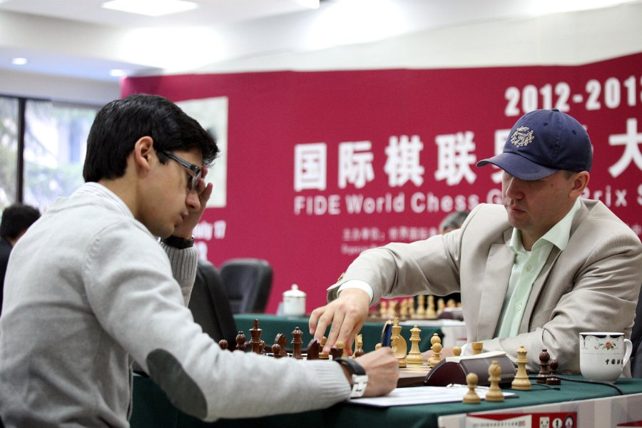

```pgn
[Event "FIDE Grand Prix - Beijing 2013"]
[Round "5"]
[Date "19.06.2013."]
[White "Kamsky, Gata (2763)"]
[Black "Giri, Anish (2734)"]
[Result "0 - 1"]

1. e4 c5 2. Nf3 d6 3. Bb5+ Bd7 4. Bxd7+ Qxd7 5. c4 Nf6 6. Nc3 g6 7. d4 cxd4 8. Nxd4 Bg7 9. f3 O-O 10. Be3 Rc8 11. b3 a6 12. Rc1 Nc6 13. a4 e6 14. O-O d5 15. Nxc6 bxc6 16. a5 Qe7 17. Na4 dxe4 18. Nb6 Rd8 19. Qe2 Rab8 20. Kh1 exf3 21. Rxf3 Ng4 22. Bg1 Ne5 23. Rff1 c5 24. b4 cxb4 25. c5 Qb7 26. Rfd1 Nc6 27. Qf3 Qc7 28. h3 Be5 29. Qb3 Rxd1 30. Rxd1 Rd8 31. Rf1 Nd4 32. Qxb4 Nf5 33. Rb1 Ng3+ 34. Kh2 Bd4 35. Bxd4 Rxd4 36. Qe1 Ne4+ 37. Kh1 Qxc5 38. Rc1 Qg5 39. Kg1 Kg7 40. Nc4 h5 41. Ne3 Rd3 42. Nf1 Nd2 43. Kh1 Rxh3+ 0-1
```
