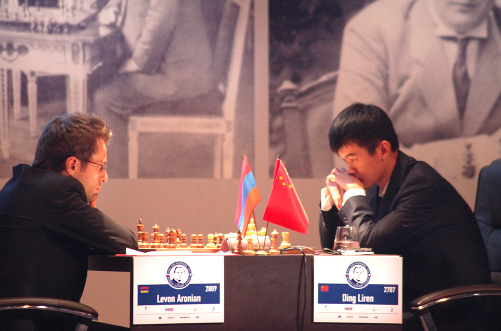

```pgn
[Event "Aljehinov memorijal 2013"]
[Round "1"]
[Date "21.04.2013."]
[White "Ding, Liren (2707)"]
[Black "Aronian, Levon (2809)"]
[Result "1-0"]

1. d4 d5 2. c4 c6 3. Nf3 Nf6 4. Nc3 a6 5. e3 e6 6. c5 Nbd7 7. b4 b6 8. Bb2 a5 9. a3 Be7 10. Bd3 O-O
11. O-O Ba6 12. Ne1 Bc4 13. Bxc4 dxc4 14. Qe2 Rb8 15. Ra2 b5 16. e4 Rb7 17. Nc2 Nb8 18. Raa1 Qc8 19. Rad1 Rd8 20. Bc1 Na6
21. Bf4 Rbd7 22. h3 Ne8 23. Qe3 Bf6 24. e5 Be7 25. Ne4 Nac7 26. Nd6 Qa8 27. Qg3 Nd5 28. Ne3 Nc3 29. Rde1 Bxd6 30. exd6 Ne4
31. Qh4 Nd2 32. Nd5 Nxf1 33. Nb6 Qa7 34. Rxf1 Nf6 35. Be5 Nd5 36. Nxd5 exd5 37. Bxg7 Kxg7 38. Qg5+ Kf8 39. Qf6 Kg8 40. Qg5+ Kf8
41. Qf6 Kg8 42. Re1 axb4 (42...h6 43.Re3 Kh7 44.Re7 Rf8 45.Qf5+ Kg8 46.Rxd7 Qa8 47.Qg4+ Kh7 48.Qe6 Kg7 49.Qe5+ Kg6 50.bxa5 Kh7 51.Rc7 c3 52.Qf6) 43. Re5 h6 44. Rh5 Qxa3 45. Qxh6 f6 46. Qxf6 1-0
```
