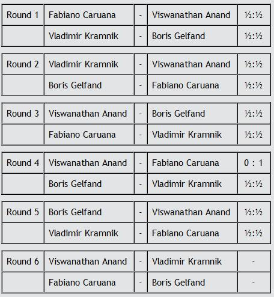

Igra se šesto kolo *Zurich Chess Chelange 2013*. Rezultati:



Dosad jedina odlučena partija je ona između **Ananda** i **Carune**, iz četvrtog kola.

```pgn
[Event "Zurich Chess Chelange 2013"]
[Round "4"]
[Date "27.02.2013."]
[White "Anand, Viswanathan (2780)"]
[Black "Caruana, Fabiano (2757)"]
[Result "0-1"]
1. e4 e5 2. Nf3 Nc6 3. Bb5 a6 4. Ba4 Nf6 5. O-O b5 6. Bb3 Bc5 7. c3 d6 8. d4 Bb6 9. Be3 O-O 10. Nbd2 h6 11. h3 Re8 12. Re1 Bd7 13. Bc2 Rb8 14. Rc1 Nh7 15. Bd3 Qf6 16. Nb3 Nf8 17. Kh2 g5 18. d5 Ne7 19. c4 Bxe3 20. Rxe3 c5 21. dxc6 Bxc6 22. Kg1 Nfg6 23. Nfd2 Nf4 24. Bf1 Bd7 25. c5 Red8 26. Qe1 Nc6 27. Nf3 d5 28. exd5 Nxd5 29. Rxe5 Nxe5 30. Qxe5 Be8 31. Na5 Qxe5 32. Nxe5 Ne7 33. a3 Rbc8 34. Nd3 Nc6 35. Nb7 Rd4 36. Nd6 Rd8 37. Re1 Bd7 38. g4 Be6 39. Re3 Kf8 40. b4 Ne7 41. Bg2 Nc8 42. Nxc8 Bxc8 43. Ne5 Re8 44. Rd3 Rxd3 45. Nxd3 Re2 0-1
```
