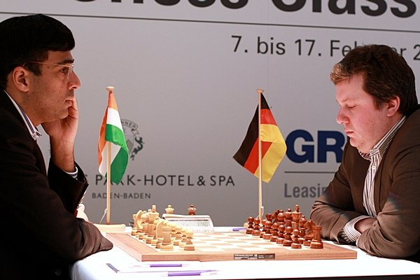

Jedina odlučena partija petog kola:

```pgn
[Date "11.02.2013."]
[White "Anand, V. (2779)"]
[Black "Naiditsch, A. (2723)"]
[Result "1-0"]1. e4 e5 2. Nf3 Nc6 3. Bb5 Nf6 4. d3 d6 5. c3 Be7 6. Nbd2 O-O 7. Nf1 Re8 8. Ng3 Bf8 9. O-O Bd7 10. h3 h6
11. Re1 Ne7 12. Bxd7 Qxd7 13. d4 Ng6 14. c4 c5 15. d5 b5 16. cxb5 Qxb5 17. Qc2 Nd7 18. Nd2 Nf4 19. Re3 g6 20. a4 Qa6
21. a5 Rab8 22. Nc4 Rb4 23. b3 Reb8 24. Bd2 R4b5 25. Ra3 h5 26. h4 Nf6 27. Nf1 Bh6 28. Re1 Kh7 29. g3 Qc8 30. f3 Qh3
31. gxf4 Qxf3 32. Qd1 Qh3 33. fxe5 Rxb3 34. Rxb3 Rxb3 35. exf6 Rf3 36. Qe2 Bxd2 37. Ncxd2 Rf4 38. Qh2 1-0
```

Poredak nakon petog kola:

<table><tbody><tr><td>#</td><td>Ime</td><td>Zemlja</td><td>Rating</td><td>Bodovi</td></tr><tr><td>1</td><td><strong>Caruana, Fabiano</strong></td><td>ITA</td><td>2757</td><td>3½</td></tr><tr><td>2</td><td><strong>Anand, Viswanathan</strong></td><td>IND</td><td>2780</td><td>3</td></tr><tr><td>3</td><td><strong>Fridman, Daniel</strong></td><td>GER</td><td>2667</td><td>2½</td></tr><tr><td>4</td><td><strong>Naiditsch, Arkadij</strong></td><td>GER</td><td>2716</td><td>2½</td></tr><tr><td>5</td><td><strong>Adams, Michael</strong></td><td>ENG</td><td>2725</td><td>2</td></tr><tr><td>6</td><td><strong>Meier, Georg</strong></td><td>GER</td><td>2640</td><td>1½</td></tr></tbody></table>
