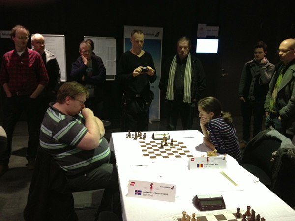

  
Ne, nećemo analizirati ovu partiju, samo nam se svidjela fotografija :). Desno je [L’ami Alina](http://www.alinalami.com/p/about-me.html "Official website of Alina l'Ami") (WGM) protiv Ragnarsson Johanna, kako u konačnici lovcem i skakačem ganja protivničkog kralja. Uspjela je, ali joj je trebalo 43 poteza. Kažu da je bilo gusto 😉

Dobro bi bilo ponovit malo taj mat, a? 🙂
