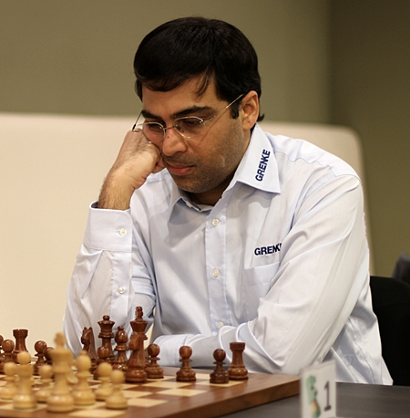

Od 7. do 17. veljače 2013 u Baden-Badenu, u *Schachzentrum Baden-Baden (Baden-Baden šahovskom centru), po prvi puta* održava se velemajstorski turnir kategorije 19. Igra se po Bergerovom sistemu (svatko sa svakim), ukupno 6 natjecatelja, a sudjeluju: **Viswanathan Anand** (na slici desno) – svjetski prvak (Indija), **Fabiano Caruana** (Italija), **Michael Adams** (Engleska), **Arkadij  Naiditsch** (Njemačka), **Daniel Fridman** (Njemačka), **Georg Meier** (Njemačka).

Saznati više i/ili pogledati *livestream* mečeva možete na [službenoj stranici turnira](http://www.grenkechessclassic.de/en).
