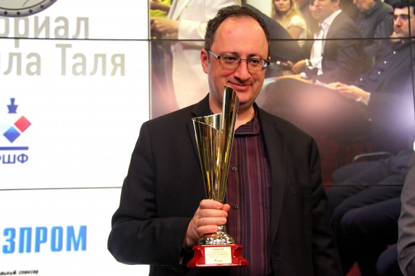

| Mjesto |  |  |  | 1 | 2 | 3 | 4 | 5 | 6 | 7 | 8 | 9 | 10 | Bodovi |
| --- | --- | --- | --- | --- | --- | --- | --- | --- | --- | --- | --- | --- | --- | --- |
| 1 | Gelfand | 🇮🇱 | 2755 |  | ½ | 1 | ½ | ½ | 1 | ½ | 1 | ½ | ½ | 6 |
| 2 | Carlsen | 🇳🇴 | 2864 | ½ |  | 0 | ½ | ½ | 1 | ½ | ½ | 1 | 1 | 5½ |
| 3 | Caruana | 🇮🇹 | 2774 | 0 | 1 |  | ½ | ½ | 0 | ½ | 1 | 1 | ½ | 5 |
| 4 | Mamedyarov | 🇦🇿 | 2753 | ½ | ½ | ½ |  | ½ | 1 | ½ | ½ | ½ | ½ | 5 |
| 5 | Andrejkin | 🇷🇺 | 2713 | ½ | ½ | ½ | ½ |  | ½ | ½ | ½ | ½ | 1 | 5 |
| 6 | Nakamura | 🇺🇸 | 2784 | 0 | 0 | 1 | 0 | ½ |  | 1 | 0 | 1 | 1 | 4½ |
| 7 | Karjakin | 🇷🇺 | 2782 | ½ | ½ | ½ | ½ | ½ | 0 |  | ½ | ½ | ½ | 4 |
| 8 | Morozovich | 🇷🇺 | 2760 | 0 | ½ | 0 | ½ | ½ | 1 | ½ |  | 0 | ½ | 3½ |
| 9 | Anand | 🇮🇳 | 2786 | ½ | 0 | 0 | ½ | ½ | 0 | ½ | 1 |  | ½ | 3½ |
| 10 | Kramnik | 🇷🇺 | 2803 | ½ | 0 | ½ | ½ | 0 | 0 | ½ | ½ | ½ |  | 3 |

Nakon što je **Nakamura** – vodeći nakon šest kola – upropastio sjajnu poziciju lošom izvedbom u posljednja tri kola (0/3), **Gelfand** je iskoristio svoju šansu. Odlučujuće je bilo što je u šestom kolu kao bijeli izvukao častan remi protiv **Carlsena** koji mu nikako ne leži (gubio je od njega na *Tata Steel* (2012), *Turnir kandidata* (2013) o.a.) i što je pobjedio **Nakamuru,** direktnog suparnika za prvo mjesto u sedmom kolu. Zatim je s dva remija protiv **Mamedyarova** i **Kramnika** samo potvrdio odličan nastup.

Dolaze mlade snage – drugo mjesto zauzeo je **Carlsen** sa solidnih 5½, a treće **Caruana** s 5 bodova, koliko imaju i **Mamedyarov**, jedini neporaženi igrač na ovom turniru uz Gelfanda (4. mjesto) i prvak Rusije **Andrejkin** (5. mjesto). S druge strane, veterani (**Anand**, **Kramnik**) su podbacili na ovom turniru zauzevši posljednja dva mjesta.
