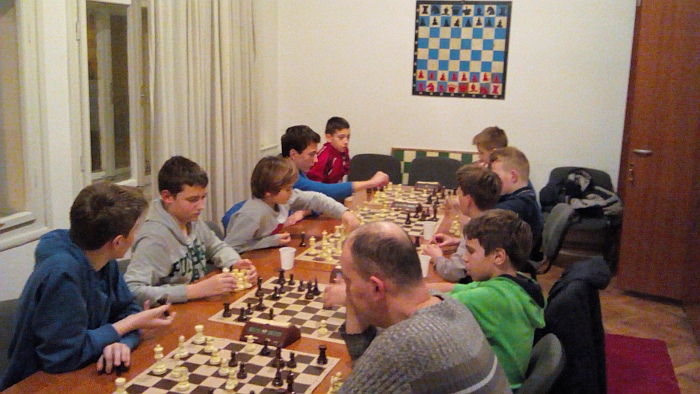

Jučer je u Klubu odigran turnir u cugeru, prema strogim pravilima “taknuto – maknuto”, “nemoguć potez – izgubljena partija”, a najvažnija stvar vezana za ovaj turnir jest da je odigran u organizaciji natjecatelja! Bruno je igrao, čitao parove i zapisivao rezultate, tj. bio je glavni voditelj turnira. Roditelji nisu nikoga odveli prije kraja turnira, tako da su svi odigrali po devet partija. Hvala i Borisu što im se pridružio jer je svim kadetima on i dalje veliki izazov!  
Bez obzira na rezultate, i dalje su najjači i najzreliji igrači Ivan i Vraneša jer se oni više ne ljute ako im dam kakav savjet ili pak pomognem protivniku za vrijeme partije. Ostalima je pobjeda i dalje najvažnija pa tako otpada edukativni dio mog petljanja u partije. 🙂  
Molim kadete da sljedeći petak svi vrate školske iskaznice kako se ne bi zagubile do sljedećeg turnira, također podsjećam roditelje koji još nisu dostavili sve potrebne dokumente za izradu klupskih iskaznica ili podatke za kontakt (mlađi kadeti) da je krajnje vrijeme da to učine. Sljedeći petak posljednji je ovogodišnji termin šahovske škole, nadam se da neće biti neopravdanih izostanaka. Cure znaju na koga se to odnosi. 🙂  

| R.br. | Ime | 1. | 2. | 3. | 4. | 5. | 6. | 7. | 8. | 9. | 10. | Bod |
| --- | --- | --- | --- | --- | --- | --- | --- | --- | --- | --- | --- | --- |
| 1. | Bruno | \* | 1/2 | 1 | 1 | 1 | 0 | 0 | 1 | 0 | 1 | 5.5 |
| 2. | Božo | 1/2 | \* | 1/2 | 0 | 1 | 0 | 1 | 1 | 0 | 1 | 5 |
| 3. | Kljujev | 0 | 1/2 | \* | 0 | 1 | 0 | 0 | 1 | 0 | 1 | 3.5 |
| 4. | Filip | 0 | 1 | 1 | \* | 1 | 0 | 0 | 1 | 0 | 1 | 5 |
| 5. | Vraneša | 0 | 0 | 0 | 0 | \* | 0 | 0 | 1 | 0 | 1 | 2 |
| 6. | Ivan | 1 | 1 | 1 | 1 | 1 | \* | 1 | 1 | 1 | 1 | 9 |
| 7. | Luka | 1 | 0 | 1 | 1 | 1 | 0 | \* | 1 | 0 | 1 | 6 |
| 8. | Stipe | 0 | 0 | 0 | 0 | 0 | 0 | 0 | \* | 0 | 0 | 0 |
| 9. | Boris | 1 | 1 | 1 | 1 | 1 | 0 | 1 | 1 | \* | 1 | 8 |
| 10. | Luka Fran | 0 | 0 | 0 | 0 | 0 | 0 | 0 | 1 | 0 | \* | 1 |
