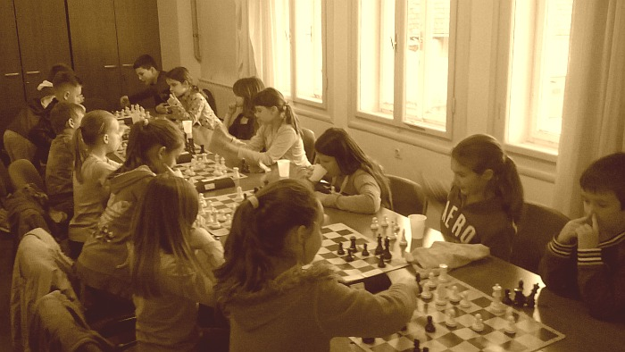
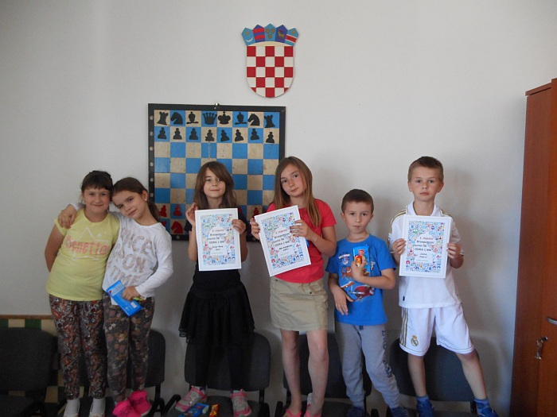

U četvrtak 26. svibnja 2016. u klupskim prostorijama igrat će se mješoviti brzopotezni turnir za mlađe kadete (do četvrtog razreda), članove Kluba.  
Turnir počinje u 14 sati.  
Očekivani završetak turnira je u 16.15.

darko

---

*26\. svibnja 2016.*  
Danas su mlađi kadeti odigrali turnir u  brzopoteznom šahu. Nadam se, samo jedan u nizu jer se vidi potreba da kadeti nauče i brže igrati i pravilno reagirati pod stresom, odnosno u vremenskom tjesnacu. Bilo im je svima teško, a čak se ni Luka, koji je znatno ispred ostalih, nije pokazao dovoljno dobrim u nekim situacijama. Lorusso pokazuje dobar napredak i začudnu smirenost, mala Ana još nema koncentraciju, ali zato prilično zdravo razvija figure, Dora još ne poštuje vrijednost figura, Katarina ima žicu, ali joj je krajnje vrijeme da počne i učiti (njezine klupske kolegice Anđela, Monika i Ana već su počele, a ona je uz njih trenutačno najvjerojatniji četvrti član školske ekipe sljedeće godine), Hana zasad napreduje najbrže u svojoj generaciji, a kako doma nema ravnopravnog protivnika (pobjeđuje mamu!), morat ćemo je naučiti igrati protiv računala. Luka u šahovsku školu ide s višićima jer je prejak za niže razrede, ali je danas pokazao dosta nesigurnosti u realizaciji te gotovo ostao bez prvog mjesta u meču protiv Katarine. Možda mu protivnici nisu bili dovoljan izazov.  
U svakom slučaju, ovi su kadeti odigrali još deset partija, **Luka** je osvojio zlatnog slona, **Katarina** srebrnoga, a **Hana** brončanoga. Čestitke svima na fer igri, a pobjednicima na ostvarenom rezultatu!

  
darko
