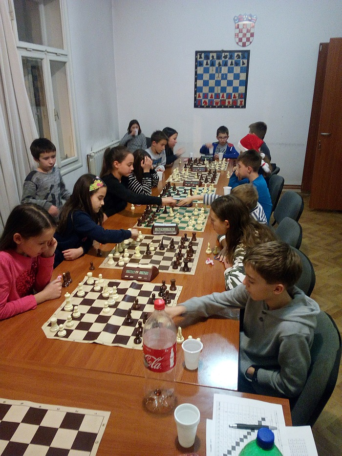
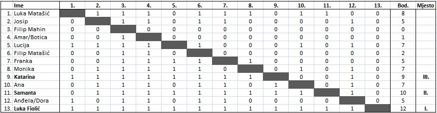
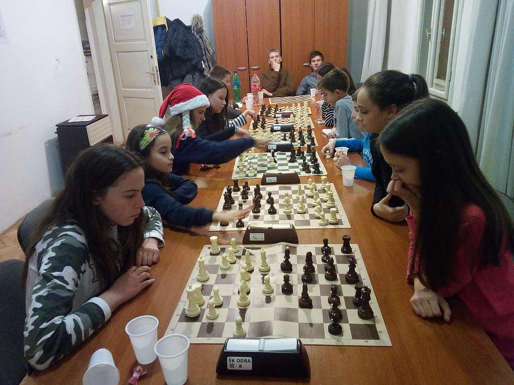
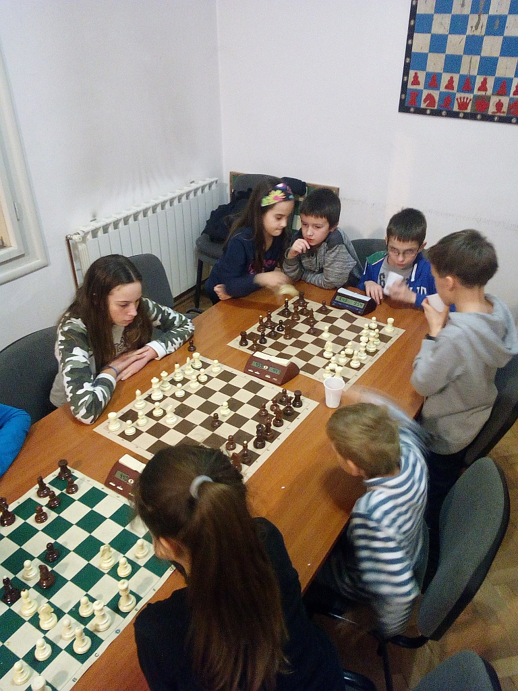
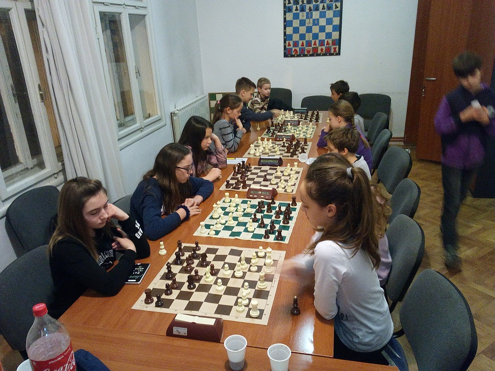
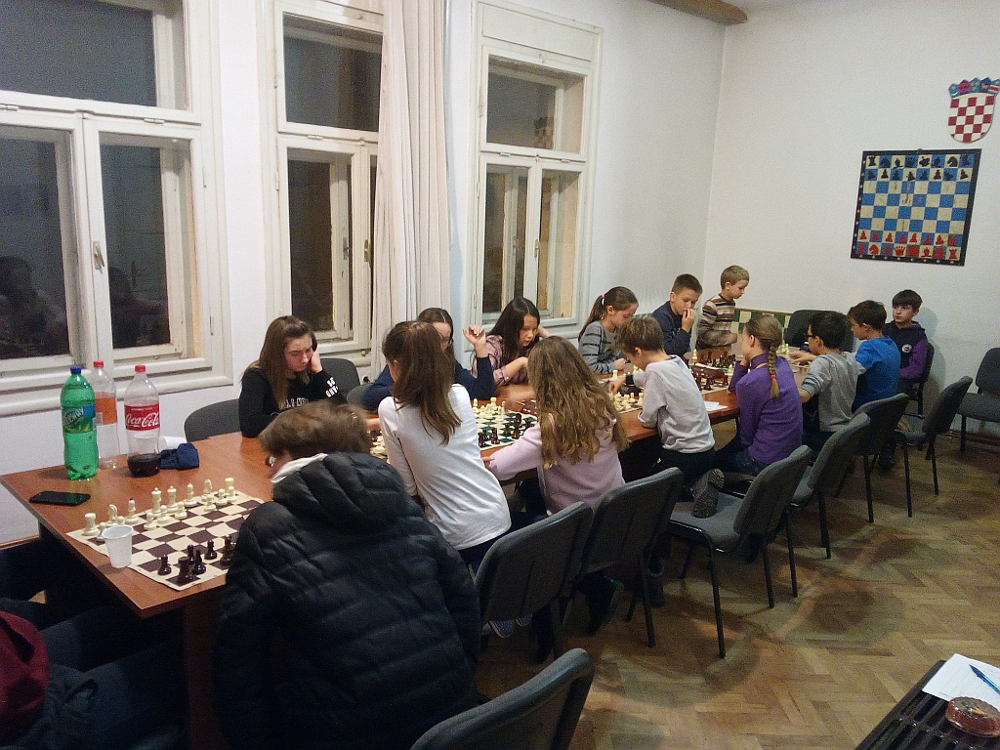

**K**ako sam primjetio da se dosta klinaca ne snalazi u vremenskom tjesnacu, odigrali smo jedan brzopotezni turnir na pet minuta (5+0). To im je najteže za igrati, jer još uvijek nemaju rutinu niti stignu naći ideju u poziciji. Cuger na pet minuta nema neku edukativnu svrhu, ali im može pomoći da malo uvježbaju reakcije kada se u ozbiljnoj partiji nađu u cajtnotu. Najkritičniji su Monika te Luka i Filip Matašić. Vjerujem da im je ovaj turnir barem malo pomogao. Većina školskih natjecanja, kao i drugih turnira za najmlađe, igra se po prilično ubrzanom tempu, a neki naši vrlo dobri šahisti i šahistice se tu baš ne snalaze. Turnir smo odigrali u dva petka, a igralo se po striktnim pravilima, taknuto-maknuto, kao i gubitak partije na prvi nemogući potez. Jučer se nisu pojavili Amar i Anđela pa su ih zamijenili Botica i Dora.  Luka Fiolić je jučer zakasnio na prvo kolo, umjesto njega je jednu partiju odigrao Vraneša, a Luka je u strahu od gubitka boda hrabro slagao da je tati krepao akumulator. 🙂  
**U** klub su nam odnedavna počeli dolaziti Filip Mahin i Lucija Botica. Očekivano, oni su na kraju bili na začelju, ali mislim da su dosta dobro podnijeli ovo natjecanje. Nadam se da će biti dovoljno uporni, ubrzo naučiti osnove i već za godinu dana ukrasti koji bod iskusnijim protivnicima. Stariji i lukaviji klinci su otkrili da postoje i [aplikacije](https://play.google.com/store/apps/details?id=com.chessking.android.learn.schoolforbeginners&hl=en) za android u kojima mogu učiti i/ili ponoviti osnovne matove (mat damom, mat topom) kao i osnovne završnice, kralj i pješak protiv kralja i slično. Možda je to dobra ideja i za ove koji tek počinju.  
**A**mar ima potencijala, ali je prilično neredovit. S Lukom Matašićem i Frankom se najmanje radi, ali Luka ima talent, a Franka koncentraciju i upornost pa su ostvarili lijep rezultat. Luka ima osam godina, a Franka (još uvijek) deset. Morat ćemo angažirati nekoga od starijih učenika da s njih dvoje rade i individualno na šahu pa će im rezultati biti još i bolji. Ukoliko Luka Matašić nađe vremena, jer je prilično aktivan i u nogometu. Vrlo dobru igru po ovom tempu pokazali su Luka Fiolić, Lucija, Samanta i Katarina. Luka jer dosta igra sa starijima, Lucija jer ima talent, Samanta zbog trenutačno  najozbiljnijeg pristupa, a Katarina bi mogla i više od pokazanoga. Monika je pokazala mali napredak, ali joj je i dalje teško donositi odluke o kojima nije dovoljno promislila. Ana je završila s istim brojem bodova  kao i Monika i Lucija, a prije mjesec dana na trening turniru na sporiji tempo, 10+0, bila je uvjerljivo najbolja.  
**I**za Nove godine nastavljamo s pripremama za skorašnje Prvenstvo osnovnih škola Grada Zagreba.

   
