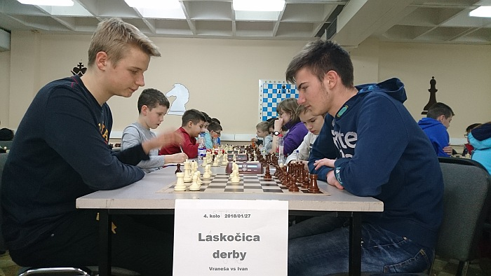
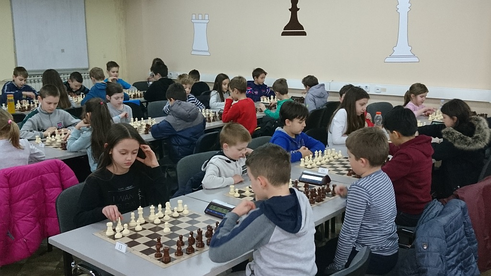
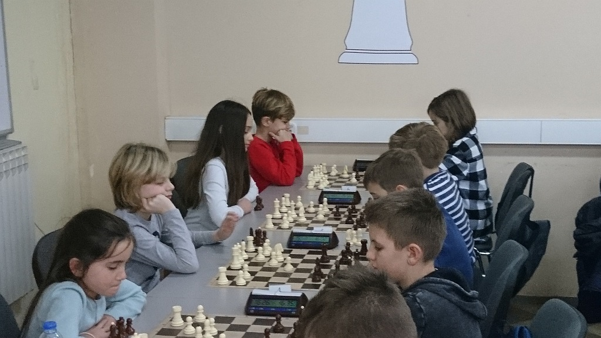

  
Sve pohvale za trud i organizaciju Zagrebačkom šahovskom savezu, koji je u suradnji sa ŠK Caissa i ove godine nastavio s organizacijama kadetskih turnira, koji su i više nego dobro došli za razvoj mladih šahista i šahistica. Može se reći da je turnir i dobro tempiran, jer im uskoro počinju ekipna školska prvenstva kao i pojedinačna prvenstva Zagreba. Tako je ovaj vikend odigran turnir pod nazivom Caissina čizmica, podijeljen u dvije kategorije, U16 i U12, a tempo igre bio je 15+10. Želja mi je bila da na turniru nastupe svi članovi školskih ekipa, pa iako nisu svi nastupili, zadovoljan sam odzivom.

Rezultati:  
[U16](http://chess-results.com/tnr328884.aspx?lan=13&art=1&rd=7&fed=CRO&wi=821)  
1.  II Karlušić Luka   1886 ŠK Caissa, Zagreb 6,5  
2.  II Maravić Ivan   1912 ŠK Odra, Zagreb  5,5  
3\. IV Šeremešić Sanjin   1714 ŠK Brestje, Sesvete 5,5

1.  IV Kaplan Astrid   1624 ŠK Caissa, Zagreb 3,5  
2\. VK Kolovrat Ana   1600 ŠK Odra, Zagreb  3,0  
3.  VK Halužan Samanta   1616 ŠK Odra, Zagreb  2,0

[U12](http://chess-results.com/tnr328909.aspx?lan=13&art=1&rd=7&fed=CRO&wi=821)  
1\. I Putar Lara  1787 ŠK Srebro, Zagreb  6,0  
2\. VK Car Jura 1663 ŠK Ban Jelačić, Zaprešić 6,0  
3\. IV Rukavina David   1732 ŠK Sljeme-Agroproteinka, Sesvete 6,0

1\. III Weygand Nora   1653 ŠK Caissa, Zagreb 4,0  
2\. VK Katić Gabriel  1628 ŠK Ericsson-Nikola Tesla, Zagreb 4,0  
3\. VK Vukmirović Rita   1600 4,0

Među vukove, tj. u grupu starijih kadeta, bacili smo Katarinu, Anu, Smanatu i Amara. I nisu se baš snašli. Ne računajući međusobne bodove, samo je Ana uspjela osvojiti bod u ovoj konkurenciji. Ipak, cilj je ostvaren i odigrali su važne partije, protiv jakih protivnika, kao zadnju pripremu pred početak školskih natjecanja. Važna stvar je da je i Amar zaigrao na ozbiljnijem turniru i pokaže li dovoljno upornosti, nije kasno da se priključi ekipi. Stavili smo ga i na listu igrača koji će igrati za drugu kadetsku ekipu pa se nadam da će iskoristiti  priliku zaigrati i za Klub, ukoliko ga kapetan pozove. U ovoj skupini su igrali i Ivan i Vraneša, ali oni su već jaki šahisti te pripadaju u sam vrh. Čak su se i međusobno sastali u četvrtom kolu, ali su partiju prijateljski remizirali te nam uskratili podatak tko je trenutačno jači igrač po ubrzanom tempu. Za njih je kobno bilo šesto kolo kada su izgubili od direktnih konkurenata te je Ivan na kraju osvojio drugo mjesto, a Vraneša peto.

U mlađoj skupini nastupili su Lucija (4), Monika (3,5), Filip (3), Dora (2,5), Luka Matašić (2), Botica (2) i Roko (1). Luka nije imao svoj dan, vjerojatno je u mislima bio na nogometu. Tako je prilično podbacio iako je jači igrač od većine koja se ovaj puta našla ispred njega. To je iskoristio i Filip i pobijedio u bratskom okršaju te na kraju skupio respektabilna tri boda. U sestrinskom okršaju između Monike i Lucije, zabilježen je prijateljski remi. Botica je skupila dva boda, dva boda više od očekivanog rezultata, obzirom da joj je ovo bio prvi službeni nastup. I više nego pohvalno. Od Roka uskoro očekujem više, naročito petkom kada obično odluta na igralište. A vjerujem da će odigrati i skorašnje pojedinačno prvenstvo Zagreba. Dora se opet nekako izvukla i napravila pristojan rezultat. U posljednje vrijeme razvukla je svoje obveze na više strana i ne posvećuje se šahu dovoljno da bi napredovala kako se to od nje očekuje. Lucija je napravila najbolji rezultat zahvaljujući dobrom finišu te završila na 17. mjestu. Sa pola boda manje, Monika je završila turnir na 18. mjestu. Moniku je samo pobjeda u posljednjem kolu dijelila od postolja, ali nije uspjela. Nije toliko bitno, koliko je bitno da je u formi za nadolazeće školsko prvenstvo.  
  
