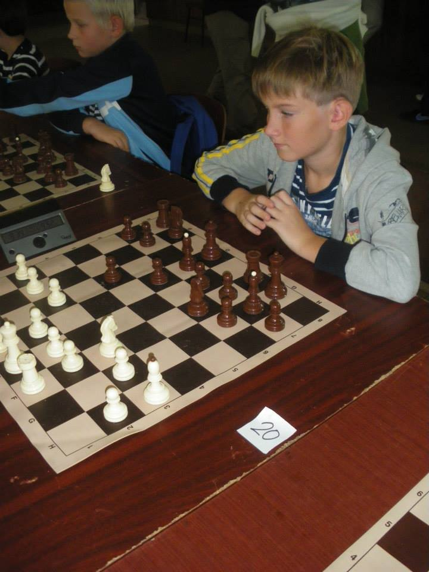

Cvetković Božo, Maravić Ivan, Novak Bruna i Vraneša Ivan (abecednim redom, bez “dame imaju prednost” 😉 ) nastupili su na ***X. memorijalu Gorana Majića –** kadeti do 11 godina.*

Konačan poredak pogledajte [ovdje](http://chess-results.com/tnr109662.aspx?art=1&lan=1&wi=821 "ŠK Odra na X. Memorijalu Gorana Majića - kadeti do 11 godina"), a fotke na [Facebook stranici](https://www.facebook.com/sahovskiklub.ivandvorzak/media_set?set=a.525144827550573.1073741915.100001651808272&type=1 "Facebook: Ivan Dvoržak 10. mem. Gorana Majića") kluba domaćina, gdje možete saznati više i o samom turniru (samo ako ste logirani u svoj FB acc).
