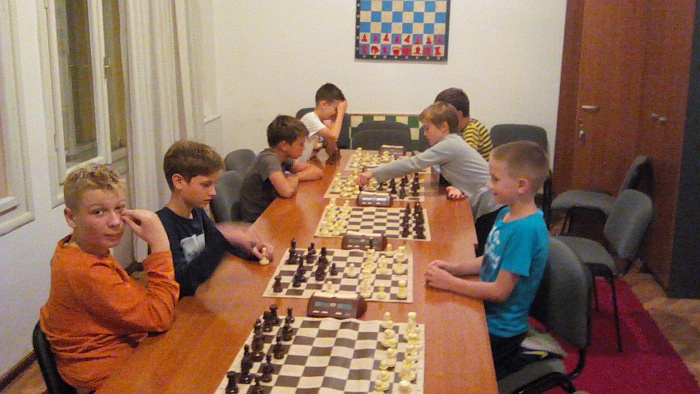
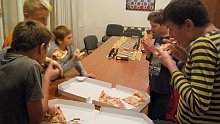

Već nas polako zamjenjuju…

U petak su stariji kadeti (i Luka, koji se opasno nameće prvoj ekipi…) odigrali cuger. Božo ih je počastio pizzom u povodu svog rođendana. Ivan je za to vrijeme remizirao u petom kolu prvenstva Europe u Poreču. Rezultati su zanimljivi, ali još se ne vidi jasno tko, osim standardnih Ivana, Brune, Bože i Vraneše, upada u prvu postavu. Vjerojatno će tako i biti dok ne odigraju klupsko prvenstvo s malo ozbiljnijim tempom. Uvjerljivo je pobijedio Bruno, a imao je problema samo s Kljujevom (tada je Božo pomogao Bruni savjetom, iako zna da je to strogo zabranjeno, i tako sam sebe eliminirao iz borbe za prvo mjesto). Kljujev mu je oprostio samo zato što mu je rođendan! 🙂 Bruno se neobično uozbiljio, i u igri i u ponašanju. Sve pohvale za ovaj rezultat i ponašanje koje bi trebalo biti primjer i ostalima. Luka Fran malo je loše počeo turnir s tri izgubljene, ali se poslije sabrao. On se prihvatio mnogo drugih aktivnosti pa se vidi da je počeo mrvicu kasniti za ostalima.  Zločest je bio samo mali Luka, ali s obzirom na godine, dečki ga toleriraju. :))) Očekujem da će uskoro ovakve turnire i sami organizirati i igrati bez nadzora nas starijih.  

| R.br. | Prezime i ime | 1. | 2. | 3. | 4. | 5. | 6. | 7. | Bod | Mjesto |
| --- | --- | --- | --- | --- | --- | --- | --- | --- | --- | --- |
| 1. | Vraneša, Ivan | \* | 0 | 0 | 1 | 1 | 1/2 | 1 | 3,5 | 3. |
| 2. | Cvetković, Božo | 1 | \* | 1 | 1 | 0 | 1/2 | 1 | 4,5 | 2. |
| 3. | Odak, Stipe | 1 | 0 | \* | 0 | 0 | 1 | 0 | 2 | 4. |
| 4. | Fiolić, Luka | 0 | 0 | 1 | \* | 0 | 1 | 0 | 2 | 4. |
| 5. | Kolovrat, Bruno | 0 | 1 | 1 | 1 | \* | 1 | 1 | 5 | 1. |
| 6. | Kovačević, Luka Fran | 1/2 | 1/2 | 0 | 0 | 0 | \* | 1 | 2 | 4. |
| 7. | Kljujev, Ivan | 0 | 0 | 1 | 1 | 0 | 0 | \* | 2 | 4. |
