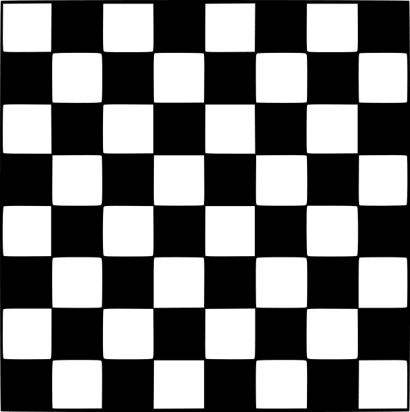
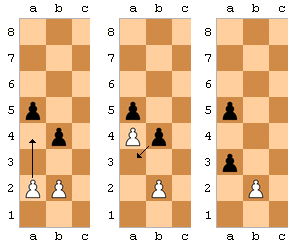
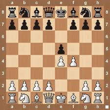

## Šahovski kviz

  

*Šahovska pravila, šahovska otvaranja, problemi..*

**1.** Koliko **polja** ima šahovska ploča?

- a) 60
- b) 64
- c) 100
- d) 46

Rješenje

b) 64

**2.** Kako se zove ovo otvaranje? **1. d4 d5 2. c4**

- a) Kraljev gambit
- b) Damin gambit
- c) Carev gambit
- d) Babin gambit

Rješenje

b) Damin gambit

**3.** **En passant** je:

- a) Neko jelo.
- b) Uzimanje pješaka u prolazu.
- c) Oznaka za cajtnot na francuskom.
- d) Igranje pješakom za dva polja naprijed.

Rješenje

b) Uzimanje pješaka u prolazu.

**4.** Želimo igrati **kraljev gambit**. Koji potez slijedi nakon **1. e4 e5** ?

- a) d4
- b) c4
- c) f4
- d) b4

Rješenje

c) f4

**5.** **Kojom rukom** moramo pritisnuti tipku na šahovskom satu za vrijeme partije?

- a) Uvijek lijevom rukom.
- b) Uvijek onom rukom koja je bliže šahovskom satu.
- c) Uvijek onom rukom kojom smo micali figuru.
- d) Lijevom, pa desnom naizmjence.
- e) Uvijek desnom rukom.
- f) Svejedno je.
- g) To nam na početku partije kaže sudac.

Rješenje

c) Uvijek onom rukom kojom smo micali figuru.

**6.** **K** je oznaka za koju figuru?

- a) Za damu.
- b) Za kralja.
- c) Za lovca.
- d) Za topa.

Rješenje

b) Za kralja.

**7.** Za šahista je **najbitnije**:

- a) Znati veliki broj šahovskih otvaranja.
- b) Računati što više poteza unaprijed.
- c) Biti bolji od svih u razredu.
- d) Razumjeti šahovsku igru i dobro se zabaviti.

Rješenje

d) Razumjeti šahovsku igru i dobro se zabaviti.

