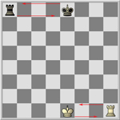
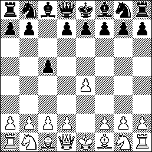

## Šahovski kviz #3

  

*Ponavljanje*

**1.** 

Rohada **nije moguća** kad...

- a) ...je napadnut kralj
- b) ...kad je napadnut top
- c) ...kad kralj prelazi preko polja koje je napadnuto
- d) ...kad top prelazi preko polja koje je napadnuto
- e) ...kad smo micali topa
- f) ...kad smo micali kralja

Rješenje

a) ...je napadnut kralj, c) ...kad kralj prelazi preko polja koje je napadnuto, e) ...kad smo micali topa, f) ...kad smo micali kralja

**2.** Ako odigramo potez bijelim pješakom sa **e2** za dva polja naprijed i zatim još za jedno polje naprijed na kojem se polju sad nalazi pješak?

- a) e4
- b) d4
- c) 5e
- d) Sd5
- e) e5

Rješenje

e) e5

**3.** Remi je situacija kad:

- a) oba protivnika imaju isti broj figura
- b) kada nema više figura na šahovskoj ploči osim kraljeva
- c) kada nema više figura na šahovskoj ploči osim kraljeva i pješaka
- d) kad je tri puta uzastopno ponovljen isti potez
- e) kada protivniku padne zastavica

Rješenje

b) kada nema više figura na šahovskoj ploči osim kraljeva, d) kad je tri puta uzastopno ponovljen isti potez

**4.** Tko je svjetski prvak u šahu?

- a) Gary Kasparov
- b) Robert Fisher
- c) Magnus Carlsen
- d) Viswanathan Anand

Rješenje

d) Viswanathan Anand

**5.** 

Otvaranje na slici je:

- a) Francuska obrana
- b) Engleska obrana
- c) Sicilijanska obrana
- d) Protugradna obrana
- e) Kraljev gambit

Rješenje

c) Sicilijanska obrana

