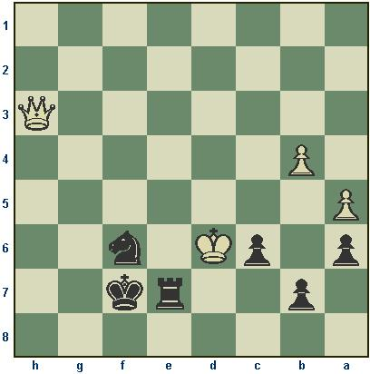
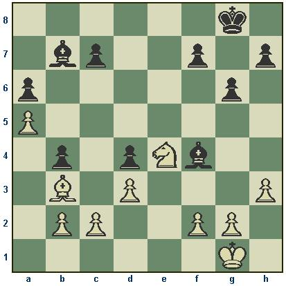

1\. Bijeli je odigrao Kd6 (iz partije Xiangzi – Nakamura, 2008). Je li to smio?  

2\. A sada će trebati malo analizirati i računati :). U poziciji na dijagramu (iz partije Grischuk – Leko, 2007) vidljivo je da bijeli može osvojiti pješaka na a6. Poslije **29\. Sc5 Lc8 30. Lc4** čini se da je crni u problemima. Međutim, postoji rješenje za crnog, to je **30.. Ld6**. Napišite varijante: kako će se crni braniti ako bijeli uzme pješaka lovcem, a kako ako ga uzme skakačem? Napišite i ono najvažnije za svaku analiziranu varijantu: ZAŠTO se crni obranio? (npr. “zato što bijeli nema dovoljno materijala”, “zato što nastaje završnica sa raznopoljnim lovcima”, “zato što je pat”, “zato što nastaje pozicija sa ponavljanjem poteza” i sl.)

P.S. Tko rješi ovaj zadatak objavit ćemo mu ime i njegovo rješenje 🙂

