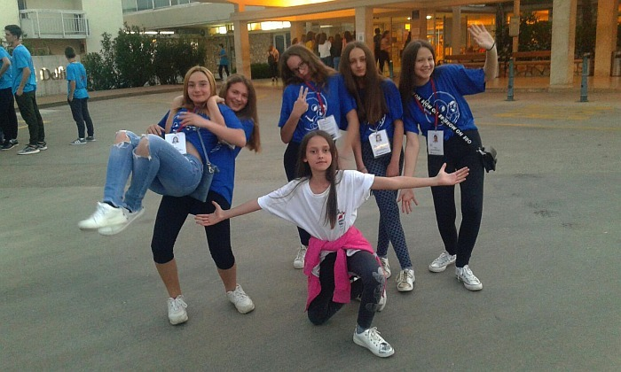
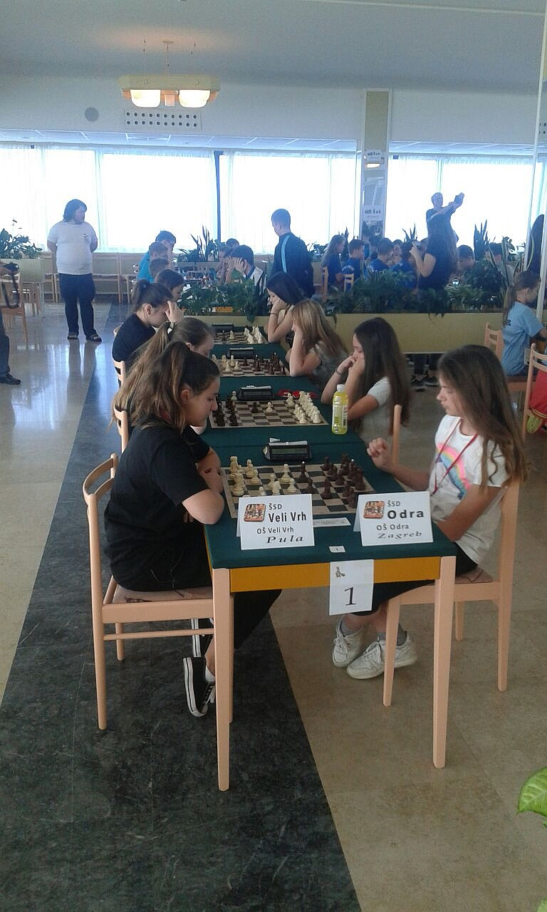

U Poreču se od danas, 22. travnja do utorka, 24. travnja održava [završnica ekipnog prvenstva OŠ](http://chess-results.com/tnr348376.aspx?lan=13&turdet=YES).  
OŠ Odra je u finalu sa još pet škola. Djevojke su danas sretno stigle, a sutra ih očekuje pet teških mečeva. Nadajmo se da će na vrijeme na spavanje, da će se zabaviti i sutra dati sve od sebe za što bolji rezultat.  
…  
23.4.2018.  
Djevojke su dobro započele turnir, pobjedom nad Pulom, zatim remijem protiv Jelse, ali su u trećem kolu doživjele neugodan poraz protiv ekipe Maruševca pokraj Varaždina. Završile su na kraju četvrte, a konačni poredak je prilično pravedan. Očekivano, pobjednice turnira sa svih pet meč-pobjeda su djevojke iz OŠ Vukovina, (MK) Trgovac Marta, (I) Trgovac Mira, (II) Jazbec Dora i (III) Kirin Ivana. Čestitke pobjednicama!  
Naše djevojke su uvidjele da “nisu daleko” od samog vrha, ali im za takav poduhvat treba još dosta rada. Za neriješen rezultat protiv prvakinja im je nedostajalo samo pola boda. Objektivno, moraju podići rejting za još barem 100 bodova, a nadam se da će to ostvariti u sljedećih godinu dana. Pristup je bio zadovoljavajući, ali svaka od njih mora riješiti svoju boljku. Ana je igrala mrvicu opreznije nego što je to njen stil, Monika se nikako nije mogla prisiliti igrati brže i gubila je partije na vrijeme, a Katarina je brzala kao da trči sprint. Samanta je dala sve od sebe i ona mora još samo podignuti kvalitetu igre.  
Ovo im je velika škola i, uspiju li i nagodinu osvojiti Prvenstvo Zagreba, mislim da će im ovo iskustvo uvelike pomoći. Djevojke je na turniru  vodio i pratio prof. Tomaško, a zahvaljujemo mu i na fotografijama. 🙂 Čestitke djevojkama iz OŠ Odra, Ani, Moniki, Katarini, Samanti, Franki i Luciji, i želimo im sretan povratak.

Poredak sa partijama

<table><tbody><tr><td>Mj.</td><td>Momčad</td><td>1</td><td>2</td><td>3</td><td>4</td><td>5</td><td>6</td><td>&nbsp;TB1</td><td>&nbsp;TB2</td><td></td></tr><tr><td><strong>1.</strong></td><td>ŠSD VUČKO, VUKOVINA</td><td>&nbsp;*</td><td>3</td><td>3½</td><td>2½</td><td>4</td><td>4</td><td>10</td><td>17,0</td><td></td></tr><tr><td><strong>2.</strong></td><td>ŠSD TOMISLAV, NAŠICE</td><td>1</td><td>&nbsp;*</td><td>3½</td><td>3</td><td>4</td><td>3</td><td>8</td><td>14,5</td><td></td></tr><tr><td><strong>3.</strong></td><td>ŠSD MARUŠEVEC, MARUŠEVEC</td><td>½</td><td>½</td><td>&nbsp;*</td><td>4</td><td>2</td><td>2</td><td>4</td><td>9,0</td><td></td></tr><tr><td>4</td><td><strong>ŠSD ODRA, ZAGREB</strong></td><td>1½</td><td>1</td><td>0</td><td>&nbsp;*</td><td>2½</td><td>2</td><td>3</td><td>7,0</td><td></td></tr><tr><td>5</td><td>ŠSD VELI VRH, PULA</td><td>0</td><td>0</td><td>2</td><td>1½</td><td>&nbsp;*</td><td>2½</td><td>3</td><td>6,0</td><td></td></tr><tr><td>6</td><td>ŠSD SOLINE, JELSA</td><td>0</td><td>1</td><td>2</td><td>2</td><td>1½</td><td>&nbsp;*</td><td>2</td><td>6,5</td><td></td></tr></tbody></table>

darko
