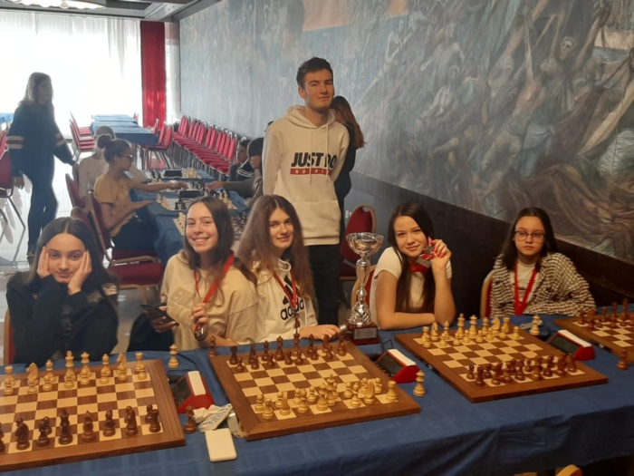
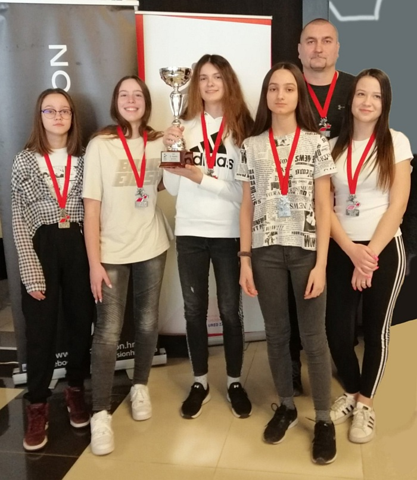
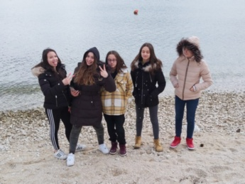
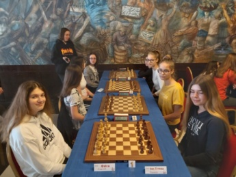

**Osvajanjem srebra** na ovogodišnjem Prvenstvu  školskih sportskih društava Republike Hrvatske, djevojke iz OŠ Odra (**Ana, Monika, Samanta, Lucija i Franka**)  potvrdile su da već godinama pripadaju u sam vrh. [Prvenstvo](https://chess-results.com/tnr512467.aspx?lan=13&art=63) je igrano uhotelu Medena u Segetu Donjem, od 5. do 6. veljače, a djevojke su igrale devet mečeva i ostvarile 8 pobjeda i jedan poraz. Zasluženi prvak je OŠ Kralja Tomislava iz Našica (Petra Vidović, Tina Gretić, Mia Dundović i Elizabeta Bernat) sa svih devet pobjeda!   Treće mjesto osvojila je OŠ G. Krklec, Maruševec (Emina Cerjan, Janja Inkret, Jelena Inkret, Marta Maloić-Surko i Tara Rušec).  
**I** prošle godine djevojke su se vratile sa srebrom, a u proteklih godinu dana ostvarile su veliki napredak u igri. Srećom po šah, i konkurencija je napredovala. Impresionirale su čvrstinom i psihičkom stabilnošću koju su pokazale u pristupu mečevima, jer im je i sam odlazak na prvenstvo bio neizvjestan do posljednjeg trenutka. Naime, čak tri igračice su imale zdravstvenih problema i bilo je upitno hoće li uopće nastupiti. A  Ana se pojavila na turniru tek u rano jutro na sam dan početka turnira.  
**A**na i Samanta su igrale nešto ispod svojih mogućnosti, ali i to je bilo više nego dovoljno da pokažu konkurenciji da su još uvijek daleko jača ekipa. Monika je odigrala cijeli turnir na vrhunskoj razini, pokazala je samo neke male nedostatke u poznavanju teorije, ali to će brzo ispraviti. Lucija je igrala vrlo čvrsto, jednu partiju je izgubila grubim previdom ali je u potpunosti zadovoljila. Franka je pobijedila što je trebala pobijediti, ali je premalo igrala da bi mogli ocijeniti njenu igru. **ČESTITAMO djevojkama na ovom velikom uspjehu!** Sada imaju godinu dana da pokušaju ostvariti sličan ili možda čak i bolji rezultat za godinu dana. Ana i Samanta postaju srednjoškolke, ali Monika, Franka i Lucija mogu podignuti svoju igru na još viši nivo, a u pomoć im stižu i sestre Fiolić.  
**D**jevojke je na turniru pratio mentor ekipe, prof. Krešimir Tomaško, a ulogu trenera imao je njihov klupski kolega Ivan Maravić.  
**R**ed je osvrnuti se i na organizaciju natjecanja. Hrvatski školski sportski savez se ove godine nije baš proslavio jer su propozicije natjecanja bile nejasne do samog kraja. Naime, nakon što su prošle godine uveli “nokaut sustav”  u ovo natjecanje i dobili brojne kritike, ove godine inzistirali su na igranju “švicarskog sustava” natjecanja, ali u nemogućim uvjetima gdje su iz natjecanja prvo izbacili 16 ekipa te je ostao premali broj ekipa, a sparivanje postalo nemoguće. Savez inzistira na provođenju pravilnika, a isti je u praksi neprovediv. Čudi me da se ne sjete potražiti savjet prije nego isti postane služben. Druga stvar, koja je djelovala vrlo ružno, bila je djelomično provedena ideja da se kvalifikacijski dio natjecanja od šest kola odigra u manje od 24 sata, bez pauze između partija i bez trenutka slobodnog vremena, kako bi se uštedjelo te većina ekipa vratila kući već drugi dan. Nažalost ili nasreću, kako se gleda, zbog lošeg vremena, dobar dio djece ostao je i drugi dan na natjecanju jer vremenski uvjeti nisu dopuštali ekspresni povratak kućama. Takvim planiranjem natjecanja gubi se onaj važni dio sporta, a to je da se djeca sportaši druže i/ili da im se barem pruži prilika da se druže i upoznaju i izvan natjecanja.

---

```pgn
[Event "Državno prvenstvo učenica OŠ 2020."]
[Site "sahovski-klub.com"]
[Date "2020.02.04"]
[Round "7"]
[White "Vinkovic Hana II 1686 OŠ I. Kozarca, Županja"]
[Black "Kolovrat Lucija IV 1622 OŠ Odra, Zagreb"]
[Result "0-1"]
[WhiteElo "1686"]
[BlackElo "1622"]
[TimeControl "-"]
[ECO "C50"]
[Opening "Four Knights Game: Italian Variation"]

1. e4 e5 2. Nf3 Nc6 3. Bc4 Bc5 4. Nc3 Nf6 5. O-O d6 6. h3 h6 7. d3 O-O 8. Be3 Bxe3 9. fxe3 Re8 10. Re1 Be6 11. Bb3 Bxb3 12. axb3 d5 13. exd5 Nxd5 14. Nxd5 Qxd5 15. e4 Qd7 16. c3 Rad8 17. Qd2 Qxd3 18. Qxd3 Rxd3 19. Rad1 Red8 20. Rxd3 Rxd3 21. Ra1 Re3 22. Nd2 Re2 23. Nc4 Rxe4 24. Ra4 f5 25. Nd2 Rxa4 26. bxa4 Kf7 27. Kf2 Kf6 28. Kf3 g5 29. g3 Ne7 30. Nc4 h5 31. Ne3 f4 32. gxf4 gxf4 33. Ng2 Kg5 34. Ke4 Ng6 35. Ne1 Kh4 36. Nf3+ Kxh3 37. Ng5+ Kg3 38. Kf5 Nh4+ 39. Kxe5 Nf3+ 40. Nxf3 Kxf3 41. Kf5 Kg3 42. Kg5 f3 43. Kxh5 f2 44. Kg6 f1=Q 45. Kg7 Qf5 46. Kg8 Qd7 47. Kf8 Kf4 48. Kg8 Kf5 49. Kf8 Kg6 50. Kg8 Qd8# 0-1
```

---

  
   
darko
