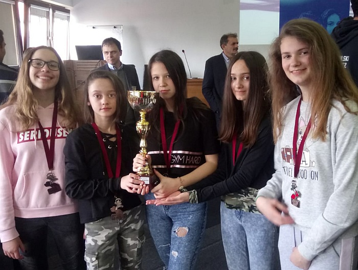
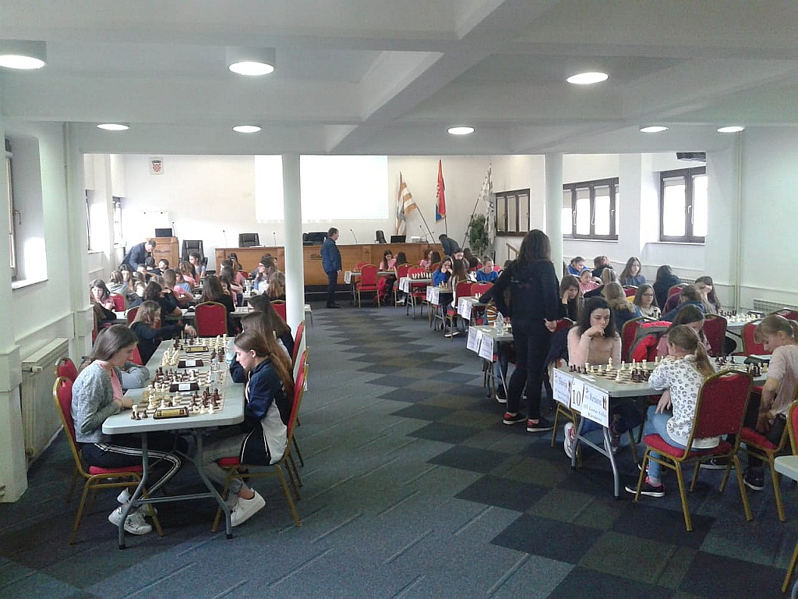
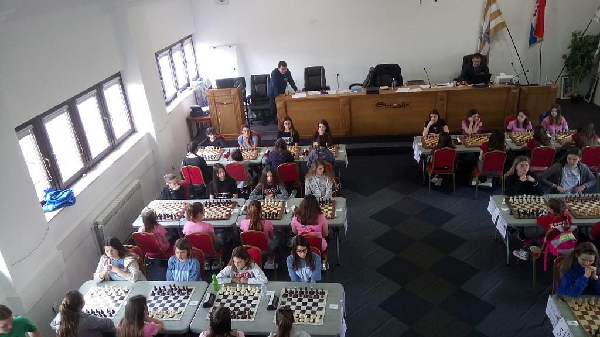
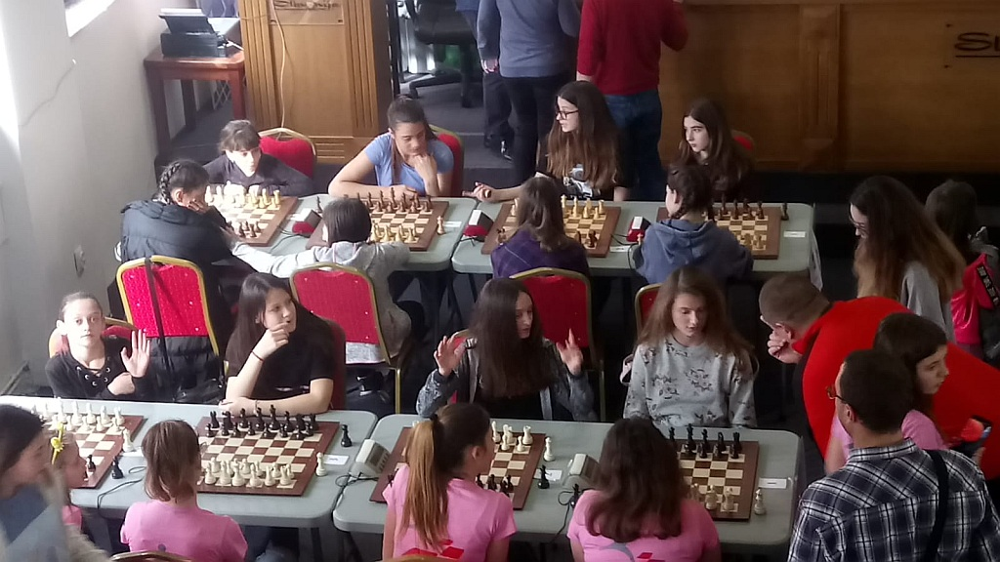
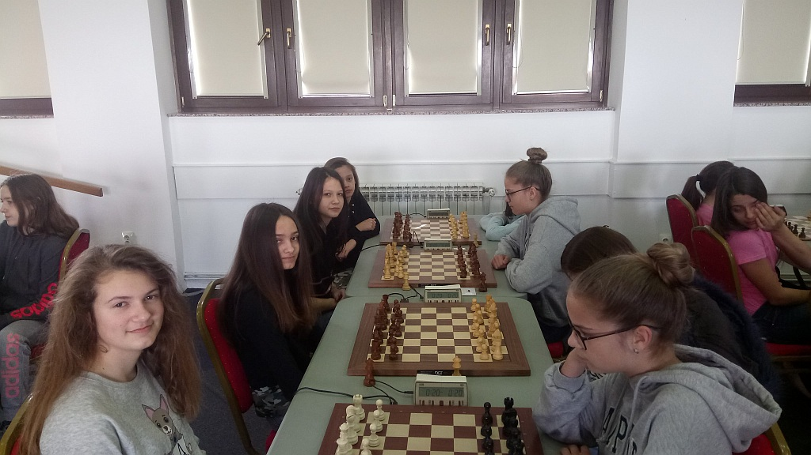
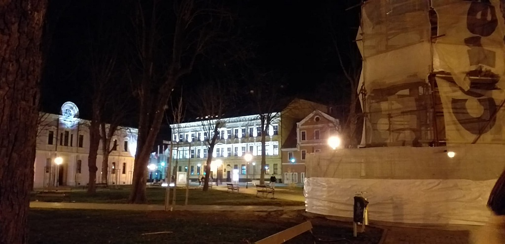
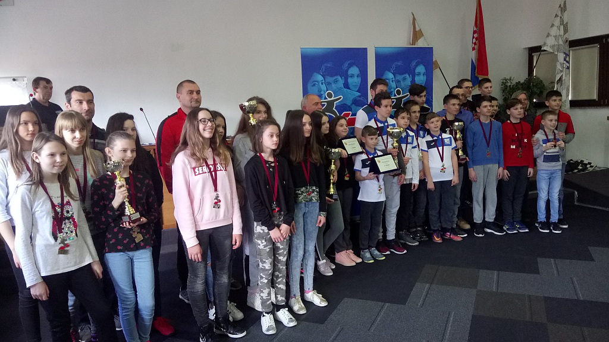
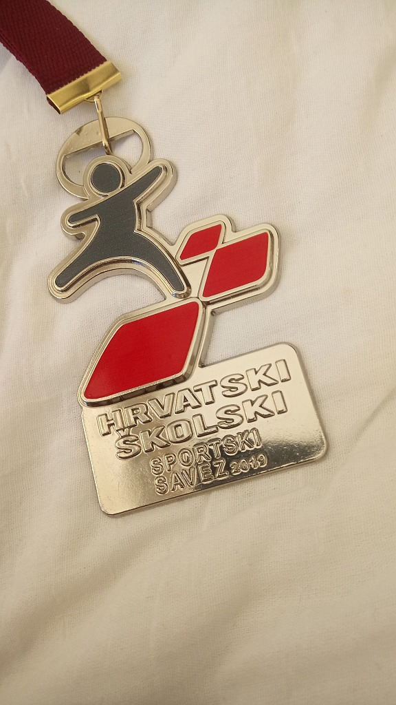
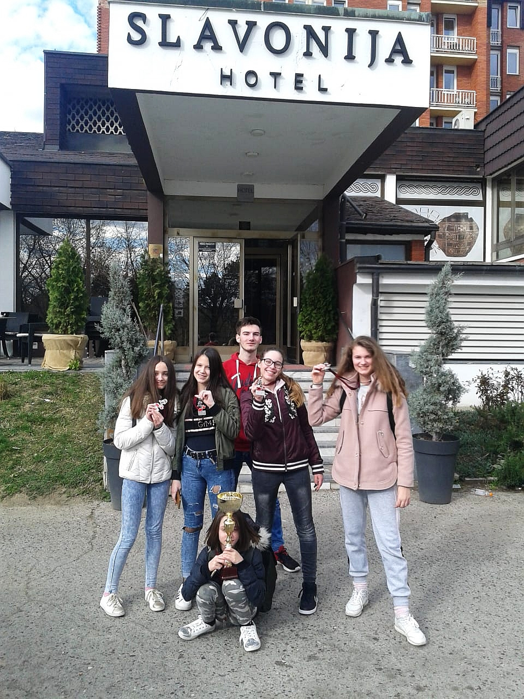

U Vinkovcima, u hotelu Slavija, od 12. do 14. ožujka odigrana je završnica Ekipnog prvenstva ŠŠD-a Hrvatske za djevojčice, a naše **cure su se vratile sa srebrom!** Za OŠ Odra nastupile su **Ana Kolovrat (K), Monika Kolovrat, Samanta Halužan, Lucija Kolovrat i Franka Kolovrat**. Učestvovale su 22. ekipe, a naše cure su bile rangirane kao četvrte po snazi. Jutro prije kvalifikacijskih mečeva, djevojke su iskoristile za kupanje, a kada su počeli mečevi, pokazale su potrebnu samouvjerenost i snagu, jer su ove godine došle ipak znatno spremnije nego [prošle](/novosti/drzavno-prvenstvo-ssd-republike-hrvatske-2017-2018-djevojcice/) kada su završile kao četvrte. Kvalifikacije su igrane na tempo 15+5, a imali smo i priliku uživo gledate sve njihove partije zahvaljujući prijenosu na internetu. U šest kvalifikacijskih mečeva ubilježile su 4 pobjede i dva remija. Remizirale su samo sa Našicama i zadnje kolo sa Jelsom. [Kvalifikacije](http://chess-results.com/tnr422625.aspx?lan=13) su završile kao druge. Osam ekipa ušlo je u četvrtfinale koje se dalje igralo na ispadanje. U četvrtfinalu i polufinalu uvjerljivo su nadigrale ekipe iz Županje i Pule. U finalu su igrale 2:2 protiv Našica te je po dodatnim kriterijima (pobjeda na višoj ploči) Našicama pripalo zlato, a naše djevojke su kući ponijele srebro! Time su završile ovogodišnji niz od 17 mečeva bez poraza. Uz ekipu na natjecanju su bili voditelj/mentor prof. Krešimir Tomaško te u ulozi trenera Ivan Maravić.  Sve djevojke pokazale su zavidan stupanj kvalitete igre kao i koncentracije. Posebno je bila impresivna Lucijina igra u kvalifikacijama. Računamo li i gradske kvalifikacije, Samanta je napravila nevjerojatan niz i rezultat, 16,5/17! U polufinalu je poklonila remi jer su već imale rezultat za prolaz. Od grubih grešaka, na cijelom natjecanju, samo su Monika i Franka imale po jednu, u petom odn. šestom kolu kvalifikacija. Monika zbog umora, a Franka ili zbog treme ili nedovoljno vježbe. Franka je jedina pokazala mrvicu nesigurnosti, ali nije kiksala niti jedan važan meč. Ana je sve odradila kako treba, a partije koje je izgubila, izgubila je zbog pogrešne strategije. To je nešto što još mora učiti. Samanta se uspjela suzdržati, a divljala je samo jednu partiju. Jednostavno, voli igrati (pre)agresivno i nekad ne pazi na obranu. :)))  
Iako su djelovale samouvjereno i kao kulerice, tek nakon što su uspješno prošle četvrtfinalni meč, osjetilo se veliko olakšanje u cijeloj ekipi. 🙂  
Djevojke, čestitamo vam!  
     
   
