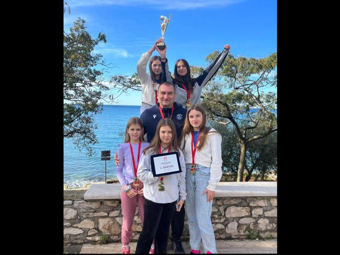
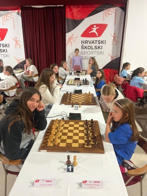
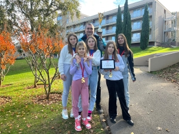

  
Vjeka Vidra, Ivana Fiolić, Lucija Fiolić, Petra Medoš, Ana Predović.  
Ova imena zapisana su zlatnim slovima u povijesnim knjigama OŠ Odra i ŠK Odra. Cure su na [Državnom školskom prvenstvu](https://chess-results.com/tnr852209.aspx?lan=1&art=63) osvojile zlato te tako postale prva ekipa Odre ikada kojoj je to pošlo za rukom!  
Natjecanje se održalo u Poreču od 20. do 22. studenoga. Tempo igre je bio 20’+5″ po potezu.   
Turnir je počeo više nego dobro za nas, prva tri jutarnja kola cure su uvjerljivo pobijedile te tako zasjele na vrh tablice. Popodnevna kola donijela su puno više napetosti i drame. U četvrtome kolu je rezultat je bio 2-2 protiv OŠ Mejaši koja ima najjače prve dvije ploče. Tada je situacija bila i dalje jako povoljna, i dalje se Odra nalazila na prvome mjestu. Iduće kolo je bilo najdramatičnije kolo prvoga dana, meč protiv OŠ Gradina je izgledao u jednome trenutku kao maksimalna pobjeda za nas, međutim, Ivana ne uspjeva realizirati materijalnu prednost, Lucija previđa mat, a Petra topa te tako gubimo meč 1,5-2,5. Zadnje kolo prvoga dana je bio remi protiv OŠ Eugena Kvaternika iz Velike Gorice. Lucija je pobijedila napetu partiju koja je mogla otići na obje strane. Vjeka lagano dobiva. Petra, najvjerojatnije od šoka prošloga poraza, ostavlja figuru u ranoj fazi partije te gubi. Zadnja je ostala Ivana koja je loše igrala do cajtnota, u kojemu je našla puno vrhunskih poteza te došla u dobivenu poziciju. Međutim, zbog stalnog manjka vremena previđa damu te gubi partiju. Tako se OŠ Odra nalazila prije zadnjeg dana i zadnja tri kola na četvrtome mjestu, meč bod manje od trećeg te dva meč boda manje od prva dva mjesta. Drugi dan su cure izašle u najpozitivnijem mogućem izdanju i s najboljim mogućim pristupom na zadnja tri kola. Sedmo kolo su dobile 3-1 te je uslijedilo osmo kolo u kojemu su igrale protiv direktnih konkurentkinja za medalju, OŠ Veli Vrh iz Pule. To je bio najdramatičniji meč, Vjeka je brzo ostavila materijal, Ivana ga osvojila i to je bilo 1-1. Ostale su Lucija s pješakom više te Petra s figurom više. Tada Petra previđa topa te situacija ne izgleda dobro, međutim, Petra počinje gurati slobodnjaka prema dami i u tome uspjeva te pobjeđuje. Nakon toga je Lucija sklopila remi kako bi osigurala meč pobjedu. Tako su se cure našle prije zadnjega kola na drugome mjestu s bodom zaostatka za OŠ Mejaši. Zadnje kolo cure dobivaju, OŠ Mejaši remiziraju te tako ih naše cure prestižu i postaju prvakinje Hrvatske! S obzirom na najveći broj pojedinačnih i ekipnih pobjeda, više nego zasluženo prvo mjesto.   
Ovo je definitivno naš najveći klupski i školski uspjeh u šahu ikada koji su cure nevjerojatnom upornošću i borbenošću za vrijeme partija izborile. Čestitke curama, kao i profesoru Tomašku koji ih je vodio, bodrio i čitave doveo kući :). Također, čestitke “kuharu” Darku Vidakoviću bez kojega ova ekipa ne bi bila ni približno toliko jaka te je ovo najbolji prikaz svog njegova rada tijekom posljednjih jedanaest godina. Uspjeh je proslavljen petak nakon povratka kući tradicionalno – uz pizzu. Nadamo se da je ovo samo prvi od ovakvih uspjeha te da će ovo svim našim članovima biti poticaj da rade više i da uz taj rad ponove ovakav uspjeh!

Bravo cure, ponosni smo na vas!

## **Konačni poredak**

<table><tbody><tr><td><strong>Mj.</strong></td><td><strong>Momčad</strong></td><td><strong>Partije</strong></td><td><strong>+</strong></td><td><strong>=</strong></td><td><strong>–</strong></td><td><strong>TB1</strong></td><td><strong>TB2</strong></td></tr><tr><td><strong>1</strong></td><td><strong>OŠ Odra, Zagreb</strong></td><td><strong>9</strong></td><td><strong>6</strong></td><td><strong>2</strong></td><td><strong>1</strong></td><td><strong>14</strong></td><td><strong>24,5</strong></td></tr><tr><td>2</td><td>OŠ Gradina, Gradina</td><td>9</td><td>5</td><td>4</td><td>0</td><td>14</td><td>22</td></tr><tr><td>3</td><td>OŠ Mejaši, Split</td><td>9</td><td>5</td><td>4</td><td>0</td><td>14</td><td>21</td></tr><tr><td>4</td><td>OŠ Eugena Kvaternika, Velika Gorica</td><td>9</td><td>4</td><td>3</td><td>2</td><td>11</td><td>23</td></tr><tr><td>5</td><td>OŠ Veli Vrh, Pula</td><td>9</td><td>4</td><td>3</td><td>2</td><td>11</td><td>21,5</td></tr><tr><td>6</td><td>OŠ Gustava Krkleca, Maruševec</td><td>9</td><td>4</td><td>3</td><td>2</td><td>11</td><td>21,5</td></tr><tr><td>7</td><td>OŠ Dore Pejačević, Našice</td><td>9</td><td>5</td><td>1</td><td>3</td><td>11</td><td>21</td></tr><tr><td>8</td><td>OMŠ Barunice Dedee Vranyczany, Zagreb</td><td>9</td><td>5</td><td>1</td><td>3</td><td>11</td><td>20</td></tr><tr><td>9</td><td>OŠ Vladimira Becića, Osijek</td><td>9</td><td>3</td><td>4</td><td>2</td><td>10</td><td>20</td></tr><tr><td>10</td><td>OŠ Maria Martinolića, Mali Lošinj</td><td>9</td><td>4</td><td>1</td><td>4</td><td>9</td><td>19,5</td></tr><tr><td>11</td><td>OŠ Popovača, Popovača</td><td>9</td><td>4</td><td>1</td><td>4</td><td>11</td><td>18,5</td></tr><tr><td>12</td><td>OŠ Strožanac, Strožanac-Podstrana</td><td>9</td><td>4</td><td>1</td><td>4</td><td>9</td><td>18</td></tr><tr><td>13</td><td>OŠ Rovišće, Rovišće</td><td>9</td><td>3</td><td>3</td><td>3</td><td>9</td><td>18</td></tr><tr><td>14</td><td>OŠ Ljudevita Modeca, Križevci</td><td>9</td><td>3</td><td>3</td><td>3</td><td>9</td><td>16</td></tr><tr><td>15</td><td>OŠ Vela Luka, Vela Luka</td><td>9</td><td>3</td><td>2</td><td>4</td><td>8</td><td>18</td></tr><tr><td>16</td><td>OŠ Stjepana Cvrkovića, Stari Mikanovci</td><td>9</td><td>2</td><td>4</td><td>3</td><td>8</td><td>17</td></tr><tr><td>17</td><td>OŠ Julija Kempfa, Požega</td><td>9</td><td>3</td><td>2</td><td>24</td><td>8</td><td>16</td></tr><tr><td>18</td><td>OŠ Mače, Mače</td><td>9</td><td>3</td><td>2</td><td>4</td><td>8</td><td>16</td></tr><tr><td>19</td><td>OŠ Dragutina Tadijanovića, Slavonski Brod</td><td>9</td><td>2</td><td>3</td><td>4</td><td>7</td><td>15,5</td></tr><tr><td>20</td><td>OŠ Štrigova, Štrigova</td><td>9</td><td>3</td><td>1</td><td>5</td><td>7</td><td>15</td></tr><tr><td>21</td><td>OŠ Dragojle Jarnević, Karlovac</td><td>9</td><td>2</td><td>2</td><td>5</td><td>6</td><td>14</td></tr><tr><td>22</td><td>OŠ Brodarica, Brodarica</td><td>9</td><td>3</td><td>0</td><td>6</td><td>6</td><td>13</td></tr><tr><td>23</td><td>OŠ Silvija Strahimira Kranjčevića, Senj</td><td>9</td><td>0</td><td>4</td><td>5</td><td>4</td><td>12,5</td></tr><tr><td>24</td><td>OŠ Starigrad, Starigrad</td><td>9</td><td>0</td><td>2</td><td>7</td><td>2</td><td>10,5</td></tr></tbody></table>

##### 1\. OŠ Odra (TB1: 14 / TB2: 24,5)

<table><tbody><tr><td><strong>Pl.</strong></td><td><strong>Ime</strong></td><td><strong>1</strong></td><td><strong>2</strong></td><td><strong>3</strong></td><td><strong>4</strong></td><td><strong>5</strong></td><td><strong>6</strong></td><td><strong>7</strong></td><td><strong>8</strong></td><td><strong>9</strong></td><td><strong>Bod.</strong></td><td><strong>Partije</strong></td></tr><tr><td>1</td><td>Vidra Vjeka</td><td>1</td><td>0</td><td>½</td><td>0</td><td>1</td><td>1</td><td>0</td><td>0</td><td>0</td><td>3,5</td><td>9</td></tr><tr><td>2</td><td>Fiolić Ivana</td><td>1</td><td>1</td><td>1</td><td>0</td><td>½</td><td>0</td><td>1</td><td>1</td><td>1</td><td>6,5</td><td>9</td></tr><tr><td>3</td><td>Fiolić Lucija</td><td>1</td><td>1</td><td>1</td><td>1</td><td>0</td><td>1</td><td>1</td><td>½</td><td>1</td><td>7,5</td><td>9</td></tr><tr><td>4</td><td>Medoš Petra</td><td>1</td><td>1</td><td>1</td><td>1</td><td>0</td><td>0</td><td>1</td><td>1</td><td>1</td><td>7,0</td><td>9</td></tr></tbody></table>

*IvanM*
