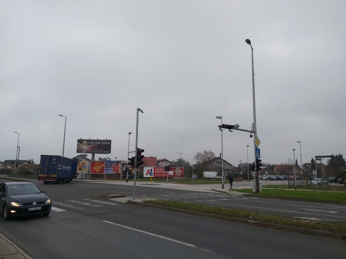

  
6.11. u hotelu Aristos u Buzinu odigralo se Ekipno brzopotezno prvenstvo Hrvatske. Natjecanje je okupilo ukupno 37 ekipa iz svih dijelova Hrvatske. Tempo je bio 3’+2″. Igralo se na četiri ploče. ŠK Odra nastupio je u sastavu: Stjepan Maravić, Ivan Maravić, Mladen Sliepčević, Darko Šutić, Ivan Vraneša i Božo Cvetković. Natjecanje za našu ekipu je počelo više nego dobro, tri pobjede u prva tri kola, dioba prvoga mjesta i meč na prvom stolu. Nakon prvoga poraza smo posustali te na kraju završili na 22. mjestu. Od pojedinačnih rezultata naših igrača, valja istaknuti Mladena kao najboljeg pojedinca (samo jedan poraz!). Maravići su također odigrali poprilično solidan turnir, iako su imali nešto manje od 50%, ali su većinu partija igrali protiv igrača iznad 2200. Treba izdvojiti pobjedu starijeg Maravića nad IM Ticom! Božo se pokazao kao najugodnije iznenađenje turnira osvojivši 50% bodova protiv respektabilnih protivnika. Šutić i Vraneša su rezultatski podbacili, znamo da oni mogu odigrati puno bolje od ovoga što su pokazali, te se nadamo da ćemo tu bolju igru vidjeti prvom mogućom prilikom. Sve u svemu, bilo je ovo jedno pozitivno iskustvo. Čestitamo ekipi HAŠK Mladost na osvajanju turnira! Sve rezultate možete vidjeti [ovdje](http://chess-results.com/tnr688975.aspx?lan=13).

<table><tbody><tr><td><strong>Bo.</strong></td><td></td><td><strong>Ime</strong></td><td><strong>1</strong></td><td><strong>2</strong></td><td><strong>3</strong></td><td><strong>4</strong></td><td><strong>5</strong></td><td><strong>6</strong></td><td><strong>7</strong></td><td><strong>8</strong></td><td><strong>9</strong></td><td><strong>10</strong></td><td><strong>11</strong></td><td><strong>12</strong></td><td><strong>13</strong></td><td><strong>Bod.</strong></td><td><strong>Partije</strong></td></tr><tr><td>1</td><td>MK</td><td>Maravić Stjepan</td><td></td><td>1</td><td>0</td><td>0</td><td>0</td><td></td><td>½</td><td>0</td><td>0</td><td>½</td><td></td><td>1</td><td>1</td><td>4</td><td>10</td></tr><tr><td>2</td><td>MK</td><td>Maravić Ivan</td><td>1</td><td></td><td>1</td><td>0</td><td>0</td><td>0</td><td></td><td>0</td><td>½</td><td>1</td><td>0</td><td>½</td><td></td><td>4</td><td>10</td></tr><tr><td>3</td><td>MK</td><td>Sliepčević Mladen</td><td>1</td><td>1</td><td>½</td><td>½</td><td>½</td><td></td><td>1</td><td>0</td><td></td><td></td><td>½</td><td></td><td></td><td>5</td><td>8</td></tr><tr><td>4</td><td>II</td><td>Šutić Darko</td><td>1</td><td>0</td><td>1</td><td>0</td><td></td><td>0</td><td>0</td><td></td><td>½</td><td>1</td><td>0</td><td>0</td><td>0</td><td>3,5</td><td>11</td></tr><tr><td>5</td><td>II</td><td>Vraneša Ivan</td><td></td><td>1</td><td></td><td></td><td>0</td><td>0</td><td></td><td></td><td>0</td><td>0</td><td></td><td>1</td><td>0</td><td>2</td><td>7</td></tr><tr><td>6</td><td>III</td><td>Cvetković Božo</td><td>1</td><td></td><td></td><td></td><td></td><td>0</td><td>1</td><td>0</td><td></td><td></td><td>0</td><td></td><td>1</td><td>3</td><td>6</td></tr></tbody></table>

*IvanM*
