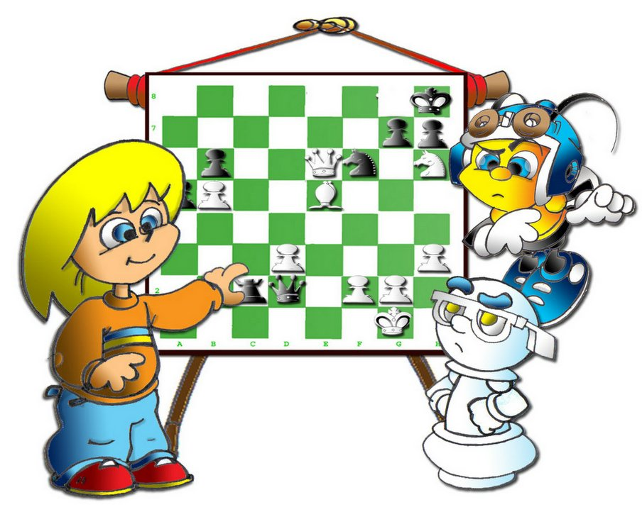

Pribiližava se ekipno prvenstvo OŠ Novog Zagreba,  
ekipa OŠ Odra prijavljena je u sljedećem sastavu:

1\. Ivan  
2\. Vraneša  
3\. Bruno  
4\. Ana  
5\. Monika  
6\. Lucija  
7\. Božo

Kapetan ekipe je Ivan.

Prvenstvo će se odigrati **u petak 22. studenoga 2013.** godine u prostorijama I. osnovne škole Dugave, Školski prilaz bb. Početak prvenstva je **u 17:30 sati**, a kraj oko 20:30 sati. Generalni sponzor Dugave opena je izdavačka kuća Školska knjiga.

Nadam se da Stipe neće zaboraviti potvrditi prijavu u tajništvu škole!  
Iznimno, za ovo natjecanje nisu potrebne *iskaznice Hrvatskog školskog športskog saveza*, ali već za nastup na ekipnom prvenstvu Zagreba (koje je u planu za siječanj/veljaču 2014.) obvezatne su. Treba se nadati  da će škola  
(OŠ Odra) osigurati natjecateljima potrebne iskaznice.  
Obveza roditelja je da natjecatelje dovezu do OŠ Dugave. Šahovske rekvizite donijet će voditelj šahovske škole. Tog dana nema šahovske škole, a Franku pozivamo da dođe bodriti ekipu. 🙂

VAŽNO: U subotu  **23\. studenoga 2013. od 9:30 do 14:00** na istoj adresi održava se pojedinačno prvenstvo osnovnoškolaca Novog Zagreba.  
Broj natjecatelja je ograničen, a obično ih bude više od stotinu. Stoga je vrlo vjerojatno da će službeni rok za prijavu biti skraćen.  
(Dopuna: Skraćen je rok za prijavu do petka 15. studenoga 2013.!)

[http://sah-dugave.org/2013/11/mikronis-kup-vi-pojedinacno-prvenstvo-osnovnih-skola-novog-zagreba/](http://sah-dugave.org/2013/11/mikronis-kup-vi-pojedinacno-prvenstvo-osnovnih-skola-novog-zagreba/)

Natjecanje nije obvezatno, ali ga toplo preporučujem. Ove godine poziv su dobili i učenici OŠ Odra pa bi bilo dobro da ga iskoriste.  
Na gornjem linku su navedeni potrebni podaci za prijavu pa molim roditelje da u skladu sa svojim mogućnostima i u dogovoru s mladim šahistima obave prijavu.  
Dopuna: U prilogu su poziv i pravilnik s detaljima kako na e-mail i s kojim podacima prijaviti natjecatelje. Upisnina iznosi 20 kn i pretpostavljam da se plaća neposredno prije početka turnira.

[poziv na pojedinacno prvenstvo](/files/wp/2013/11/poziv-na-pojedinacno-prvenstvo-OS-Novog-Zagreba.doc)

[pravilnik pojedinacnog prvenstva](/files/wp/2013/11/pravilnik-pojedinacnog-prvenstva-OS-Novog-Zagreba-2013..doc)

dopune 13.11.2013.

\*\*\* Mami Ivani prepun je  poštanski sandučić i ne može primati obavijesti elektroničkom poštom. \*\*\*
