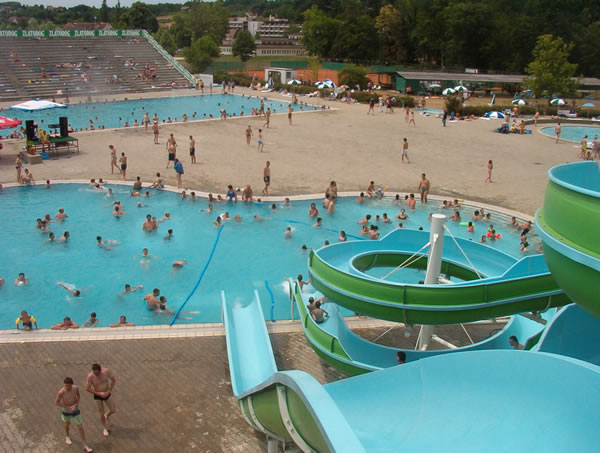

U subotu, 13. travnja 2013. u **Topuskom** je odigran prvi krug *Kadetskoga ekipnog prvenstva*. Mlada ekipa *ŠK Odra* prvi put nastupa na ovom prvenstvu i stječe iskustva za budućnost.  U prva tri kola zabilježili su dva poraza i jedan neriješeni meč.  Prema riječima voditelja **S. Maravića**, svi članovi pokazali su veliku ozbiljnost u pristupu igri i nije bilo (očekivane 😉 ) brzopletosti. Vrijedan bod donio je **Božo Cvetković**, čije je taktiziranje urodilo plodom u trećem kolu. Posebno se istaknula **Bruna Novak**, koja je u posljednji čas uvrštena u ekipu za ovaj krug, a ostvarila je dvije pobjede iz tri partije. Šteta je samo što nije bilo vremena za kupanje.

Sljedeće subote liga se nastavlja u **Buševcu**. Barem za prvo kolo očekujemo i pomoć **Ane Kololvrat**, kojoj će to biti prvo ekipno natjecanje.

U petak će se u prostorijama Kluba analizirati partije pa molim Ivana, Vranešu, Božu i Brunu da **ne zaborave donijeti partije.**

Rezultati se mogu vidjeti na [ovdje.](http://chess-results.com/tnr94315.aspx?art=0&lan=13&wi=821)
