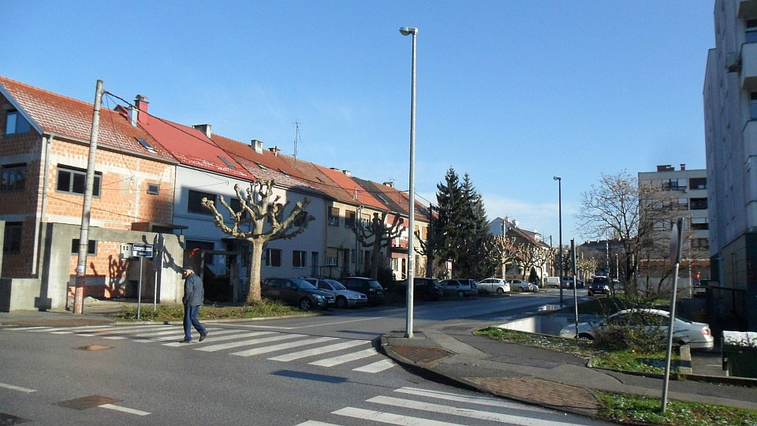
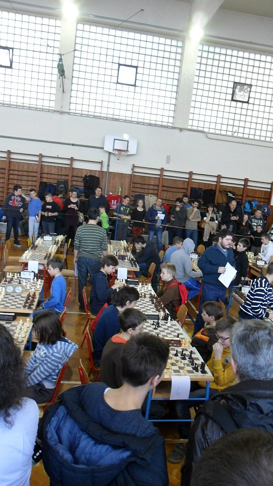
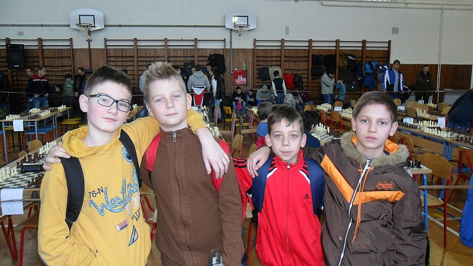

Danas je, po lijepom sunčanom danu s dva centimetra snijega u Zagrebu, u OŠ Frana Galovića završeno Ekipno prvenstvo OŠ Grada Zagreba. Ekipa OŠ Odra, u sastavu Ivan, Bruno, Božo, Vraneša i Luka Fran, završila je veoma visoko, uvjerljivom pobjedom u posljednjem kolu, turnir su završili na petome mjestu. [REZULTATI.](http://www.chess-results.com/tnr158827.aspx?lan=1&art=20&snr=10&turdet=YES&flag=30&wi=984&group=8 "OŠ Odra na ekipnom školskom ZG-a 2015.") Šteta što dalje prolaze samo prve četiri ekipe, a to su redom: OŠ Dugave, OŠ Frana Galovića, OŠ Tituša Brezovačkog i OŠ Brestje. No naši su dečki pokazali zavidnu zrelost i zalaganje te vjerujem da će već sljedeće godine proći u završnicu. S obzirom na to da su prošle godine bili šesnaesti, ovo je veliki napredak. Također, posebne pohvale Vraneši, koji je danas imao stopostotni učinak. Napokon smo riješili i problem školske iskaznice za Luku Frana, ali se on razbolio. Želimo mu brzo ozdravljenje. Njegovo, Brunino i Božino pojedinačno prvenstvo počinje za tri tjedna.

Sljedeći tjedan počinje isto ovo ekipno prvenstvo, ali za djevojčice.  
**Sutra ujutro u Domu sportova počinje pojedinačno prvenstvo za kadete do 9 i 11 godina.** Potrebno je doći u 8.30 radi prijave. Svi bi trebali ponijeti klupske i/ili zdravstvene iskaznice. Naime, za nekoliko članova još nisu izrađene iskaznice HŠS-a, a dok ne budu, potrebno je imati uza se neki drugi identifikacijski dokument.

Također, imamo novost na našim stranicama. Zasad u eksperimentalnoj fazi, dopušteno je komentiranje! 🙂

darko
