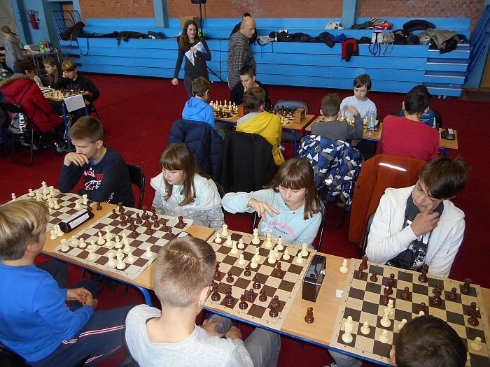
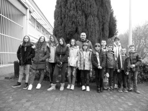
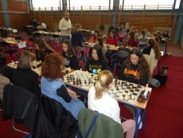
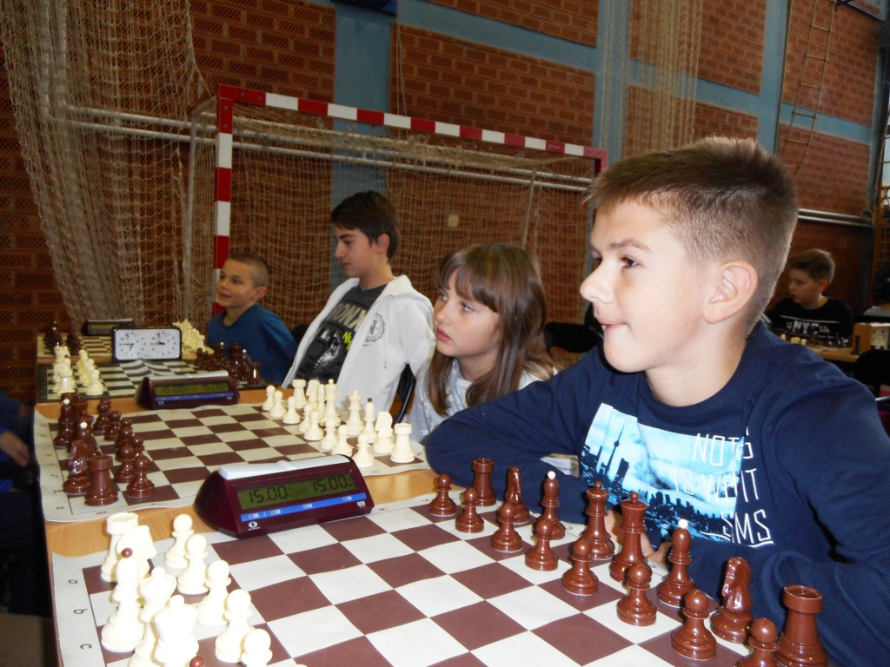
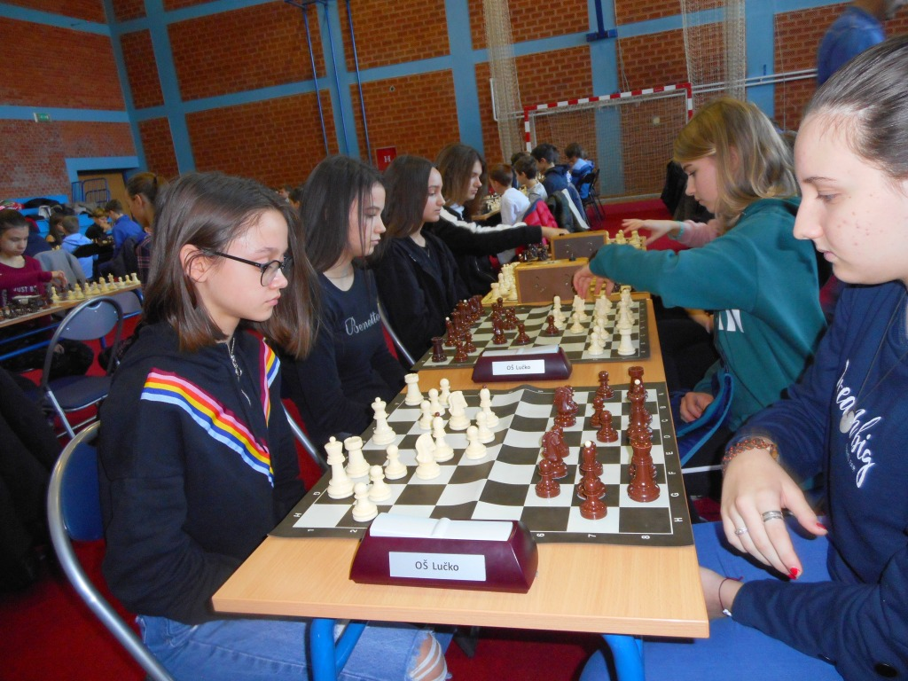

### Djevojke ušle u finale!

  
Dvije subote zaredom, 7. i 14. prosinca, igrane su kvalifikacije Ekipnog prvenstva OŠ Grada Zagreba za 2019/20. Tempo igre bio je 15+0, a prvenstvo je održano u OŠ Lučko. Nastupilo je 20 ekipa u [muškoj](http://chess-results.com/tnr496426.aspx?lan=13) i sedam ekipa u [ženskoj](http://chess-results.com/tnr496427.aspx?lan=13&art=0&turdet=YES) konkurenciji. Prve četiri ekipe iz svake skupine ulaze u finale koje će se igrati **18.** **siječnja 2020.** U finale su se u muškoj konkurenciji plasirale ekipe OŠ Josipa Račića, OŠ Lučko, OŠ Dragutina Domjanića i OŠ Brestje. U ženskoj konkurenciji **u finale su ušle OŠ Odra**, OŠ Ive Andrića, OŠ dr. Ivana Merza i I. OŠ  Dugave. Dečki OŠ Odra završili su na visokom šestom mjestu, a ove godine pomagale su im sestre Fiolić koje sljedeće godine prelaze u žensku ekipu. Dečki imaju još vremena popraviti rezultat sljedećih godina, kada će biti stariji i, nadam se ozbiljniji u pristupu vježbi i treningu. A od cura, koje su starije, sedmi i osmi razred,  očekujemo da u siječnju uzmu pehar za prvo mjesto. Kapetani ekipa bili su Luka Fiolić i Ana Kolovrat. Ekipe je na prvenstvu vodio prof. Krešimir Tomaško.

<table><tbody><tr><td colspan="14"><strong>&nbsp;&nbsp;6. OŠ ODRA dečki ( Kapetan: Luka Fiolić / TB1: 8 / TB2: 13)</strong></td></tr><tr><td><strong>Pl.</strong></td><td></td><td><strong>Ime</strong></td><td><strong>&nbsp;</strong></td><td><strong>Sk.</strong></td><td><strong>1</strong></td><td><strong>2</strong></td><td><strong>3</strong></td><td><strong>4</strong></td><td><strong>5</strong></td><td><strong>6</strong></td><td><strong>7</strong></td><td><strong>Bod.</strong></td><td><strong>Partije</strong></td></tr><tr><td>1.</td><td></td><td>Fiolić Luka</td><td></td><td>6</td><td>½</td><td>½</td><td>0</td><td>1</td><td>1</td><td>0</td><td>½</td><td>3,5</td><td>7</td></tr><tr><td>2.</td><td></td><td>Biondić Slavko</td><td></td><td>3</td><td></td><td></td><td></td><td></td><td>0</td><td></td><td></td><td>0,0</td><td>1</td></tr><tr><td>3.</td><td></td><td>Fiolić Ivana</td><td></td><td>4</td><td>1</td><td>0</td><td></td><td>0</td><td>1</td><td>0</td><td>0</td><td>2,0</td><td>6</td></tr><tr><td>4.</td><td></td><td>Fiolić Lucija</td><td></td><td>4</td><td>½</td><td>1</td><td>0</td><td></td><td>½</td><td></td><td>½</td><td>2,5</td><td>5</td></tr><tr><td>5.</td><td></td><td>Matašić Filip</td><td></td><td>5</td><td>1</td><td></td><td>0</td><td></td><td></td><td>1</td><td></td><td>2,0</td><td>3</td></tr><tr><td>6.</td><td></td><td>Mahin Josip</td><td></td><td>7</td><td></td><td>1</td><td></td><td>0</td><td></td><td>1</td><td>1</td><td>3,0</td><td>4</td></tr><tr><td>7.</td><td></td><td>Pisačić Ivan</td><td></td><td>1</td><td></td><td></td><td>0</td><td>0</td><td></td><td></td><td></td><td>0,0</td><td>2</td></tr></tbody></table>

<table><tbody><tr><td colspan="14"><strong>&nbsp;&nbsp;1. OŠ ODRA cure ( Kapetan: Ana Kolovrat / TB1: 12 / TB2: 22,5)</strong></td></tr><tr><td><strong>Pl.</strong></td><td></td><td><strong>Ime</strong></td><td><strong>&nbsp;</strong></td><td><strong>Sk.</strong></td><td><strong>1</strong></td><td><strong>2</strong></td><td><strong>3</strong></td><td><strong>4</strong></td><td><strong>5</strong></td><td><strong>6</strong></td><td><strong>7</strong></td><td><strong>Bod.</strong></td><td><strong>Partije</strong></td></tr><tr><td>1.</td><td></td><td>Kolovrat Ana</td><td></td><td>8</td><td>1</td><td>1</td><td></td><td>1</td><td>1</td><td>1</td><td>0</td><td>5,0</td><td>6</td></tr><tr><td>2.</td><td></td><td>Kolovrat Monika</td><td></td><td>7</td><td>1</td><td>1</td><td></td><td>1</td><td>1</td><td>½</td><td>1</td><td>5,5</td><td>6</td></tr><tr><td>3.</td><td></td><td>Halužan Samanta</td><td></td><td>8</td><td>1</td><td>1</td><td></td><td>1</td><td>1</td><td>1</td><td>1</td><td>6,0</td><td>6</td></tr><tr><td>4.</td><td></td><td>Kolovrat Lucija</td><td></td><td>7</td><td>1</td><td></td><td></td><td></td><td>1</td><td></td><td>1</td><td>3,0</td><td>3</td></tr><tr><td>5.</td><td></td><td>Kolovrat Franka</td><td></td><td>7</td><td></td><td>1</td><td></td><td>1</td><td></td><td>1</td><td></td><td>3,0</td><td>3</td></tr></tbody></table>

  
