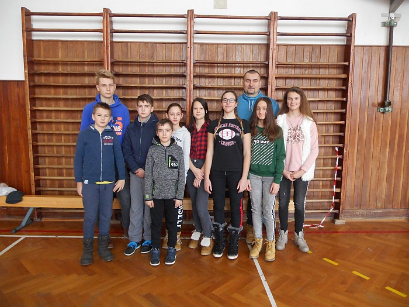
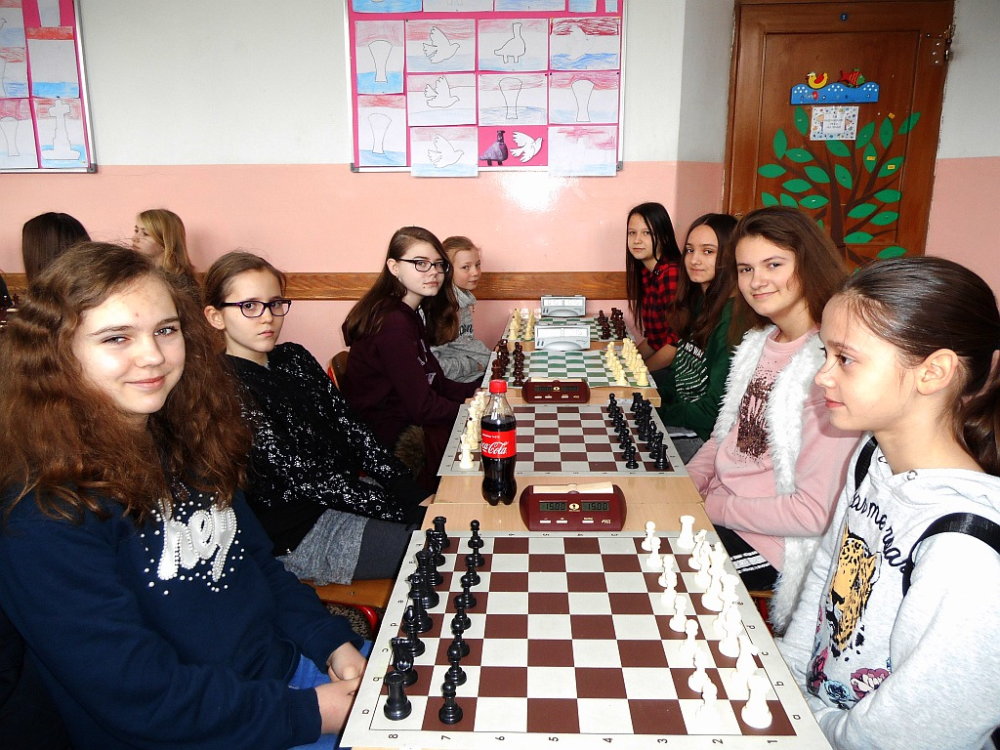
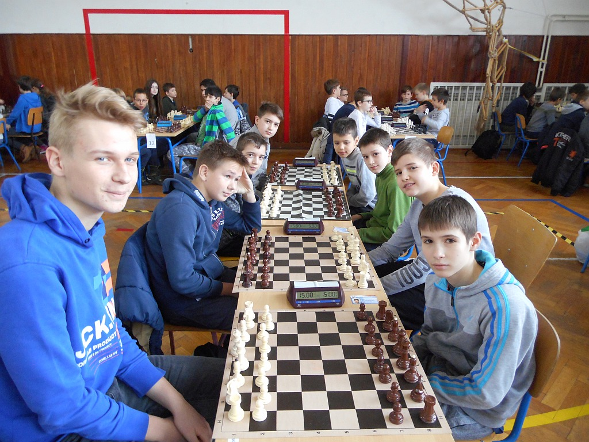
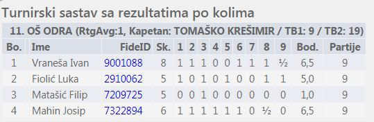
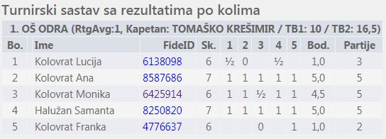

  
Danas su započele kvalifikacije Ekipnog prvenstva OŠ Grada Zagreba. Natjecanje se održava u organizaciji Školskog sportskog saveza Grada Zagreba, a igra se u OŠ Frana Krste Frankopana. U konkurenciji dječaka nastupa 29 ekipa, a u konkurenciji djevojčica 12 ekipa. Prve četiri ekipe, kako u ženskoj, tako i u muškoj konkurenciji, stječu pravo nastupa u finalu koje se igra 16. veljače. Naši dečki nastupaju u sastavu Vraneša, Luka, Filip i Josip, a rezerva je Slavko. Za sada im ide vrlo dobro i [nakon tri kola](http://chess-results.com/tnr410272.aspx?lan=13&art=0&turdet=YES&flag=30) imaju 5 meč bodova tj. dvije pobjede i jedan neodlučen ishod te se nalaze na trećem mjestu. Djevojke stoje još bolje, ali su one uložile i puno više truda u pripremi za ovo natjecanje. One su [trenutačno na prvom mjestu](http://chess-results.com/tnr410274.aspx?lan=13)  sa tri pobjede iz tri kola i vrlo vjerojatno će ući u finale te imati priliku braniti [prošlogodišnji naslov prvakinja](/novosti/ekipno-prvenstvo-osnovnih-skola-grada-zagreba-2018-finale/). Djevojke nastupaju u sastavu Lucija, Ana, Monika i Samanta, a rezerva je Franka. Kvalifikacije se nastavljaju sljedeće subote…

  

---

Dečki su završili kao 11. te se nisu plasirali u završnicu. Dobro su igrali, a posebno je ugodno iznenadio Josip. Cure su završile kao prve i 16. veljače igraju finale. Tri koje najviše rade i vježbaju su imale gotovo 100% učinak.  
  
