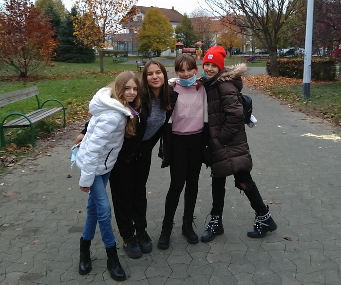
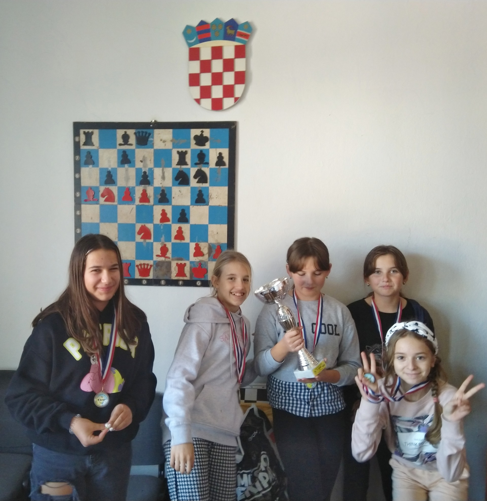
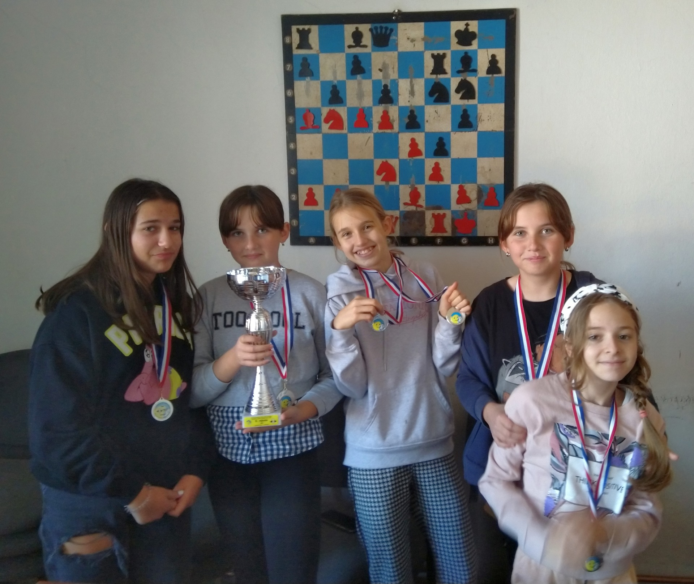
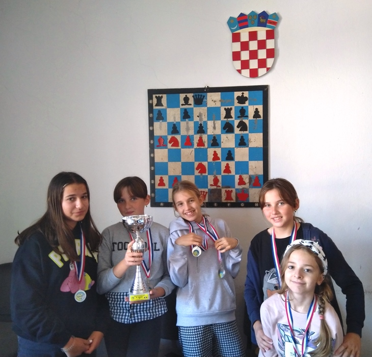
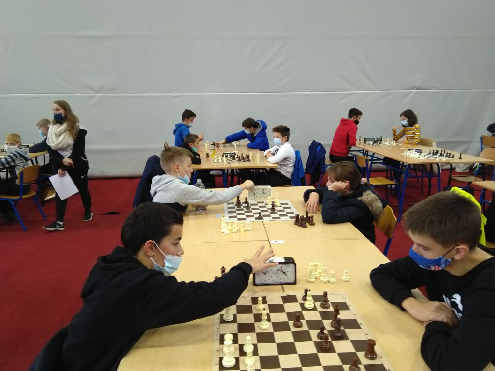

**Djevojke srebrne!**  
  
U subotu 13. studenog odigrano je [Ekipno prvenstvo OŠ Grada Zagreba](http://chess-results.com/tnr590811.aspx?lan=13&art=0&turdet=YES&flag=30), a djevojke iz OŠ Odra osvojile su drugo mjesto i plasirale se u finale tj. na Državno prvenstvo. Prvenstvo je odigrano u OŠ Lučko, igralo se na tempo 15+0, nastupile su četiri ekipe, a prve dvije ekipe plasirale su se u finale. Za OŠ Odra igrale su Lucija Fiolić, Vjeka Vidra, Iva Periša, Lucija i Petra Medoš. Nažalost, zbog samoizolacije Petra nije mogla igrati, ali ju je starija sestra dostojno zamijenila. Djevojke su dva meča odigrale neriješeno i jedan dobile. Možda su mogle i do zlata, ali smo im najjaču igračicu premjestili u mješovitu ekipu, ili kako to športski savez zove, među dječake. 🙂 Nema veze, cilj je ostvaren, pehar i medalje su tu, a Ivana će im pomoći u narednim mečevima. Ovaj premještaj Ivani nije najbolje sjeo, čak je i vježbu smanjila, ali se nadam da će uskoro postati svjesna da je ona po svojoj šahovskoj snazi ipak prerasla ovo natjecanje. 🙂 Njena sestra koja je po snazi 100 bodova slabija, napravila je 100% učinak na prvoj ploči. ČESTITAMO djevojkama koje su nastavile tradiciju OŠ Odra u osvajanju medalja na ekipnim školskim natjecanjima!

<table><tbody><tr><td colspan="12"><strong>&nbsp;&nbsp;2. OŠ ODRA ( Kapetan: Lucija Fiolić / TB1: 4 / TB2: 7)</strong></td></tr><tr><td><strong>Bo.</strong></td><td></td><td><strong>Ime</strong></td><td></td><td></td><td></td><td><strong>1</strong></td><td><strong>2</strong></td><td><strong>3</strong></td><td><strong>Bod.</strong></td><td><strong>Partije</strong></td><td><strong>&nbsp;</strong></td></tr><tr><td>1</td><td></td><td>Fiolić Lucija</td><td></td><td></td><td></td><td>1</td><td>+</td><td>1</td><td>3,0</td><td>3</td><td></td></tr><tr><td>2</td><td></td><td>Vidra Vjeka</td><td></td><td></td><td></td><td>1</td><td>0</td><td>1</td><td>2,0</td><td>3</td><td></td></tr><tr><td>3</td><td></td><td>Periša Iva</td><td></td><td></td><td></td><td>0</td><td>0</td><td>1</td><td>1,0</td><td>3</td><td></td></tr><tr><td>4</td><td></td><td>Medoš Lucija</td><td></td><td></td><td></td><td>0</td><td>1</td><td>0</td><td>1,0</td><td>3</td><td></td></tr></tbody></table>

   

Istoga dana, počelo je i natjecanje u [muškoj/mješovitoj konkurenciji](http://chess-results.com/tnr590810.aspx?lan=13&art=63&turdet=YES&flag=30). Na to natjecanje prijavilo se 18 ekipa. OŠ Odra je nastupila u sastavu: Luka Fiolić, Ivana Fiolić, Ivan Pisačić, Slavko Biondić i Filip Matašić. Natjecanje se igralo dvije subote, prve u OŠ Lučko, a druge u OŠ Rapska. Dečki (i cure 😀 ) su završili na **petom mjestu**. Da je bilo “po pravici”, bili bi drugi, ili prvi… O tome malo kasnije. Tempo igre bio je istovjetan kao u ženskoj konkurenciji. Ugodno je iznenadio Filip sa vrlo dobrim rezultatom. Luka je također odigrao jako dobro, a malo je šteta što je prvo kolo izgubio na vrijeme. Ivana je napravila solidan rezultat na drugoj ploči, dok smo možda ipak malo više očekivali od Slavka. Mrvicu više. Čestitke ekipi! I profesoru Tomašku koji je pratio i mentorirao ekipe na ovom prilično stresnom natjecanju. :))))

<table class="CRs1"><tbody><tr class="CRg1b"><td class="none" colspan="18"><strong>5. OŠ ODRA (Kapetan: Luka Fiolić / TB1: 11 / TB2: 20,5)</strong></td></tr><tr class="CRng1b"><td class="CRc"><strong>Bo.</strong></td><td class="CR"><strong>&nbsp;</strong></td><td class="CR"><strong>Ime</strong></td><td class="CR"><strong>&nbsp;</strong></td><td class="CRr"><strong>&nbsp;</strong></td><td class="CR"><strong>&nbsp;</strong></td><td class="CRc"><strong>1</strong></td><td class="CRc"><strong>2</strong></td><td class="CRc"><strong>3</strong></td><td class="CRc"><strong>4</strong></td><td class="CRc"><strong>5</strong></td><td class="CRc"><strong>6</strong></td><td class="CRc"><strong>7</strong></td><td class="CRc"><strong>8</strong></td><td class="CRc"><strong>9</strong></td><td class="CRc"><strong>Bod.</strong></td><td class="CRc"><strong>Partije</strong></td><td class="CRr"></td></tr><tr class="CRng2 CRO"><td class="CRc">1</td><td class="CR"></td><td class="CR">Fiolić Luka</td><td class="CR"></td><td class="CRr"></td><td class="CR"></td><td class="CRc">0</td><td class="CRc">+</td><td class="CRc">1</td><td class="CRc">1</td><td class="CRc">1</td><td class="CRc">+</td><td class="CRc">1</td><td class="CRc">1</td><td class="CRc">0</td><td class="CRc">7,0</td><td class="CRc">9</td><td class="CRr"></td></tr><tr class="CRng1 CRO"><td class="CRc">2</td><td class="CR"></td><td class="CR">Fiolić Ivana</td><td class="CR"></td><td class="CRr"></td><td class="CR"></td><td class="CRc">1</td><td class="CRc">½</td><td class="CRc">0</td><td class="CRc">1</td><td class="CRc">0</td><td class="CRc">0</td><td class="CRc">1</td><td class="CRc">1</td><td class="CRc">0</td><td class="CRc">4,5</td><td class="CRc">9</td><td class="CRr"></td></tr><tr class="CRng2 CRO"><td class="CRc">3</td><td class="CR"></td><td class="CR">Biondić Slavko</td><td class="CR"></td><td class="CRr"></td><td class="CR"></td><td class="CRc"></td><td class="CRc">–</td><td class="CRc">–</td><td class="CRc">–</td><td class="CRc">1</td><td class="CRc">0</td><td class="CRc">1</td><td class="CRc">1</td><td class="CRc">0</td><td class="CRc">3,0</td><td class="CRc">5</td><td class="CRr"></td></tr><tr class="CRng1 CRO"><td class="CRc">4</td><td class="CR"></td><td class="CR">Pisačić Ivan</td><td class="CR"></td><td class="CRr"></td><td class="CR"></td><td class="CRc">–</td><td class="CRc"></td><td class="CRc"></td><td class="CRc"></td><td class="CRc"></td><td class="CRc"></td><td class="CRc"></td><td class="CRc"></td><td class="CRc"></td><td class="CRc">0,0</td><td class="CRc">0</td><td class="CRr"></td></tr><tr class="CRng2 CRO"><td class="CRc">5</td><td class="CR"></td><td class="CR">Matašić Filip</td><td class="CR"></td><td class="CRr"></td><td class="CR"></td><td class="CRc">0</td><td class="CRc">1</td><td class="CRc">1</td><td class="CRc">1</td><td class="CRc">1</td><td class="CRc">0</td><td class="CRc">1</td><td class="CRc">0</td><td class="CRc">1</td><td class="CRc">6,0</td><td class="CRc">9</td><td class="CRr"></td></tr></tbody></table>

Dosta je loše započelo za mušku ekipu jer je u petak poslijepodne, dan prije početka natjecanja svoj nastup otkazao Ivan Pisačić, iz još nepoznatih razloga. Sad, da li je u pitanju samoizolacija ili nešto drugo, saznat ćemo. Bio je to prilično velik udarac za ekipu. A Slavko je pak nepromišljeno prihvatio obavezu nastupa na natjecanju iz SUDOKU-a te tako ostavio ekipu prva četiri kola (stigao je na peto!) bez jednog igrača. Kada je natjecanje započelo, u prvom kolu, iz nekih, zdravoj pameti nepoznatih razloga, jedna od sutkinja je prislila Filipa da igra na trećoj ploči i nije se osvrtala na ničije primjedbe, a ponajmanje na pravilnik natjecanja. To je i jedina partija koju je Filip izgubio u prvom krugu. Zbog toga smo vjerojatno ostali i bez jednog meč boda. Od drugog kola su suci ipak došli pameti (sudačka ekipa u sastavu; glavni sudac IA Siniša Režek , pomoćnici;  ks Tihana Iveković, ks Klara Krmpotić, Ana Iveković i ks Nenad Mudrinić) pa je Filip u nastavku igrao četvrtu ploču. Ekipa je uprkos tome, nakon prvog kruga dijelila drugo mjesto. Nažalost po natjecanje, turnir je i prije početka postao neregularan. Naime, dvije škole (OŠ Brestje i OŠ Julija Klovića) su protivno pravilniku prijavile osnovni sastav upisavši igrače od rednog broja dva, iako je pravilnikom određeno da se igrači u osnovni sastav upisuju od rednog broja jedan. Ove škole nisu imale četiri igrača, a kako pravilnik dopušta da škola igra i sa tri igrača, nadali su se da će tako postići bolji rezultat izbjegnu li borbu na prvoj ploči. Protivno [pravilniku](/files/wp/2021/11/2300-Posebni_propisnik_-_-ah.pdf). Zanimljiviji dio neregularnosti dogodio se u drugom dijelu natjecanja kada se ekipa OŠ Otok (pobjednička ekipa prema neslužbenim rezultatima) premjestila na niže ploče. Obzirom da su došli s igračem manje na nastavak natjecanja, svoju prvu ploču su premjestili na drugu i tako redom. Sucima je ukazano na to i obzirom da pravilnik predviđa i takvu situaciju te se prema njemu te partije kontumaciraju (gube za sudačkim stolom) bilo je to za očekivati. Ali se to nije dogodilo. Zašto? To treba pitati sudačku ekipu. I Školski sportski savez Grada Zagreba koji se (dosad) uvijek držao svojih pravilnika, “kao pijan plota”.  
Nevezano uz ovu tematiku neregularnosti, bilo je lijepo vidjeti djecu i svu tu radost natjecanja. Vidjelo se koliko im to nedostaje već dulje vrijeme.  
Vrijedi spomenuti i za neupućene u šah… šah je do prije samo nekoliko desetljeća bio prilično šovinistički sport. Ženama se branilo igrati na “muškim” turnirima, a i danas su njihova natjecanja manje medijski pokrivena, manje su nagrade i slično. Ipak, dogodio se i napredak. Tako u šahu, osim u školskom šahu, ne postoji muška i ženska konkurencija, nego samo ženska i mješovita. U školskom sportu u RH to ide puževim korakom i tek je prije par godina, nakon prilično burnih negodovanja roditelja, dopušteno da i djevojčice igraju sa dječacima. U šahu se ekipe uvijek slažu na način da najjači igrač/igračica neke ekipe igra na prvoj ploči i tako redom. Dopuštena su odstupanja od 100 rtg bodova. Kako školski sport nema svoj sustav ocjenjivanja, a ne priznaje FIDE ili nacionalni rejting igrača, u školskom sportu tog pravila nema. Kako bi se ipak izbjeglo naštimavanje protivnika, prihvaćeno je pravilo (i unešeno u pravilnik) da se za vrijeme natjecanja ne mogu mijenjati ploče, osim po strogo određenim pravilima prilikom izmjene igrača.  
Još jednom čestitke svim igračima i igračicama, a djevojkama puno sreće u predstojećem finalu!

<table><tbody><tr><td><strong>Mj.</strong></td><td><strong>Ekipa</strong></td><td><strong>1.Rd</strong></td><td><strong>2.Rd</strong></td><td><strong>3.Rd</strong></td><td><strong>4.Rd</strong></td><td><strong>5.Rd</strong></td><td><strong>6.Rd</strong></td><td><strong>7.Rd</strong></td><td><strong>8.Rd</strong></td><td><strong>9.Rd</strong></td><td><strong>&nbsp;MB/B&nbsp;</strong></td></tr><tr><td>1</td><td>OŠ OTOK</td><td>12w2½</td><td>2b2</td><td>4w2</td><td>9b3</td><td>3w2</td><td>5b3</td><td>8w3</td><td>11b2½</td><td>6w2½</td><td>15/22,5</td></tr><tr><td>2</td><td>OŠ LUČKO</td><td>15b3</td><td>1w2</td><td>5b2</td><td>13w4</td><td>8b2</td><td>3w1½</td><td>11b3</td><td>4b2½</td><td>9w4</td><td>13/24</td></tr><tr><td>3</td><td>OŠ DOBRIŠE CESARIĆA</td><td>5w3</td><td>7b4</td><td>9w2½</td><td>11w3</td><td>1b2</td><td>2b2½</td><td>4w1</td><td>6w2</td><td>8b2</td><td>13/22</td></tr><tr><td>4</td><td>OŠ DRAGUTINA DOMJANIĆA</td><td>16b4</td><td>11w2</td><td>1b2</td><td>8w2</td><td>12b2</td><td>6w2½</td><td>3b3</td><td>2w1½</td><td>5b3</td><td>12/22</td></tr><tr><td>5</td><td>OŠ ODRA</td><td>3b1</td><td>6w2½</td><td>2w2</td><td>10b3</td><td>11b3</td><td>1w1</td><td>13b4</td><td>8w3</td><td>4w1</td><td>11/20,5</td></tr><tr><td>6</td><td>OŠ BRESTJE</td><td>9w2</td><td>5b1½</td><td>7w3</td><td>14b3</td><td>10w3</td><td>4b1½</td><td>12w2½</td><td>3b2</td><td>1b1½</td><td>10/20</td></tr><tr><td>7</td><td>OŠ BARTOLA KAŠIĆA</td><td>18b2</td><td>3w0</td><td>6b1</td><td>15b2</td><td>16w3</td><td>13w2</td><td>14b2</td><td>17b2½</td><td>12w3</td><td>10/17,5</td></tr><tr><td>8</td><td>OŠ JOSIPA RAČIĆA</td><td>10w3</td><td>13w3</td><td>11b1½</td><td>4b2</td><td>2w2</td><td>12w3</td><td>1b1</td><td>5b1</td><td>3w2</td><td>9/18,5</td></tr><tr><td>9</td><td>OŠ TRNSKO</td><td>6b2</td><td>18w3</td><td>3b1½</td><td>1w1</td><td>14b4</td><td>11w0</td><td>10w2½</td><td>15b3</td><td>2b0</td><td>9/17</td></tr><tr><td>10</td><td>I. OŠ DUGAVE</td><td>8b1</td><td>17w4</td><td>12b2</td><td>5w1</td><td>6b1</td><td>14w2½</td><td>9b1½</td><td>16w4</td><td>11w2</td><td>8/19</td></tr><tr><td>11</td><td>OŠ JORDANOVAC</td><td>14w3</td><td>4b2</td><td>8w2½</td><td>3b1</td><td>5w1</td><td>9b4</td><td>2w1</td><td>1w1½</td><td>10b2</td><td>8/18</td></tr><tr><td>12</td><td>OŠ JULIJA KLOVIĆA</td><td>1b1½</td><td>15w3</td><td>10w2</td><td>17b3</td><td>4w2</td><td>8b1</td><td>6b1½</td><td>13w3</td><td>7b1</td><td>8/18</td></tr><tr><td>13</td><td>OŠ MEDVEDGRAD</td><td>17w3</td><td>8b1</td><td>14w2</td><td>2b0</td><td>15w3</td><td>7b2</td><td>5w0</td><td>12b1</td><td>16b3</td><td>8/15</td></tr><tr><td>14</td><td>OŠ RAPSKA</td><td>11b1</td><td>16w3</td><td>13b2</td><td>6w1</td><td>9w0</td><td>10b1½</td><td>7w2</td><td>–4</td><td>15b2</td><td>7/16,5</td></tr><tr><td>15</td><td>OŠ PAVLEKA MIŠKINE</td><td>2w1</td><td>12b1</td><td>18b3</td><td>7w2</td><td>13b1</td><td>17w3</td><td>16b2</td><td>9w1</td><td>14w2</td><td>7/16</td></tr><tr><td>16</td><td>MEĐUNARODNA OSNOVNA ŠKOLA VEDRI OBZORI</td><td>4w0</td><td>14b1</td><td>17b1½</td><td>18w2</td><td>7b1</td><td>–4</td><td>15w2</td><td>10b0</td><td>13w1</td><td>4/12,5</td></tr><tr><td>17</td><td>OŠ GORNJE VRAPČE</td><td>13b1</td><td>10b0</td><td>16w2½</td><td>12w1</td><td>18b1½</td><td>15b1</td><td>–4</td><td>7w1½</td><td>0w0</td><td>4/12,5</td></tr><tr><td>18</td><td>OŠ AUGUSTA CESARCA</td><td>7w2</td><td>9b1</td><td>15w1</td><td>16b2</td><td>17w2½</td><td>0w0</td><td>0w0</td><td>0w0</td><td>0w0</td><td>4/8,5</td></tr></tbody></table>

darko
