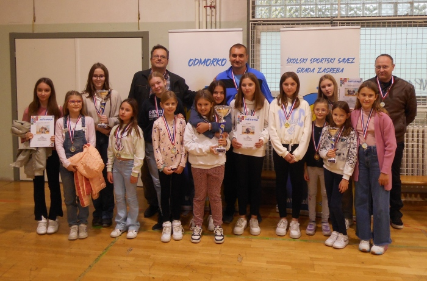
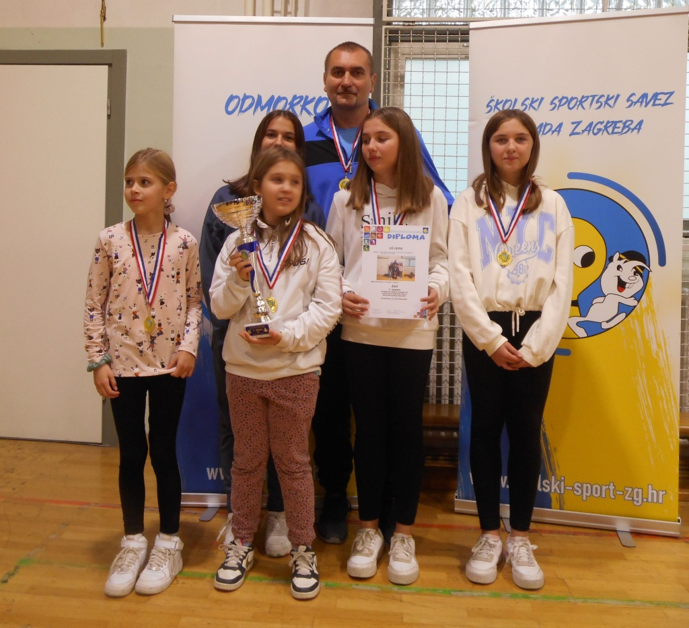
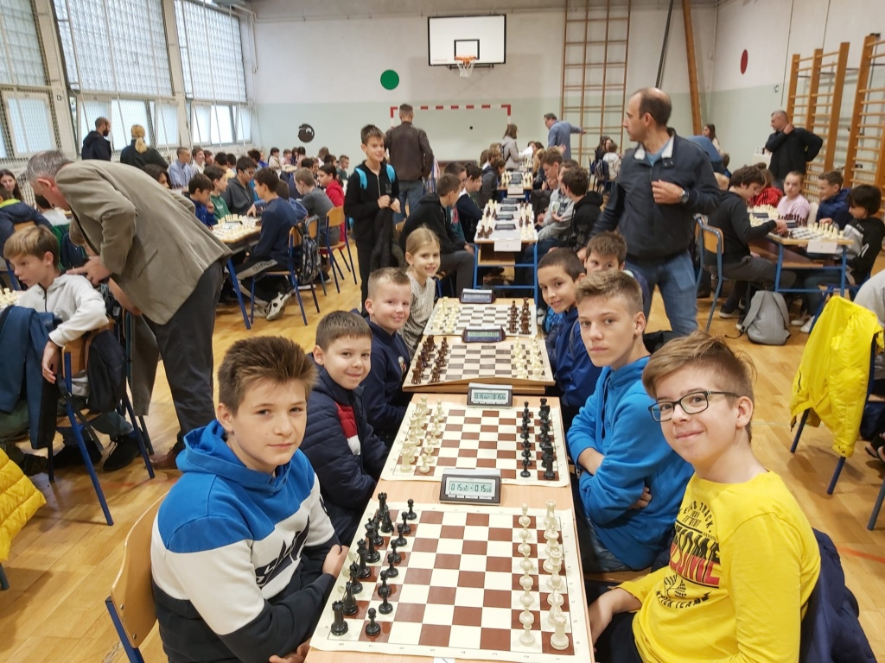
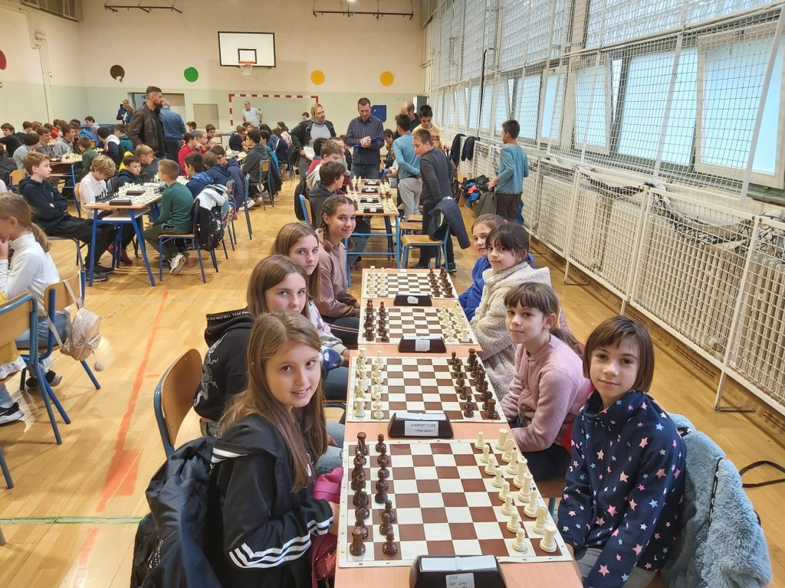
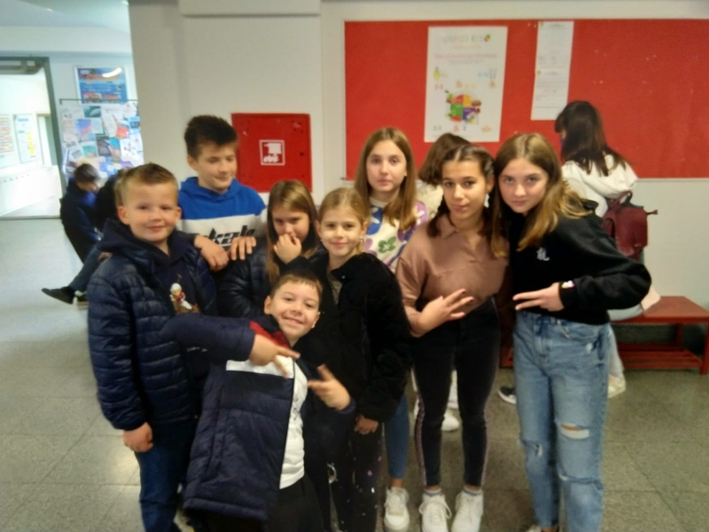

Djevojke iz OŠ Odra osvojile su [Ekipno prvenstvo OŠ Grada Zagreba](http://chess-results.com/tnr685205.aspx?lan=13&art=0&turdet=YES&flag=30) i plasirale se u finale u Poreču. Voditelj ekipe bio je prof. Krešimir Tomaško. Kapetanica ekipe bila je Vjeka Vidra, sestre Ivana i Lucija Fiolić završile su sa 100% učinkom, a ugodno je iznenadila Petra Medoš sa samo jednom izgubljenom partijom. Kao što je prošle godine Ivana pomagala muškoj ekipi, ove godine tu ulogu je preuzela Ana Predović. Za dečke su još nastupili iskusniji Slavko Biondić i Luka Matašić, a mlađi dio ekipe  predstavljali su uz Anu još i Emanuel Ćurić, Emanuel Kovačević i Petar Primorac. Iako se tomu nismo previše nadali, i mlađi dio ekipe nije ostao praznih ruku pa su prve bodove skupili i Emanuel K. i Petar, a Emanuel Ć. čak dva! Slavko i Luka su svoj dio odradili više nego solidno sa po samo jednim porazom. Ana je uspjela u prvom kolu osvojiti pola boda što je ekipi donijelo i jedinu ekipnu pobjedu, uz dva neriješena rezultata. Iako su ekipa tek u nastajanju, nisu završili na posljednjem mjestu. 🙂 Nadam se da će nastaviti raditi te za koju godinu i od njih možemo očekivati medalje.  
Prvenstvo je igrano na tempo 15+0, uz jedan nemogući potez. Igralo se u sportskoj dvorani OŠ Rapska.  
U ženskoj konkurenciji prvo mjesto osvojila je **OŠ Odra**, a drugo mjesto **OŠ Dragutina Domjanića**. U muškoj konkurenciji prvaci su iz  **OŠ Dobriše Cesarića**, dok je drugo mjesto osvojila **OŠ Josipa Račića**. Te četiri ekipe plasirale su se na državnu završnicu koja će se ove godine igrati u Poreču.  
Čestitke svim učesnicima, a djevojkama želimo puno sreće u finalu!  
   

### **Djevojke, konačni poredak sa partijama**

<table class="CRs1"><tbody><tr class="CRng1b"><td class="CRc"><strong>Mj.</strong></td><td class="CRc"><strong>&nbsp;</strong></td><td class="CR"><strong>Ekipa</strong></td><td class="CRc">1</td><td class="CRc">2</td><td class="CRc">3</td><td class="CRc">4</td><td class="CRc">5</td><td class="CRc">6</td><td class="CRc">7</td><td class="CRc">8</td><td class="CRc">9</td><td class="CRc">&nbsp;TB1</td><td class="CRc">&nbsp;TB2</td><td class="CRc">&nbsp;TB3</td><td class="CRc"></td></tr><tr class="CRng2"><td class="CRc"><strong>1.</strong></td><td class="CRc">

</td><td class="CR"><strong>Oš Odra</strong></td><td class="CR">&nbsp;*</td><td class="CRc">2</td><td class="CRc">3</td><td class="CRc">3</td><td class="CRc">4</td><td class="CRc">4</td><td class="CRc">4</td><td class="CRc">4</td><td class="CRc">4</td><td class="CRc"><strong>15</strong></td><td class="CRc">28</td><td class="CRc">102,3</td><td class="CRc"></td></tr><tr class="CRng1"><td class="CRc">2.</td><td class="CRc">

</td><td class="CR">Oš Dragutina Domjanića</td><td class="CRc">2</td><td class="CR">&nbsp;*</td><td class="CRc">2½</td><td class="CRc">3</td><td class="CRc">4</td><td class="CRc">4</td><td class="CRc">4</td><td class="CRc">4</td><td class="CRc">4</td><td class="CRc">15</td><td class="CRc">27,5</td><td class="CRc">102,5</td><td class="CRc"></td></tr><tr class="CRng2"><td class="CRc">3.</td><td class="CRc">

</td><td class="CR">Oš Montessori Barunice Dedee</td><td class="CRc">1</td><td class="CRc">1½</td><td class="CR">&nbsp;*</td><td class="CRc">3</td><td class="CRc">1</td><td class="CRc">3½</td><td class="CRc">3</td><td class="CRc">4</td><td class="CRc">4</td><td class="CRc">10</td><td class="CRc">21</td><td class="CRc">52</td><td class="CRc"></td></tr><tr class="CRng1"><td class="CRc">4.</td><td class="CRc">

</td><td class="CR">Oš Silvija Strahimira Kranjčevića</td><td class="CRc">1</td><td class="CRc">1</td><td class="CRc">1</td><td class="CR">&nbsp;*</td><td class="CRc">2½</td><td class="CRc">3</td><td class="CRc">4</td><td class="CRc">4</td><td class="CRc">3</td><td class="CRc">10</td><td class="CRc">19,5</td><td class="CRc">48</td><td class="CRc"></td></tr><tr class="CRng2"><td class="CRc">5.</td><td class="CRc">

</td><td class="CR">Oš Antuna Branka Šimića</td><td class="CRc">0</td><td class="CRc">0</td><td class="CRc">3</td><td class="CRc">1½</td><td class="CR">&nbsp;*</td><td class="CRc">2</td><td class="CRc">2</td><td class="CRc">4</td><td class="CRc">3</td><td class="CRc">8</td><td class="CRc">15,5</td><td class="CRc">41,3</td><td class="CRc"></td></tr><tr class="CRng1"><td class="CRc">6.</td><td class="CRc">

</td><td class="CR">Oš Rapska</td><td class="CRc">0</td><td class="CRc">0</td><td class="CRc">½</td><td class="CRc">1</td><td class="CRc">2</td><td class="CR">&nbsp;*</td><td class="CRc">2</td><td class="CRc">4</td><td class="CRc">4</td><td class="CRc">6</td><td class="CRc">13,5</td><td class="CRc">21,3</td><td class="CRc"></td></tr><tr class="CRng2"><td class="CRc">7.</td><td class="CRc">

</td><td class="CR">Oš Ive Andrića</td><td class="CRc">0</td><td class="CRc">0</td><td class="CRc">1</td><td class="CRc">0</td><td class="CRc">2</td><td class="CRc">2</td><td class="CR">&nbsp;*</td><td class="CRc">4</td><td class="CRc">2</td><td class="CRc">5</td><td class="CRc">11</td><td class="CRc">19,8</td><td class="CRc"></td></tr><tr class="CRng1"><td class="CRc">8.</td><td class="CRc">

</td><td class="CR">Oš Bartola Kašića</td><td class="CRc">0</td><td class="CRc">0</td><td class="CRc">0</td><td class="CRc">0</td><td class="CRc">0</td><td class="CRc">0</td><td class="CRc">0</td><td class="CR">&nbsp;*</td><td class="CRc">2½</td><td class="CRc">2</td><td class="CRc">2,5</td><td class="CRc">5,5</td><td class="CRc"></td></tr><tr class="CRng2"><td class="CRc">9.</td><td class="CRc">

</td><td class="CR">Oš Žuti Brijeg</td><td class="CRc">0</td><td class="CRc">0</td><td class="CRc">0</td><td class="CRc">1</td><td class="CRc">1</td><td class="CRc">0</td><td class="CRc">2</td><td class="CRc">1½</td><td class="CR">&nbsp;*</td><td class="CRc">1</td><td class="CRc">5,5</td><td class="CRc">5,5</td><td class="CRc"></td></tr></tbody></table>

### Dečki, konačni poredak nakon 9 kola

<table><tbody><tr><td><strong>Mj.</strong></td><td><strong>SNo</strong></td><td></td><td><strong>&nbsp;</strong></td><td><strong>Ekipa</strong></td><td>Partije</td><td><strong>&nbsp; +&nbsp;</strong></td><td><strong>&nbsp; =&nbsp;</strong></td><td><strong>&nbsp; </strong>–<strong>&nbsp;</strong></td><td><strong>&nbsp;</strong>TB1</td><td>&nbsp;TB2</td><td>&nbsp;TB3<strong>&nbsp;</strong></td><td></td></tr><tr><td>1.</td><td>21</td><td></td><td></td><td>Oš Dobriše Cesarića</td><td>9</td><td>7</td><td>2</td><td>0</td><td>16</td><td>28</td><td>187,5</td><td></td></tr><tr><td>2.</td><td>14</td><td></td><td></td><td>Oš Josipa Račića</td><td>9</td><td>7</td><td>2</td><td>0</td><td>16</td><td>26</td><td>190</td><td></td></tr><tr><td>3.</td><td>6</td><td></td><td></td><td>Oš Bartola Kašića</td><td>9</td><td>5</td><td>3</td><td>1</td><td>13</td><td>25</td><td>188,5</td><td></td></tr><tr><td>4.</td><td>8</td><td></td><td></td><td>Oš Dragutina Domjanića</td><td>9</td><td>5</td><td>2</td><td>2</td><td>12</td><td>22,5</td><td>174</td><td></td></tr><tr><td>5.</td><td>10</td><td></td><td></td><td>Oš Lučko</td><td>9</td><td>5</td><td>1</td><td>3</td><td>11</td><td>23,5</td><td>168</td><td></td></tr><tr><td>6.</td><td>16</td><td></td><td></td><td>Oš Julija Klovića</td><td>9</td><td>4</td><td>3</td><td>2</td><td>11</td><td>21,5</td><td>185</td><td></td></tr><tr><td>7.</td><td>2</td><td></td><td></td><td>Oš Rapska</td><td>9</td><td>4</td><td>2</td><td>3</td><td>10</td><td>19</td><td>158,5</td><td></td></tr><tr><td>8.</td><td>9</td><td></td><td></td><td>Oš Izidora Kršnjavoga</td><td>9</td><td>4</td><td>1</td><td>4</td><td>9</td><td>18</td><td>183</td><td></td></tr><tr><td>9.</td><td>17</td><td></td><td></td><td>Oš Ive Andrića</td><td>9</td><td>3</td><td>3</td><td>3</td><td>9</td><td>17,5</td><td>185</td><td></td></tr><tr><td>10.</td><td>3</td><td></td><td></td><td>Oš Jordanovac</td><td>9</td><td>4</td><td>1</td><td>4</td><td>9</td><td>17</td><td>178</td><td></td></tr><tr><td>11.</td><td>13</td><td></td><td></td><td>Oš Ivana Cankara</td><td>9</td><td>4</td><td>1</td><td>4</td><td>9</td><td>17</td><td>169</td><td></td></tr><tr><td>12.</td><td>4</td><td></td><td></td><td>Međunarodna Oš Vedri Obzori</td><td>9</td><td>2</td><td>4</td><td>3</td><td>8</td><td>17,5</td><td>132</td><td></td></tr><tr><td>13.</td><td>1</td><td></td><td></td><td>Oš Prečko</td><td>9</td><td>2</td><td>4</td><td>3</td><td>8</td><td>17</td><td>156,5</td><td></td></tr><tr><td>14.</td><td>11</td><td></td><td></td><td>Oš Frana Krste Frankopana</td><td>9</td><td>3</td><td>2</td><td>4</td><td>8</td><td>16,5</td><td>141,5</td><td></td></tr><tr><td>15.</td><td>12</td><td></td><td></td><td>Oš Rudeš</td><td>9</td><td>3</td><td>2</td><td>4</td><td>8</td><td>15,5</td><td>134</td><td></td></tr><tr><td>16.</td><td>15</td><td></td><td></td><td>Oš Alojzija Stepinca</td><td>9</td><td>3</td><td>2</td><td>4</td><td>8</td><td>14,5</td><td>166</td><td></td></tr><tr><td>17.</td><td>18</td><td></td><td></td><td>Oš Montessori Barunice Dedee</td><td>9</td><td>4</td><td>0</td><td>5</td><td>8</td><td>14,5</td><td>165,5</td><td></td></tr><tr><td>18.</td><td>5</td><td></td><td></td><td>Oš Medvedgrad</td><td>9</td><td>2</td><td>3</td><td>4</td><td>7</td><td>15,5</td><td>138,5</td><td></td></tr><tr><td>19.</td><td>7</td><td></td><td></td><td>Oš Horvati</td><td>9</td><td>2</td><td>2</td><td>5</td><td>6</td><td>15,5</td><td>139,5</td><td></td></tr><tr><td>20.</td><td>20</td><td></td><td></td><td>Oš Tituša Brezovačkog</td><td>9</td><td>2</td><td>2</td><td>5</td><td>6</td><td>14,5</td><td>134</td><td></td></tr><tr><td>21.</td><td>22</td><td></td><td></td><td>Oš Odra</td><td>9</td><td>1</td><td>2</td><td>6</td><td>4</td><td>11,5</td><td>133</td><td></td></tr><tr><td>22.</td><td>19</td><td></td><td></td><td>Oš Ivana Gundulića</td><td>9</td><td>0</td><td>2</td><td>7</td><td>2</td><td>8</td><td>152,5</td><td></td></tr></tbody></table>
