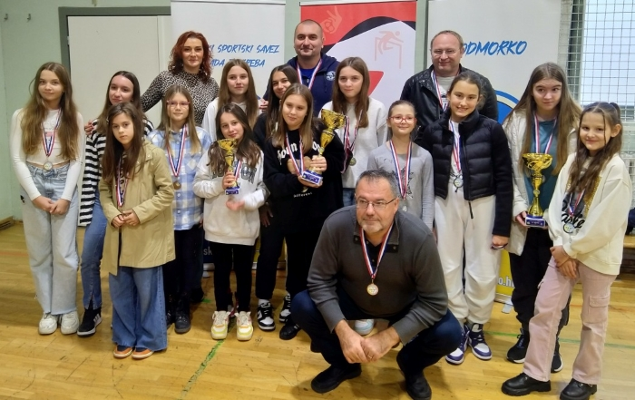
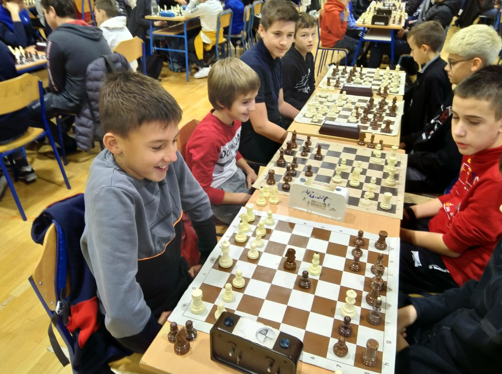
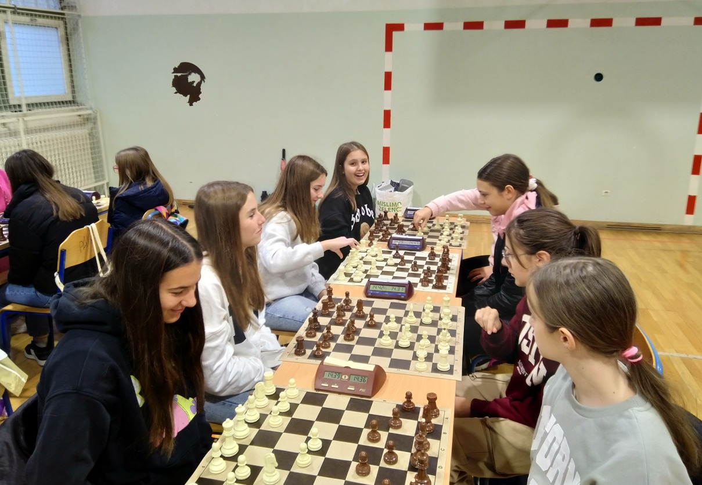

  
Djevojke iz OŠ Odra osvojile su ovogodišnje [Prvenstvo OŠ Grada Zagreba](https://chess-results.com/tnr843970.aspx?lan=13&art=0&turdet=YES&flag=30) i plasirale se na finale u Poreču! Uz ekipu djevojaka, nastupila je ekipa dječaka. Voditelj obje ekipe je bio profesor Krešimir Tomaško, a kapetani Vjeka i Slavko. Prvenstvo se igralo na 15 minuta po igraču za cijelu partiju. OŠ Rapska je i ove godine bila domaćin natjecanja.   
Sada malo više o šahu, prvo o djevojkama. Sastav je bio Vjeka, Ivana, Lucija i Petra te je Ana bila rezerva. Prvu subotu su u dosta turobnom raspoloženju loše odigrale te izgubile jedan meč. Međutim, drugu subotu su se pojavile u puno boljem raspoloženju i s malo više vježbe preko tjedna te su sve do jedne zabljesnule u ključnome meču te tako osvojile prvo mjesto! Ovim rezultatom ostvarile su pravo na nastup na Državnom prvenstvu u Poreču koje se održava od 20.11. do 22.11. te im ovim putem želimo puno sreće i odličje istoga sjaja!   
Dečki su nastupili u poprilično mladoj ekipi, jednoj od najmlađih na natjecanju, te s tri nova člana u odnosu na prošlu godinu. U sastavu su bili Bartol, Slavko, Emanuel, Vili i Domagoj. Zbog mladosti ekipe, nitko nije očekivao niti tražio od njih da skupljaju bodove, već iskustvo, ali dečki su odigrali izvrsno i završili debelo u prvoj polovici natjecanja kao [12.](https://chess-results.com/tnr843967.aspx?lan=13&art=0&rd=9&turdet=YES&flag=30) od 29 ekipa! Slavko je kapetanski bodrio svoje mlađe kolege te sigurno doprinio tome da igraju smirenije i bolje. Njima je isto druga subota bolje prošla, kada su se opustili i oslobodili. Sve pohvale cijeloj ekipi!

##### 1\. OŠ Odra – djevojke (TB1: 10 / TB2: 19)

<table><tbody><tr><td><strong>Pl.</strong></td><td><strong>Ime</strong></td><td><strong>1</strong></td><td><strong>2</strong></td><td><strong>3</strong></td><td><strong>4</strong></td><td><strong>5</strong></td><td><strong>6</strong></td><td><strong>7</strong></td><td><strong>Bod.</strong></td><td><strong>Partije</strong></td></tr><tr><td>1</td><td>Vidra Vjeka</td><td>0</td><td></td><td>1</td><td>0</td><td>1</td><td>1</td><td>+</td><td>4,0</td><td>6</td></tr><tr><td>2</td><td>Fiolić Ivana</td><td>½</td><td></td><td>1</td><td>0</td><td>1</td><td>1</td><td>+</td><td>4,5</td><td>6</td></tr><tr><td>3</td><td>Fiolić Lucija</td><td>1</td><td></td><td>1</td><td>1</td><td>1</td><td>½</td><td>+</td><td>5,5</td><td>6</td></tr><tr><td>4</td><td>Medoš Petra</td><td>1</td><td></td><td>1</td><td>0</td><td>1</td><td>1</td><td>+</td><td>5,0</td><td>6</td></tr></tbody></table>

##### 12\. OŠ Odra – dječaci (TB1: 10 / TB2: 18)

<table><tbody><tr><td><strong>Pl.</strong></td><td><strong>Ime</strong></td><td><strong>1</strong></td><td><strong>2</strong></td><td><strong>3</strong></td><td><strong>4</strong></td><td><strong>5</strong></td><td><strong>6</strong></td><td><strong>7</strong></td><td><strong>8</strong></td><td><strong>9</strong></td><td><strong>Bod.</strong></td><td><strong>Partije</strong></td></tr><tr><td>1</td><td>Glagolić Bartol</td><td>0</td><td>0</td><td>1</td><td>0</td><td>0</td><td>½</td><td></td><td>1</td><td>½</td><td>3,0</td><td>8</td></tr><tr><td>2</td><td>Biondić Slavko</td><td>0</td><td>1</td><td>1</td><td>1</td><td>1</td><td>0</td><td></td><td>1</td><td></td><td>5,0</td><td>7</td></tr><tr><td>3</td><td>Kovačević Emanuel</td><td>0</td><td>0</td><td></td><td></td><td>1</td><td>0</td><td></td><td></td><td>0</td><td>1,0</td><td>5</td></tr><tr><td>4</td><td>Sesar Vili</td><td>0</td><td>1</td><td>1</td><td>0</td><td>0</td><td>0</td><td></td><td>0</td><td>1</td><td>3,0</td><td>8</td></tr><tr><td>5</td><td>Leko Domagoj</td><td></td><td></td><td>0</td><td>0</td><td></td><td></td><td></td><td>1</td><td>1</td><td>2,0</td><td>4</td></tr></tbody></table>

*IvanM*
