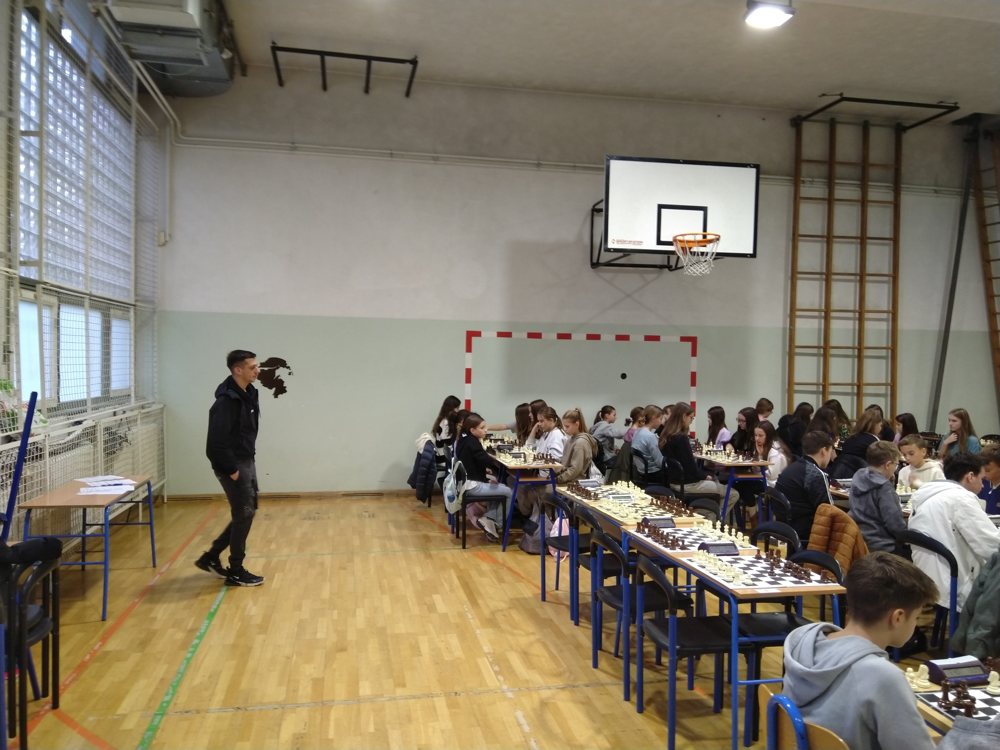
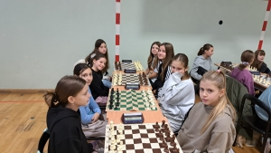
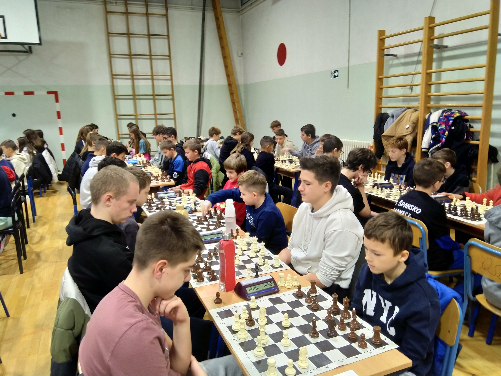

  
Od 9.11. do 16.11 u OŠ Rapska održano je Ekipno prvenstvo osnovnih škola Grada Zagreba. Prvenstvo se igralo na četiri ploče te su igrači imali 15 minuta po partiji. OŠ Odra je nastupila s jednom ekipom u konkurenciji dječaka i s jednom u konkurenciji djevojčica. Kapetan ekipe dječaka je bio Slavko, dok je kapetanica ekipe djevojčica bila Petra.  
  
Ekipa djevojčica je bila znatno oslabljena u odnosu na prošlu godinu jer su Vjeka, Ivana i Lucija postale srednjoškolke. Tako da je ove godine sastav bio: Ana, Petra, Nika, Marta i Lucia. Na kraju su završile četvrte od šest ekipa, ali bile su u borbi za medalju do zadnjeg kola, što je svakako za pohvalu! Jedine iskusnije u toj ekipi su Ana i Petra koje ne vježbaju dovoljno da bi mogle same povući ekipu ka višim mjestima. Nika, Marta i Lucia su tek počele igrati šah te se nadamo da će redovito dolaziti petkom u Klub te da će idućih godina biti u igri za najviša mjesta.  
  
Ekipa dječaka nastupila je u sastavu: Bartol, Slavko, Luka, Vili te su im rezerve bili Domagoj, Emanuel i Marul. Malo su stariji nego prošle godine, pa je i plasman bio malo bolji – 8. mjesto. Osim što imaju godinu dana iskustva više, ne pokazuju dovoljno zalaganja da bi rezultat mogao biti bolji. Zadnjih pedesetak dana jedino Luka vježba redovito, Vili povremeno, a ostali štrajkaju. Ukoliko žele napraviti bolji rezultat iduće godine morati će više raditi.  
Obje ekipe je vodio prof. Krešimir Tomaško.

##### 4\. OŠ Odra – djevojčice (TB1: 4 / TB2: 10)

<table><tbody><tr><td><strong>Pl.</strong></td><td><strong>Ime</strong></td><td><strong>1</strong></td><td><strong>2</strong></td><td><strong>3</strong></td><td><strong>4</strong></td><td><strong>5</strong></td><td><strong>Bod.</strong></td><td><strong>Partije</strong></td></tr><tr><td>1</td><td>Predović Ana</td><td>0</td><td>1</td><td>1</td><td>1</td><td>0</td><td>3</td><td>5</td></tr><tr><td>2</td><td>Medoš Petra</td><td>0</td><td>1</td><td>0</td><td>1</td><td>0</td><td>2</td><td>5</td></tr><tr><td>3</td><td>Slavković Nika</td><td></td><td>1</td><td>0</td><td></td><td>0</td><td>1</td><td>3</td></tr><tr><td>4</td><td>Slavković Marta</td><td>0</td><td></td><td></td><td>1</td><td></td><td>1</td><td>2</td></tr><tr><td>5</td><td>Lesničar Lucia</td><td>0</td><td>1</td><td>0</td><td>1</td><td>1</td><td>3</td><td>5</td></tr></tbody></table>

##### 8\. OŠ Odra – dječaci (TB1: 11 / TB2: 22)

<table><tbody><tr><td><strong>Pl.</strong></td><td><strong>Ime</strong></td><td><strong>1</strong></td><td><strong>2</strong></td><td><strong>3</strong></td><td><strong>4</strong></td><td><strong>5</strong></td><td><strong>6</strong></td><td><strong>7</strong></td><td><strong>8</strong></td><td><strong>9</strong></td><td><strong>Bod.</strong></td><td><strong>Partije</strong></td></tr><tr><td>1</td><td>Glagolić Bartol</td><td></td><td>1</td><td>1</td><td>0</td><td>1</td><td>0</td><td>0</td><td>0</td><td></td><td>3</td><td>7</td></tr><tr><td>2</td><td>Biondić Slavko</td><td></td><td>0</td><td>1</td><td>1</td><td>0</td><td>1</td><td>1</td><td>0</td><td></td><td>4</td><td>7</td></tr><tr><td>3</td><td>Lesničar Luka</td><td></td><td>0</td><td>1</td><td>1</td><td>½</td><td>1</td><td>1</td><td>1</td><td>0</td><td>5,5</td><td>8</td></tr><tr><td>4</td><td>Sesar Vili</td><td></td><td>0</td><td>0</td><td></td><td>0</td><td>1</td><td>1</td><td>½</td><td>1</td><td>3,5</td><td>7</td></tr><tr><td>5</td><td>Leko Domagoj</td><td></td><td></td><td></td><td></td><td></td><td></td><td></td><td></td><td>1</td><td>1</td><td>1</td></tr><tr><td>6</td><td>Kovačević Emanuel</td><td></td><td></td><td></td><td>0</td><td></td><td></td><td></td><td></td><td></td><td>0</td><td>1</td></tr><tr><td>8</td><td>Knezović Marul Gabriel</td><td></td><td></td><td></td><td></td><td></td><td></td><td></td><td></td><td>1</td><td>1</td><td>1</td></tr></tbody></table>
