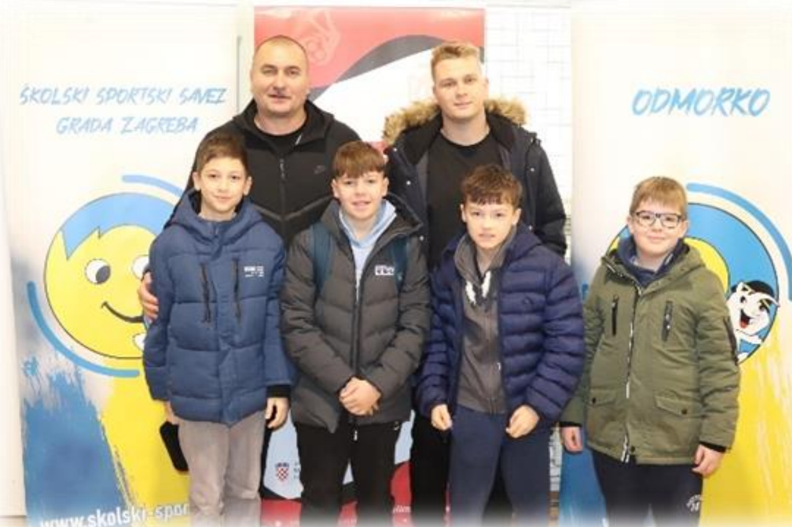
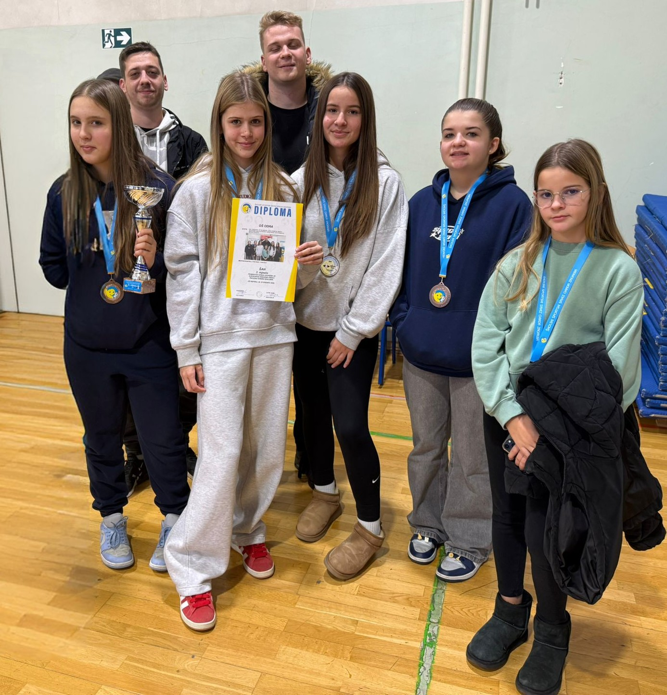
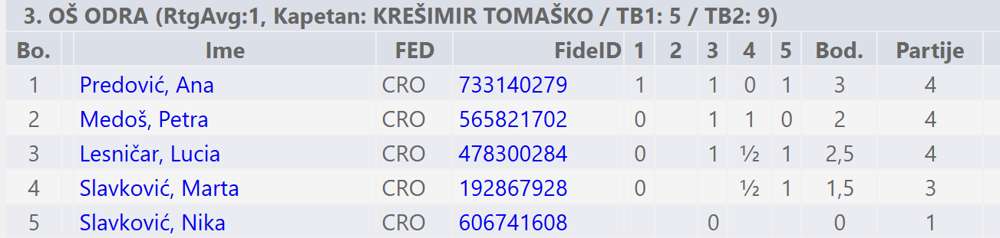
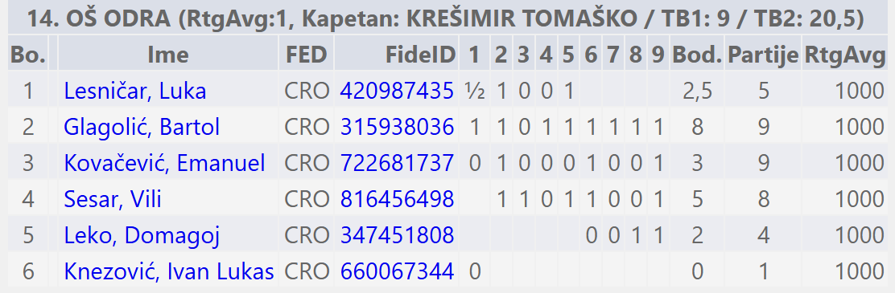

Od 29.11. do 6.12.2025 godine u OŠ Rapska održano je [Ekipno prvenstvo osnovnih škola Grada Zagreba](https://s2.chess-results.com/tnr1304868.aspx?lan=13&art=0&rd=9&turdet=YES&flag=30&SNode=S0). Prvenstvo se igralo na četiri ploče, a igrači su imali 15 minuta po partiji. OŠ Odra nastupila je s jednom ekipom u konkurenciji dječaka i jednom u konkurenciji djevojčica.

Ekipa djevojčica nastupila je u sastavu: Ana, Petra, Lucia, Marta i Nika. Cure su osvojile treće mjesto – čestitamo im na tom uspjehu! Pokazale su borbenost i dokazale da zaslužuju mjesto među tri najbolje ekipe. Uz malo više vježbe i rada, iduće godine mogle bi se plasirati i među prve dvije ekipe te izboriti finale koje se održava na moru. U njihovoj kategoriji ukupno je nastupilo pet ekipa.

Ekipa dječaka nastupila je u sastavu: Luka, Bartol, Emanuel, Vili, Domagoj i Ivan Lukas. Dečki su završili na 14. mjestu od ukupno 30 ekipa, što predstavlja zlatnu sredinu. Nažalost, izostanak redovitih dolazaka na treninge i manjak vježbe odrazili su se na rezultate. Ukoliko žele postići bolji rezultat iduće godine, bit će potrebno više rada i zalaganja.

Obje ekipe vodio je prof. Krešimir Tomaško, uz pomoć Ivana Maravića i Ivana Vraneše.

 

*IvanV*
